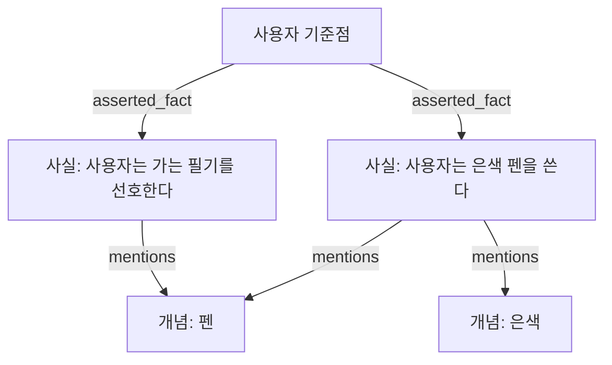

# MAI 전체 재구성 명세서

> MAI를 처음 접하는 사람이, 기존 코드를 복사하지 않고도 같은 구성과 주요 동작을 구현하기 위한 설명서.
>
> 갱신일: 2026년 10월 28일. 확인 대상: `FoggyCaligo/MAI_MyAI_sllm`의 `dev`, 커밋 `c5d6cf991d514eb285f3d3de1cc7118f9a4e80aa`.
>
> 문장 분해기 확인 대상: `FoggyCaligo/Sentence_Breaker`, 커밋 `7243e45989b04000cf49825976be9801c44f438c`.

## 0. 이 문서를 어떻게 읽으면 되는가

이 문서에서 말하는 재구성은, 함수 이름과 파일 배치까지 똑같이 복제한다는 뜻은 아니다. 프로그램을 어떤 부분으로 나누는지, 각 부분이 무슨 정보를 받고 무엇을 내보내는지, 어떤 조건에서 다음 단계로 넘어가는지, 무엇을 기억으로 인정하는지를 재현한다는 뜻이다.

예를 들어 원래 코드는 파이썬으로 되어 있지만, 다른 언어로 만들어도 된다. 다만 도구가 실패했는데 성공한 것으로 바꾸거나, 모델이 쓴 문장을 사용자가 말한 사실처럼 저장하면 같은 MAI라고 보기 어렵다. 내부 구현은 바뀔 수 있어도 이런 동작의 의미는 유지해야 한다.

본문에는 세 가지 종류의 설명이 있다.

| 구분 | 의미 |
|---|---|
| 현재 구현 | 확인한 커밋의 실행 코드에서 실제로 일어나는 동작 |
| 설계 의도 | 프롬프트나 기존 설명에 적혀 있는 목표. 코드가 이를 완전히 보장한다는 뜻은 아님 |
| 재구현 권고 | 현재의 빈틈을 개선하고 싶은 경우의 선택지. 현재 구현과 동등한 재현에는 자동으로 포함하지 않음 |

이 구분은 중요하다. 기존 README에는 사전 도구 판단이 없다고 적혀 있지만 실제 코드에서는 연결되어 있다. 검증기 장애를 통과시킨다는 설명도 실제 코드와 다르다. 이 문서는 함수 호출 관계와 데이터 흐름을 기준으로 작성했다. 차이는 25장에 모았다.

또한 문서만으로 원래 모델의 모든 답변 문장을 동일하게 재생할 수는 없다. 모델 가중치, 실행 옵션, 과거 기억 데이터, 문장 분해기의 누적 데이터와 입력 순서가 결과에 영향을 준다. 이 문서의 목표는 **구조와 계약의 재현**이다. 기존 사용자의 기억까지 복원하려면 해당 데이터베이스도 별도로 있어야 한다.

큰 구조를 먼저 이해하려면 1~5장을 읽고, 실행기를 만들려면 6~11장, 기억을 만들려면 12~16장, 사용자에게 제공하는 앱까지 만들려면 17~21장을 읽으면 된다. 22~26장은 구현 순서, 예시, 검증, 제한과 근거다.

## 1. MAI는 무엇인가

MAI는 사용자의 컴퓨터에서 실행되는 개인 AI 프로그램이다. 사용자가 대화로 요청하면 언어 모델이 요청을 해석하고, 필요하면 기억·파일·계산기·웹·터미널 등의 도구를 사용한다. 마지막 답변은 바로 전달하지 않고 검증한다. 답변이 받아들여지면, 그 대화에서 나중에도 필요한 사실을 추려 장기기억에 저장한다.

언어 모델 자체가 기억 데이터베이스는 아니다. 모델을 교체하더라도 사용자의 기억은 별도의 SQLite 파일에 남는다. 모델은 매번 그 파일 전체를 읽는 것이 아니라, 필요한 경우 기억 도구를 호출해서 일부를 가져온다.

따라서 MAI는 크게 다음 다섯 가지가 결합한 프로그램이다.

1. 사용자의 요청을 받아 계정과 대화 문맥을 확인하는 웹 앱.
2. 언어 모델과 실제 도구 실행을 번갈아 진행하는 실행기.
3. 모델이 내놓은 답변을 근거와 비교하는 검증기.
4. 사실을 저장하고 다시 찾는 장기기억.
5. 파일 읽기, 검색, 계산, 터미널 실행 등을 수행하는 구체적인 도구들.

모델에게 “너는 기억할 수 있다”라고 지시하는 것만으로 기억이 생기는 것은 아니다. 실제 저장소, 검색 방식, 저장 허용 기준, 사용자 식별 방식이 있어야 한다. 마찬가지로 “파일을 수정했다”라는 문장을 생성하는 것과 실제 파일을 수정하는 것은 다른 사건이다. MAI는 이 차이를 프로그램의 구조에서 다룬다.

## 2. 처음 보는 사람을 위한 용어

| 용어 | 여기서의 뜻 |
|---|---|
| 모델 | 문맥을 보고 다음 응답 또는 도구 호출을 생성하는 언어 모델 |
| Ollama | 로컬에서 모델을 실행하고 MAI의 요청을 받는 별도 프로그램 |
| 실행기 | 모델을 호출하고, 도구를 실행하고, 결과를 다시 모델에게 주는 제어 프로그램 |
| 한 요청 | 사용자 메시지 하나를 받아 답변 또는 오류를 반환하는 전체 작업 |
| 한 모델 차례 | Ollama의 대화 호출 한 번. 하나의 사용자 요청 안에 여러 번 있을 수 있음 |
| 도구 | 이름, 입력 규칙, 실제 처리 함수가 등록된 기능 |
| 도구 호출 | 모델이 자연어 대신 구조화된 이름과 인자를 반환하는 사건 |
| 입력 규격 | 어떤 필드가 필요하고 각 필드의 자료형·범위가 무엇인지 정의한 규칙 |
| 처리 함수 | 실제 파일·네트워크·계산 등의 작업을 수행하는 함수 |
| 후보 답변 | 아직 사용자에게 전달하지 않은 최종 답변 초안 |
| 근거 | 사용자 원문 중 직접 주장한 내용, 실제 도구 결과 등 사실을 뒷받침하는 자료 |
| 출처 식별자 | 검증과 기억 추출에서 근거를 정확히 가리키는 문자열 |
| 노드 | 기억 그래프에서 사용자 기준점, 사실, 개념 등을 나타내는 항목 |
| 연결 | 두 노드의 관계를 나타내는 항목. 방향·관계 종류·출처 설명을 가짐 |
| 사용자 기준점 | 한 사용자의 기억이 시작되는 고정 노드. 코드 이름은 `anchor` |
| 사실 | 나중에도 사용할 수 있도록 정리한 기억 문장. 코드 이름은 `fact` |
| 개념 | 사실 문장을 분해해서 얻은 검색 좌표. 코드 이름은 `concept` |
| 원문 근거 | 사용자가 입력한 글을 보존한 별도 기록. 코드 이름은 `evidence` |
| 작업 그래프 | 이번 요청에서 가져온 기억을 모아 두는 임시 상태 |
| 색인 | 검색어로 기존 개념 노드의 번호를 찾는 보조 구조 |
| FTS5 | SQLite의 단어 기반 텍스트 검색 기능. 의미 임베딩 검색과 다름 |
| 사전 판단 | 본 실행 전에 반드시 실행해야 할 도구 이름을 정하는 모델 호출 |
| 비동기 작업 | 웹 연결과 분리하여 서버에서 계속 수행하는 작업 |
| `user_id` | 로그인할 때 입력하는 계정 이름 |
| `db_id` | 로그인 이름이 바뀌어도 유지하는 내부 사용자 식별자 |

이후에는 한국어 설명을 우선한다. 실제 구현에 필요한 필드 이름과 도구 이름만 원래 표기를 함께 사용한다.

## 3. MAI를 MAI답게 만드는 규칙

### 3.1 모델의 판단과 프로그램의 확인을 분리한다

무슨 도구가 필요한지는 모델이 판단한다. 그러나 도구 이름이 실제로 등록되어 있는지, 입력이 규격에 맞는지, 처리 함수가 실행되었는지는 프로그램이 확인한다.

예를 들어 “이전 계획을 기억해?”라는 요청에서 `memory_recall`이 필요하다고 정하는 것은 모델의 의미 판단이다. 반면 `memory_recall`이라는 처리 함수가 한 번도 실행되지 않았는데 실행되었다고 처리하는 것은 허용되지 않는다.

사용자 문장에 특정 단어가 들어 있으면 도구를 고르는 문자열 분기표는 현재 설계의 중심이 아니다. “주식”이라는 단어가 있다고 항상 시세 도구를 고르면, 과거 투자 취향을 묻는 질문과 현재 시세를 묻는 질문을 구별하기 어렵다.

### 3.2 자연어와 실제 실행을 섞지 않는다

모델이 “파일을 읽겠습니다”라고 적어도 도구 실행은 아니다. 모델 응답의 구조화된 `tool_calls`에 정확한 이름과 인자가 있어야 한다. 생각 내용이나 본문에서 명령처럼 보이는 문장을 찾아 실행하지 않는다.

### 3.3 실패는 실제 실패로 전달한다

없는 도구, 잘못된 인자, 네트워크 실패, 파일 오류, 명령의 비정상 종료를 빈 성공 결과로 바꾸지 않는다. 실패의 종류와 설명을 모델에게 전달해서 다른 방법을 선택하거나 실패를 설명할 수 있게 한다.

### 3.4 이전 답변은 사용자가 이미 안다는 증거가 아니다

비슷한 질문에 과거에 답했다는 이유로 내용을 생략하지 않는다. 또한 검증에서 거절된 내부 초안은 사용자에게 전달된 대화가 아니다. 모델이 초안을 참고할 수는 있지만 사실 근거나 과거 대화로 취급해서는 안 된다.

### 3.5 기억을 읽는 행위와 새로운 기억을 만드는 행위를 분리한다

“전에 쓰던 펜이 뭐였지?”라는 질문에 기존 기억을 읽었다고 해서, 그 기억을 새롭게 확인된 사실처럼 다시 저장하지 않는다. 읽기만으로 언급 횟수가 늘어나면 자주 검색한 정보가 자주 직접 말한 정보처럼 보이게 된다.

다만 “전에 쓰던 펜이 뭐였지? 지금은 다른 펜으로 바꿨어”라는 메시지는 새 사실을 포함한다. 기억 도구를 썼다는 이유만으로 전체 메시지를 버리지는 않는다.

### 3.6 현재 정보와 과거 기억의 우선순위를 구분한다

장기기억은 과거에 알았던 내용이다. 현재 사용자의 직접 진술이나 현재 도구 결과와 다르면 현재 정보를 우선한다. 현재 시각 역시 모델의 학습 시점에서 추정하지 않고 운영체제 시계를 사용한다.

### 3.7 검색 결과의 범위를 보존한다

일부 행을 읽은 것은 전체 표를 읽은 것이 아니다. 로컬 파일 수정은 원격 저장소 수정과 같지 않다. 도구의 성공은 그 도구가 보고한 범위의 성공이다. 더 넓은 완료 주장을 하려면 그 범위의 결과 근거가 있어야 한다.

### 3.8 반복을 제한하되 일을 많이 했다는 이유로 중단하지 않는다

정상적으로 진행 중인 도구 호출과 모델 차례에 고정 총횟수 상한을 두지 않는다. 대신 같은 호출이 같은 실패를 계속 내는지, 같은 결과 묶음이 그대로 반복되는지 등을 구조적으로 감시한다.

이 규칙은 무한 실행이 절대로 없다는 보장은 아니다. 다른 인자를 계속 생성하거나 빈약한 상태를 다르게 표현하는 반복은 구조 비교를 피할 수 있다. 현재 구현의 감시는 정확히 같은 구조의 반복에 집중한다.


## 4. 전체 구성과 상태의 수명

### 4.1 현재 production 구성 관계

현재 기본 경로는 별도 planner가 먼저 모든 도구 필요성을 결정하는 구조가 아니다. 기본값에서는 main agent가 첫 라운드에 받은 **도구 카탈로그와 \`tool_manual\`**을 보고 필요한 도구를 활성화하고, 다음 라운드부터 해당 native schema를 직접 호출한다.

\`\`\`mermaid
flowchart TD
    U["사용자 / Web UI"] --> J["복구 가능한 Chat Job"]
    J --> C["최근 대화 + 계정/세션 확인"]
    C --> R["MAIRuntime"]
    R --> A["AgentRuntime / AgentLoop"]
    A --> TM["tool_manual + 도구 카탈로그"]
    TM --> T["활성화된 native tools"]
    T --> A
    A --> V["FinalGroundingVerifier"]
    V -->|"거절"| A
    V -->|"통과"| O["최종 답변"]
    O --> H["chat.sqlite3 저장"]
    O --> M["background memory post-processing"]
    A --> L["log.sqlite3 감사 로그"]
    T --> L
    V --> L
    T --> B["요청별 BrowserSessionManager"]
    R -->|"run 종료"| BC["남은 브라우저 세션 일괄 종료"]
\`\`\`

도구 목록은 등록소의 구조적 메타데이터다. 모델은 문자열 규칙으로 도구 이름의 의미를 추측하지 않는다. 첫 라운드에는 상세 인자 schema가 전부 노출되지 않고, \`tool_manual(tools=[...])\`로 정확한 등록 이름을 활성화한 뒤 다음 라운드에 해당 schema가 추가된다.

\`TOOL_REQUIREMENT_VERIFIER=true\`일 때만 과거의 별도 tool-requirement planner가 선택적으로 동작한다. 기본 \`.env.example\`은 \`false\`이며, 이 문서에서 “현재 production 기본 경로”라고 할 때는 planner가 없는 경로를 뜻한다.

### 4.2 상태의 수명과 저장 위치

| 상태 | 수명 | 저장 위치/소유자 | 프로세스 재시작 후 |
|---|---|---|---|
| 계정 설정 | 설정 파일이 유지되는 동안 | \`.env\` | 유지 |
| 로그인 Bearer token | 로그인~로그아웃 또는 서버 종료 | 서버 메모리 | 유지 안 됨 |
| Web 대화 기록 | 삭제 전까지 | \`CHAT_DB_PATH\` / \`web_chat_messages\` | 유지 |
| 감사·디버깅 기록 | 삭제 전까지 | \`LOG_DB_PATH\` / \`runs\`, \`steps\` | 유지 |
| 장기기억 그래프 | 삭제 전까지 | \`MEMORY_DB_PATH\` | 유지 |
| 문장 분해기 이력 | 삭제 전까지 | \`SENTENCE_BREAKER_DB_PATH\` | 유지 |
| 업로드 파일 | 삭제/덮어쓰기 전까지 | 계정별 upload directory | 유지 |
| 음성 프로필 | 재등록/삭제 전까지 | \`VOICE_PROFILE_DIR\` | 유지 |
| resumable chat job 계산 상태 | 서버 프로세스 동안 | \`ChatJobStore\` | 유지 안 됨 |
| Working Graph | 사용자 요청 하나 | \`MAIRuntime\` | 유지 안 됨 |
| 큰 tool result 원문 | 사용자 요청 하나 | \`ToolResultStore\` | 유지 안 됨 |
| Chromium browser session | 사용자 요청 하나 | \`BrowserSessionManager\` | 유지 안 됨 |
| 반복 guard / verifier retry 횟수 | 사용자 요청 하나 | \`AgentLoop\` | 유지 안 됨 |
| 모델 adapter / fact extractor cache | 서버 프로세스 동안 | \`MAIRuntime\` | 유지 안 됨 |

\`chat.sqlite3\`, \`memory.sqlite3\`, \`log.sqlite3\`는 역할이 다르다. 대화 DB는 사용자에게 보이는 대화 기록, memory DB는 장기기억 그래프, log DB는 감사·디버깅 기록이다. \`log.sqlite3\`의 내용은 agent나 memory 입력으로 다시 읽어 넣지 않는다.

### 4.3 같은 chat model을 여러 역할로 사용한다

현재 선택된 chat model은 역할에 따라 서로 다른 호출 방식으로 사용된다.

| 역할 | tools | think | 비고 |
|---|---|---|---|
| main agent | \`tool_manual\` + 활성화된 native tools | 기본 \`True\` | 실제 답변/도구 실행 |
| 선택적 tool requirement planner | 없음 | \`False\` | \`TOOL_REQUIREMENT_VERIFIER=true\`일 때만 |
| numeric semantic reviewer | 없음 | \`False\` | deterministic numeric 검사에서 애매한 표현 보정 |
| factual grounding reviewer | 없음 | \`False\` | claim/evidence/action outcome 검증 |
| answer quality reviewer | 없음 | \`False\` | factual pass 후 선택적 alignment/coverage 검증 |
| memory fact extractor | 없음 | \`False\` | 최종 답변 뒤 비동기 기억 추출 |

검증기는 도구를 호출하지 않는다. reviewer가 실패했다고 문자열 fallback으로 의미를 복원하지 않으며, 현재 구현은 retryable infrastructure/structured-output 오류를 최대 3회 재시도한 뒤에도 실패하면 그 실패를 상위로 전달한다.

\`model_rounds\`는 main \`AgentLoop\`의 라운드 수다. verifier와 memory extractor 호출 수는 포함하지 않는다.

## 5. 서버를 시작할 때 만드는 것

현재 기본 실행 진입점은 `run_server.py`다. 환경 설정을 읽고, 복구 가능한 대화 경로를 설치한 뒤, Uvicorn을 작업자 1개로 실행한다.

시작 시 다음 순서의 준비가 필요하다.

1. 환경 설정을 읽는다.
2. 소유자·체험 계정 설정을 검증한다.
3. 대화 기록 저장소를 연다. 정확히 알려진 옛 표 구조만 새 구조로 옮긴다.
4. 필요한 경우 옛 로그인 이름으로 저장된 대화 기록을 안정된 `db_id`로 옮긴다.
5. 기억 그래프 저장소를 연다.
6. 문장 분해기를 연다.
7. 개념 색인을 열고, 기존 개념 노드와 색인의 누락을 맞춘다.
8. 기억 검색 서비스와 기억 처리 조정자를 만든다.
9. Ollama 연결, 모델별 연결 캐시, 모델별 사실 추출기 캐시를 준비한다.
10. 업로드 디렉터리를 만든다.
11. 설정된 경우 Tailscale Funnel을 시작한다.

소유자 계정이 하나도 없거나, 계정 이름과 내부 식별자가 충돌하면 시작을 실패시킨다. SQLite에 FTS5가 없으면 의미가 다른 검색으로 몰래 대체하지 않는다.

현재 메모리 객체와 로그인·작업 저장소는 한 프로세스 안에 있다. 따라서 작업자 수를 늘리는 것은 단순한 성능 옵션 변경이 아니다. 여러 프로세스가 같은 로그인·작업 상태를 공유하도록 다시 설계해야 한다.


## 6. 사용자 메시지 하나가 처리되는 실제 순서

### 6.1 Web job과 감사 로그를 먼저 만든다

기본 Web UI는 \`POST /chat/jobs\`로 resumable job을 만든다. 작업 시작 시 \`LOG_DB_PATH\`의 audit run도 함께 생성하고 사용자의 원문을 \`user\` role로 기록한다. 같은 \`user_id\`의 job은 lock을 사용해 순차 실행한다.

직접 \`POST /chat\` 경로도 감사 로그를 남기지만, 일반 화면은 resumable job 경로를 사용한다.

### 6.2 최근 대화와 현재 사용자 메시지를 분리한다

서버는 먼저 \`SESSION_HISTORY_MESSAGES\` 범위의 기존 대화를 읽고, 그 뒤 현재 사용자 메시지를 \`chat.sqlite3\`에 저장한다. 따라서 현재 메시지가 최근 문맥에 중복되어 main model에 두 번 들어가지 않는다.

모델에게 전달되는 대화 범위와 UI에 영구 저장된 전체 대화 기록은 동일한 개념이 아니다.

### 6.3 같은 사용자의 직전 memory 후처리를 기다린다

같은 \`db_id\`의 이전 응답에서 background memory write가 아직 끝나지 않았다면 다음 요청은 \`asyncio.shield\`로 그 작업을 기다린다. 직전 턴에서 새로 말한 사실이 바로 다음 질문의 recall에 반영되도록 하기 위한 순서 보장이다.

### 6.4 요청별 실행 상태를 만든다

각 요청마다 새로 만든다.

- \`WorkingGraph\`
- \`ToolResultStore\`
- \`BrowserSessionManager\`
- 계정 권한에 맞는 \`ToolRegistry\`
- 선택 chat model의 \`OllamaAdapter\`
- 같은 모델을 \`think=False\`로 쓰는 \`OllamaFactExtractor\`

browser session은 요청 종료 시 성공/실패와 관계없이 \`close_all()\`로 정리한다.

### 6.5 authoritative runtime context를 주입한다

\`AgentRuntime\`은 도구 등록소의 model context와 \`current_time()\` 결과를 구조화 JSON으로 system context에 넣는다. 현재 시각, working directory, memory temporal precedence 같은 실행 환경 사실을 모델이 학습 지식이나 문자열 추측으로 대신하지 않게 한다.

### 6.6 기본 경로에서는 main agent가 직접 도구를 고른다

첫 main model round에는 상세 native tool schema 전체가 아니라 다음 두 가지가 제공된다.

1. 등록된 도구의 \`name\`과 \`category\` 카탈로그.
2. run-local activation tool인 \`tool_manual\` schema.

모델이 도구가 필요하다고 판단하면 예를 들어 \`tool_manual(tools=["memory_recall","web_search"])\`처럼 정확한 이름을 활성화한다. 다음 round부터 그 도구들의 native schema가 추가되고 직접 호출할 수 있다. 활성화된 schema는 해당 run 동안 유지된다.

\`TOOL_REQUIREMENT_VERIFIER=true\`이면 이 전에 별도 planner가 frozen required-tools 집합을 만들 수 있지만 기본값은 \`false\`다.

### 6.7 도구 실행과 large-result pagination

활성화되지 않은 도구를 직접 호출하거나, 등록되지 않은 이름을 \`tool_manual\`에 넣거나, schema를 위반한 인자를 보내면 구조적 실패다. handler exception과 timeout도 실패로 기록한다.

큰 결과는 \`ToolResultStore\`가 bounded model view만 본문에 넣고 원문은 request-local store에 남긴다. 추가 범위가 필요하면 \`tool_result_read\`를 활성화하고 result id/offset/limit로 읽는다.

### 6.8 candidate final을 검증한다

도구 호출 없이 content가 나오면 곧바로 사용자에게 보내지 않고 candidate final로 취급한다.

검증 순서는 현재 다음과 같다.

1. 빈 답변 구조 검사.
2. 선택적 frozen required-tool contract 검사.
3. deterministic numeric/date grounding.
4. 필요한 경우 numeric semantic review.
5. factual grounding + action outcome review.
6. factual pass이고 \`MAI_ANSWER_QUALITY_REVIEW=true\`이면 answer-quality review.
7. 문제가 있으면 candidate를 사용자에게 전달하지 않고 correction round로 돌아간다.

거절된 초안은 factual evidence가 아니다. 현재 model prompt에는 **가장 최근 거절 초안과 그 verifier feedback만** 다시 넣고, 과거의 여러 rejected draft는 audit log에만 남긴다.

### 6.9 최종 답변을 저장하고 memory 후처리를 예약한다

검증을 통과하면 assistant 답변을 persistent chat에 저장하고 job을 완료한다. 그 뒤 memory extraction/admission은 background task로 수행한다.

memory 후처리는 raw user turn, 이전 assistant 문맥, 최종 답변, 성공한 non-recall tool result를 사용한다. memory read tool 결과를 새 world fact의 근거로 다시 저장하지 않는다.

### 6.10 fatal failure

main loop가 최종적으로 실패하면 \`AgentRunFailure\`에 이미 관찰된 tool execution, model round 수, 마지막 rejected candidate를 포함한 failure context가 보존된다. Web job 경로는 이 오류를 숨기지 않고 failed 상태와 error message를 chat/audit에 남긴다. 마지막 verifier 거절 초안이 있다면 사용자가 “아무 답도 없었다”고 오해하지 않도록 failure detail에 함께 보여 줄 수 있다.


## 7. 도구 선택과 lazy native activation

### 7.1 production 기본은 별도 planner가 아니다

현재 \`.env.example\`의 \`TOOL_REQUIREMENT_VERIFIER=false\`가 기본이다. 따라서 production 기본 경로에서는 사용자 요청 전에 별도 LLM planner를 호출하지 않는다.

대신 main agent가 **카탈로그 → \`tool_manual\` → 실제 native tool**의 두 단계로 도구를 선택한다. 이렇게 하면 처음부터 모든 상세 schema를 prompt에 싣지 않으면서도 도구 선택을 문자열 heuristic으로 바꾸지 않는다.

### 7.2 \`tool_manual\`의 계약

\`tool_manual\`은 Registry의 일반 handler가 아니라 \`AgentLoop\`가 직접 제공하는 run-local activation tool이다. 실제 외부 작업을 수행하지 않고 “다음 round부터 어떤 native schema를 노출할지”만 바꾼다.

입력은 등록된 정확한 도구 이름 목록이다. 부분 문자열, 별칭 추측, 자연어 설명으로 도구를 고르지 않는다.

- 없는 이름: \`UnknownToolError\`
- 잘못된 입력 구조: \`ToolArgumentsError\`
- 아직 활성화하지 않은 실제 도구 직접 호출: \`ToolUnavailableInRoundError\`

한 번 활성화된 도구는 해당 run 동안 계속 활성화된다.

### 7.3 선택적 frozen tool requirement verifier

\`TOOL_REQUIREMENT_VERIFIER=true\`이면 \`OllamaToolRequirementPlanner\`가 사용자 요청, 최근 대화, tool definition을 보고 required tool 집합을 만든다. 이 집합은 판단 후 \`FrozenToolRequirements\`로 고정된다.

이 모드에서도 실제 충족 여부는 verifier의 자연어 판단이 아니라 \`handler_started\` 관찰을 구조적으로 비교한다. required tool을 실행하지 않고 final을 만들면 correction round가 시작된다.

이 기능은 현재 기본 production path의 필수 구성요소가 아니므로 재구현 시 “기본 동등 구현”과 “선택적 강화 모드”를 구분해야 한다.


## 8. 본 모델·도구 반복 실행기

### 8.1 한 round의 입력

각 main round는 다음을 조합한다.

- authoritative runtime context
- 기본 system policy
- 최근 대화와 현재 사용자 요청
- 도구 카탈로그
- \`tool_manual\`
- 이전 round에서 활성화된 native tool schema
- 필요한 경우 가장 최근 rejected candidate + correction contract
- 선택적 frozen required-tools 상태

모델의 자연어 본문이나 \`<think>\` 문자열을 파싱해 도구 호출로 바꾸지 않는다. Ollama native \`tool_calls\`만 실행 계약이다.

### 8.2 tool call 처리

tool call은 순서대로 실행하고 각 실행은 다음 정보를 남긴다.

- tool name
- arguments
- handler started 여부
- 성공/실패
- error type
- model-visible content
- 필요하면 large-result id

실패한 tool result도 model에는 실패로 전달한다. 실패를 빈 성공값으로 바꾸거나 특정 error string을 보고 임의의 semantic route를 선택하지 않는다.

### 8.3 감사 로그와 UI progress

resumable job에서는 observer callback으로 다음을 동시에 갱신한다.

- \`model_think_step\`: 모델 thinking
- \`model\`: candidate content와 tool_calls
- \`tool_log\`: tool 결과와 성공/실패
- \`verifier_step\`: rejection feedback 또는 final accepted

이 기록은 \`log.sqlite3\`에 append-only로 남고 model/memory context로 다시 주입되지 않는다.

### 8.4 rejected draft 격리

verifier가 candidate를 거절하면 그 candidate는 사용자에게 전달된 assistant message도, 사실 근거도 아니다.

다음 correction round에는 최신 rejected draft와 최신 verifier feedback만 system correction context로 다시 붙인다. 오래된 rejected draft/thinking/feedback는 model prompt에서 제거하되 audit log에는 남긴다.

unsupported claim마다 correction contract는 다음 둘 중 하나를 요구한다.

- **remove**: 근거가 있는 범위로 줄이거나 삭제
- **re-observe**: 해당 claim을 직접 확립하는 tool evidence를 새로 얻기

간접 목록, bounded history, 과거 rejected draft를 새 근거처럼 사용할 수 없다.

### 8.5 반복 guard

현재는 global \`AGENT_MAX_ROUNDS\`를 두지 않는다. 대신 구조적으로 다음 반복을 제한한다.

- 동일 tool call 반복
- 동일 failure 반복
- no-progress round 반복

기본 설정은 \`.env.example\`의 \`AGENT_MAX_IDENTICAL_CALLS=3\`, \`AGENT_MAX_IDENTICAL_FAILURES=2\`, \`AGENT_MAX_NO_PROGRESS_ROUNDS=2\`다.

guard는 의미 router가 아니다. tool 이름이나 오류 문구를 문자열로 해석해 다른 기능으로 자동 우회하지 않는다.

### 8.6 empty final과 최종 failure context

content가 비어 있고 tool call도 없으면 한 번 구조적 재시도를 허용한다. 다시 빈 final이면 \`EmptyFinalResponseError\`다.

어떤 fatal exception이 발생하더라도 \`AgentRunFailure\`는 가능한 범위에서 이미 실행한 tool 기록, model round 수, 마지막 rejected draft를 \`AgentFailureContext\`에 보존한다. 실패를 성공 답변으로 바꾸는 별도 recovery agent는 현재 production contract의 핵심 경로가 아니다.

## 9. 도구 등록소와 실행 환경 정보

### 9.1 등록 자료

도구 하나는 이름, 설명, 입력 자료형, 처리 함수, 선택적인 제한 시간, 분류, 부가 정보를 가진다. 이름 중복은 시작 또는 등록 오류다.

모델에게는 다음 형태의 함수 규격을 제공한다.

```json
{
  "type": "function",
  "function": {
    "name": "calculator",
    "description": "도구 설명",
    "parameters": {
      "type": "object",
      "properties": {"expression": {"type": "string"}},
      "required": ["expression"],
      "additionalProperties": false
    }
  }
}
```

현재 입력 검증은 Pydantic의 엄격 모드다. 숫자처럼 보이는 문자열을 정수로 바꾸거나, 알 수 없는 추가 필드를 버리지 않는다. 실제 각 입력의 기본값은 채우지만 규격 위반을 강제 변환으로 고치지 않는다.

### 9.2 처리 함수 실행 방식

비동기 함수는 같은 이벤트 반복부에서 기다린다. 동기 함수는 작업 스레드로 넘긴다. 제한 시간이 설정되어 있으면 해당 호출의 대기를 제한한다.

단, 스레드 대기를 시간 제한으로 끝낸다고 실제 동기 함수가 반드시 중단되는 것은 아니다. 파일·네트워크 처리 자체의 취소 성질도 고려해야 한다. 터미널은 별도의 프로세스 종료 처리가 있어 일반 동기 함수와 다르다.

기억 도구는 비동기 래퍼로 등록한다. 내부 SQLite 작업을 작업 스레드로 넘기면 연결을 만든 스레드와 사용하는 스레드가 달라질 수 있기 때문이다. 현재 구현은 SQLite의 스레드 검사를 무조건 끄는 방법으로 해결하지 않는다.

### 9.3 모델에 알려 주는 실제 환경

도구 이름을 보고 운영체제나 셸을 추측하지 않게, 도구 등록 시 실행 환경을 별도 자료로 등록한다. 같은 환경 식별자를 중복 등록하면 오류다.

터미널은 실제 셸 경로, 셸 종류, 기본 작업 디렉터리, POSIX 문법 사용 여부를 선언한다. 기억 도구는 과거 기억보다 현재 사용자 메시지와 현재 도구 결과를 우선하라는 규칙을 선언한다.

이 자료는 본 모델 호출 앞의 시스템 메시지에 JSON으로 넣는다. 분류나 부가 정보는 의도 분기표가 아니다. 실제 환경에 대한 명시적인 선언이다.

### 9.4 본 모델 정책에 포함할 내용

본 모델 정책은 구성 요소를 설명하는 장식 문구가 아니라 실제 동작 지시다. 원래 영문과 문장 표현은 달라도, 재구현에서는 다음 의미를 유지해야 한다.

1. 현재 요청에 충분히 답한다. 이전에 비슷한 답을 했다는 이유로 사용자의 지식을 가정하거나 생략하지 않는다.
2. 실제 능력은 지금 제공한 도구로 판단한다. 학습된 일반적인 ‘언어 모델은 파일에 접근하지 못한다’는 가정으로 도구를 거절하지 않는다.
3. 사전 학습 지식은 추론에 사용할 수 있지만 사실 주장의 출처로 취급하지 않는다.
4. 현재 대화에 없는 필요한 정보는 사용 가능한 도구로 얻는다. 사용자 이력은 기억, 로컬 내용은 파일·코드·터미널, 이미지 내용은 이미지 도구, 공개 정보는 웹, 현재 한국 시세는 시장, 시간은 시계 도구를 사용한다.
5. 구조 문서도 `file_read`로 읽는다. 실제 공개된 도구 이름과 내부 보조 함수 이름을 혼동하지 않는다.
6. 큰 결과에 번호와 범위가 있으면 생략된 내용을 추정하지 말고 필요한 범위를 후속 읽기로 얻는다.
7. 사용자와 도구의 사실값을 그대로 보존한다. 명시적인 변환 요청 없이 반올림·재해석·정규화하여 다른 값으로 바꾸지 않는다.
8. 원래 관찰과 계산 결과를 구분한다. 매매 이익이 났다는 것만으로 별도로 정한 목표가에 도달했다고 주장하지 않는다.
9. 비슷한 이름의 지표·다른 화면·기간을 서로 바꿔 쓰지 않는다. 차이의 원인을 정의·산식·근거 없이 만들어 내지 않는다.
10. 답변에 중요한 산술은 계산기에서 수행한다. 합계·차이·수익률·비율·가중값·목표 차이를 암산으로 대체하지 않는다.
11. 체험 쓰기 도구의 업로드 경계를 존중한다. 제공됐다는 이유로 임의 로컬 경로를 수정할 수 있다고 말하지 않는다.
12. 도구 결과를 지어내지 않는다. 실패는 실제로 취급하고 요청에 중요한 실패를 최종 답변에 설명한다.
13. 사용자에게 전달하는 답변만으로 요청 결과를 이해할 수 있어야 한다. 내부 실행 출력·로그를 이미 사용자가 읽었다고 가정하지 않는다.

이 규칙에 대한 준수는 프롬프트의 영향과 구조 검증을 함께 통해 얻는다. 모든 지시가 별도의 결정론적 검사로 강제되는 것은 아니다.

## 10. 큰 도구 결과를 전달하는 방법

### 10.1 원문과 모델에 보이는 내용은 다르다

큰 결과를 계속 대화에 넣으면 모델 문맥을 소진한다. 그러나 잘라서 나머지를 버리면 필요한 근거를 읽을 수 없다. 현재 MAI는 요청별 결과 저장소에 도구 반환 문자열을 보존하고 모델에는 범위가 명시된 일부를 준다.

기본 본문 한도는 16,000자다. 최소 설정값은 1,024자다. 읽기 한도는 본문 한도에서 512자를 뺀 값이다. 기본값에서는 15,488자가 된다.

여기서 ‘자’는 문자열 길이 단위다. UTF-8 바이트 수나 토큰 수와 다르다. JSON 메타데이터까지 합한 모델용 문자열이 본문 한도를 넘으면 실제 페이지 내용을 더 줄인다.

### 10.2 최초 전달

한도 이하의 결과는 그대로 전달한다. 한도보다 크면 임의의 `result_id`로 원문을 보관하고 첫 페이지를 반환한다. 첫 줄은 범위 메타데이터 JSON이고 그 다음은 해당 범위의 실제 문자열이다.

```json
{
  "result_id": "이 요청 안에서만 유효한 번호",
  "total_chars": 50000,
  "offset": 0,
  "returned_chars": 15488,
  "next_offset": 15488,
  "complete": false,
  "max_read_chars": 15488,
  "pagination": {
    "page": 1,
    "page_size": 15488,
    "returned_count": 15488,
    "total_count": 50000,
    "total_pages": 4,
    "has_more": true,
    "next_page": 2,
    "next_offset": 15488
  }
}
```

위 숫자는 구조를 설명하는 예시다. 실제 반환 길이는 메타데이터 크기에 따라 더 작아질 수 있다. 다음 범위는 요청한 페이지 크기로 계산하지 말고 **반환된 `next_offset`**을 사용해야 한다.

### 10.3 후속 읽기와 문맥 축소

`tool_result_read(result_id, offset, limit)`로 필요한 범위를 읽는다. offset은 0 이상, limit은 양수이고 해당 요청의 읽기 한도 이하여야 한다. 없는 번호는 오류다.

초기 페이지는 본 모델이 다음 한 차례에서 읽게 한 다음, 그 다음 모델 호출부터 내부 대화의 본문을 짧은 참조로 바꾼다. 전체 원문은 요청별 결과 저장소에 남고, 실행 기록에는 최초 전달된 결과가 남는다.

검증과 기억 추출은 기본적으로 모델에 실제 전달된 실행 결과 범위를 사용한다. 보관되어 있지만 모델이 읽지 않은 나머지를 근거로 몰래 제공하지 않는다. 후속 읽기 결과는 별도의 도구 실행 근거가 된다.

### 10.4 두 종류의 잘림을 구분한다

도구 자체가 파일 본문을 50,000자에서 잘랐을 수 있고, 그 50,000자 결과를 전달 계층에서 다시 나눌 수도 있다. 후속 결과 읽기가 복원하는 것은 **도구가 반환한 문자열 전체**다. 도구 내부에서 이미 제외된 원본 파일의 나머지까지 복원하지 않는다.

따라서 도구의 `truncated`와 결과 저장소의 `complete`는 다른 범위를 말한다. 둘을 합쳐서 “전체 파일을 다 읽었다”고 판단하지 않는다.


## 11. 후보 답변 검증

현재 \`FinalGroundingVerifier\`는 **숫자 검사 → factual review → optional quality review**로 분리되어 있다. verifier는 tool을 호출하거나 답변을 직접 수정하지 않는다.

### 11.1 deterministic numeric/date grounding

candidate의 material numeric/date value를 추출하고 다음에서 관찰된 값과 비교한다.

- 현재 user messages
- 성공한 tool result

단순 형식 차이, 날짜 별칭처럼 deterministic 비교만으로 애매한 경우에는 같은 chat model을 \`think=False\`, \`tools=()\`, strict structured output으로 호출해 numeric semantic review를 할 수 있다.

numeric reviewer는 전체 답변 품질을 평가하지 않는다.

### 11.2 factual grounding reviewer

factual reviewer는 candidate의 material claim을 claim 단위로 분해하고 다음을 반환한다.

- \`evidence_verdict\`
- \`claims[]\`
  - \`supported | unsupported | uncertain\`
  - defect: \`none | scope_expansion | contradiction | unsupported_inference | missing_evidence\`
- \`action_verdict\`
- \`reasons\`
- \`retry_summary\`

근거는 현재 user message와 **성공한** tool result다. 과거 assistant 문장은 대화 맥락일 수 있지만 factual evidence는 아니다. failed tool call은 grounding evidence에서 제외한다.

번역·음역·표현 차이는 같은 지시대상과 의미를 보존하면 사실 모순으로 취급하지 않는다.

### 11.3 action outcome 검증

state-changing tool invocation이 성공했다는 사실은 그 tool contract가 성공했다는 근거다. 그러나 candidate가 더 넓은 end-state 완료를 주장하려면 그 범위를 실제로 뒷받침하는 resulting-state evidence가 있어야 한다.

예를 들어 “파일 write 성공”만으로 “PR이 생성되고 merge됐다”고 주장할 수 없다.

### 11.4 answer-quality reviewer

\`MAI_ANSWER_QUALITY_REVIEW=true\`이고 numeric/factual 단계가 통과했을 때만 별도 quality reviewer를 호출한다.

quality reviewer는 raw tool log 전체를 다시 받지 않는다. 다음을 본다.

- current user request
- conversation context
- candidate final
- factual review summary

평가 축은 주로 \`alignment_verdict\`, \`coverage_verdict\`, \`coverage_reasons\`다.

coverage는 “더 조사할 수 있었는가”가 아니라 **이미 관찰된, 사용자 요청에 중요한 정보를 candidate가 빠뜨렸는가**를 본다. 추가 검색 가능성 자체는 coverage failure가 아니다.

### 11.5 retry budget

AgentLoop는 검증 이슈 종류별 retry budget을 따로 관리한다.

- semantic/factual 관련
- numeric 관련
- evidence/action 관련
- coverage 관련

coverage는 별도 최대 2회 budget을 가진다. budget을 모두 쓴 뒤에는 해당 축을 더 이상 같은 방식으로 무한 거절하지 않는다.

### 11.6 reviewer infrastructure failure

structured reviewer 호출은 timeout, protocol error, malformed structured output, 일부 network/5xx/429 오류를 retryable infrastructure failure로 분류해 최대 3회 재시도한다.

3회 후에도 실패하거나 non-retryable error이면 예외를 상위로 전달한다. 현재 구현은 reviewer failure를 임의의 문자열 fallback으로 “supported”로 바꾸지 않는다.

### 11.7 verifier evidence 범위

factual verifier에 전달되는 successful tool evidence는 verifier용 bounded corpus로 구성되지만, 과거의 고정 3500자 원문 절단 정책은 제거되었다. 큰 tool result 자체의 모델 전달 제한은 \`ToolResultStore\`의 pagination 계약에서 별도로 처리한다.

quality reviewer는 성능 절충을 위해 raw tool result 전체를 다시 보지 않는다. 따라서 “tool result에만 있는 사실을 candidate가 빠뜨렸는가”에 대한 coverage 민감도는 integrated reviewer보다 낮을 수 있다는 현재 한계를 문서에 인정해야 한다.

## 12. 장기기억의 데이터 구조

### 12.1 세 종류의 실제 생산 노드

현재 새 기억은 사용자 기준점, 사실, 개념으로 만들어진다.



이 그림의 분해 결과는 이해를 위한 가상 예시다. 실제 문장 분해기는 사전이나 띄어쓰기만으로 나누지 않으므로, 반드시 ‘펜’과 ‘은색’으로 나뉜다는 뜻은 아니다.

사용자 원문은 별도 `evidence` 표에 있다. 원문을 생산 그래프의 발화 노드로 다시 만드는 것은 현재 후처리 경로에 없다. `utterance` 노드 종류와 생성 함수는 옛 데이터·하위 호출을 위해 남아 있다.

### 12.2 노드의 정체성

노드 번호와 노드의 정체성 문자열을 구분한다. 번호는 데이터베이스가 할당한 정수다. 정체성 문자열은 같은 항목인지 판단하는 키다.

| 종류 | 정체성 키 | 본문 | 부가 자료 |
|---|---|---|---|
| 기준점 | `anchor:user:<db_id>` | `user_anchor::<db_id>` | 사용자 내부 식별자 |
| 사실 | `fact:<db_id>:<양끝 공백 제거한 사실 문장>` | 사실 문장 | 사용자 내부 식별자 |
| 개념 | `concept:<양끝 공백 제거한 분해 조각>` | 분해 조각 | 기본 빈 객체 |
| 옛 발화 | `utterance:evidence:<원문 번호>` | 원문 | 사용자, 원문 번호, 발화자 |

같은 사실 문장이라도 사용자 내부 식별자가 다르면 다른 사실 노드다. 반면 같은 개념 문자열은 사용자 간에도 하나의 개념 노드를 공유한다.

정체성 비교는 정확한 문자열 일치다. 비슷한 뜻이라고 하나의 노드로 합치지 않는다. ‘은색 펜을 쓴다’와 ‘실버 펜을 사용한다’는 그래프 차원에서는 다른 사실일 수 있다. 사실 추출기에 의미 중복을 줄이라는 지시가 있지만, 저장소가 의미 중복을 보장하여 제거하는 것은 아니다.

이미 있는 사실·개념을 다시 저장하면 번호와 생성 시각은 유지하고, 등장 횟수를 1 올리고, 마지막 관찰 시각을 갱신한다. 기존 기준점을 확인하는 것은 등장 횟수를 올리지 않는다. 조회 역시 등장 횟수를 올리지 않는다.

등장 횟수는 진실의 확률이나 중요도의 직접 측정값이 아니다. 같은 정확한 저장 문장이 다시 받아들여진 횟수다.

### 12.3 연결의 규칙

현재 생산 경로의 연결은 다음 두 가지다.

| 출발 | 도착 | 관계 | 출처 설명 |
|---|---|---|---|
| 사용자 기준점 | 사실 | `asserted_fact` | `user_assertion` |
| 사실 | 개념 | `mentions` | `fact_index` |

같은 출발 번호, 도착 번호, 관계 조합은 한 연결만 존재한다. 중복 삽입은 기존 연결을 재사용한다. 최초 출처 설명과 생성 시각을 새로운 삽입으로 덮어쓰지 않는다.

연결 의미는 모델이 즉석에서 만든 문장이 아니다. 저장 함수가 위처럼 정해진 종류를 사용한다. 다만 현재 SQL은 관계 문자열을 모든 경우에 제한된 열거형으로 검증하지는 않는다. 생산 경로의 고정 사용과 데이터베이스 자체의 제약을 구별해야 한다.

### 12.4 실제 기억 표의 핵심 정의

아래 정의는 독립 구현에서 그대로 사용할 수 있는 현재 핵심 표 구조다.

```sql
PRAGMA foreign_keys = ON;

CREATE TABLE IF NOT EXISTS nodes (
    id INTEGER PRIMARY KEY AUTOINCREMENT,
    identity_key TEXT NOT NULL UNIQUE,
    node_type TEXT NOT NULL
        CHECK (node_type IN ('anchor', 'utterance', 'fact', 'concept')),
    canonical_text TEXT NOT NULL,
    payload_json TEXT NOT NULL DEFAULT '{}',
    occurrence_count INTEGER NOT NULL DEFAULT 1
        CHECK (occurrence_count >= 1),
    created_at TEXT NOT NULL,
    last_seen_at TEXT NOT NULL
);

CREATE TABLE IF NOT EXISTS user_anchors (
    user_id TEXT PRIMARY KEY,
    node_id INTEGER NOT NULL UNIQUE REFERENCES nodes(id) ON DELETE CASCADE
);

CREATE TABLE IF NOT EXISTS evidence (
    id INTEGER PRIMARY KEY AUTOINCREMENT,
    kind TEXT NOT NULL,
    content TEXT NOT NULL,
    created_at TEXT NOT NULL
);

CREATE TABLE IF NOT EXISTS edges (
    id INTEGER PRIMARY KEY AUTOINCREMENT,
    from_node_id INTEGER NOT NULL REFERENCES nodes(id) ON DELETE CASCADE,
    to_node_id INTEGER NOT NULL REFERENCES nodes(id) ON DELETE CASCADE,
    relation TEXT NOT NULL,
    provenance TEXT NOT NULL,
    created_at TEXT NOT NULL,
    UNIQUE(from_node_id, to_node_id, relation)
);

CREATE INDEX IF NOT EXISTS idx_nodes_type ON nodes(node_type);
CREATE INDEX IF NOT EXISTS idx_nodes_text ON nodes(canonical_text);
CREATE INDEX IF NOT EXISTS idx_edges_from ON edges(from_node_id);
CREATE INDEX IF NOT EXISTS idx_edges_to ON edges(to_node_id);
CREATE INDEX IF NOT EXISTS idx_edges_relation ON edges(relation);

CREATE TABLE IF NOT EXISTS memory_concept_exact (
    node_id INTEGER PRIMARY KEY,
    canonical_text TEXT NOT NULL UNIQUE
);

CREATE VIRTUAL TABLE IF NOT EXISTS memory_concept_fts
USING fts5(canonical_text, tokenize='unicode61');
```

기억 시각은 시간대가 있는 UTC ISO 문자열이다. 색인에서는 FTS의 `rowid`를 실제 개념 노드 번호와 같게 둔다. 색인 표가 새 사실의 정체성을 결정하지 않는다. 그래프 저장소가 만든 개념 번호를 색인에 넣는다.

현재 `evidence` 표에는 `db_id` 열이 없다. 현재 사실의 payload에도 원문 번호나 검증 출처 번호 목록이 없다. 원문은 남지만 어떤 사실이 어느 원문·도구에서 왔는지 완전한 대응이 영구 저장되는 구조는 아니다. 이것은 재구현할 때 반드시 인지해야 하는 현재 한계다.

‘원문이 불변’이라는 표현은 현재 API가 원문을 수정하지 않고 삽입하여 보존한다는 계약이다. SQL 트리거로 수정·삭제를 절대 금지한 표라는 뜻은 아니다.

## 13. 문장 분해기까지 다시 만드는 방법

### 13.1 역할과 상태

Sentence_Breaker는 사실 문장을 개념 조각으로 나누기 위한 별도 구성 요소다. 모델 토큰화, 한국어 형태소 분석, 기억 그래프 전체와 같지 않다. 입력된 문자들의 연결 경로를 누적하고 다음 문장에서 과거와 일치하는 연속 경로를 찾는다.

공백과 문장부호도 문자로 취급한다. 중요한 특징은 **분해가 읽기만 하는 함수가 아니라는 것**이다. 기존 이력으로 분해한 뒤 현재 입력의 문자 경로를 누적 저장한다.

MAI는 반환된 조각 중 공백뿐인 조각을 버린다. 그래프에 넣을 때 조각 양끝 공백을 제거한다. 조각 내부 공백은 그대로 남는다.

### 13.2 별도 데이터베이스

| 표 | 핵심 필드 | 의미 |
|---|---|---|
| `alph_nodes` | `alph` 기본키, 생성 시각 | 관찰된 문자 하나 |
| `sentence_layers` | `sentence_id` 기본키, `char_length`, 생성 시각 | 입력 한 번의 고유 층 |
| `alph_links` | 번호, `source_alph`, `target_alph`, `sentence_id`, `position`, 생성 시각 | 그 입력에서 인접 문자가 이어진 위치 |

문자 쌍, 입력 번호·위치, 출발 문자·입력 번호에 색인을 만든다. 같은 문자를 여러 번 본다고 문자 노드를 복제하지 않는다. 그러나 같은 문자 연결이라도 새로운 입력에서는 새로운 연결 행을 넣는다. 입력별 연속 경로를 구별해야 하기 때문이다.

입력 번호는 `sentence-<UUID>` 형태다. 본 알고리즘에 숫자 순서가 필요한 것은 아니다. 각 입력의 경로를 구별할 수 있는 고유 번호면 된다.

### 13.3 각 문자 쌍의 일치 후보를 구한다

입력 문자열을 `c[0]`, `c[1]`, …, `c[n-1]` 문자 배열로 만든다. 각 위치 i에 대해 과거 저장소에서 `c[i] → c[i+1]`과 같은 연결을 찾는다.

그 결과를 `step_matches[i]`라는 집합으로 보관한다. 각 원소는 `(과거 입력 번호, 과거 위치)`다. 같은 문자 쌍이라는 것만으로 충분하지 않고, 같은 과거 입력의 위치가 연속하여 진행되는지 확인해야 한다.

### 13.4 연속 범위를 지원하는 경로 수를 센다

현재 입력의 `[start, end)` 범위가 2자 이상일 때 다음을 한다.

1. 첫 문자 쌍의 후보 집합을 생존 집합으로 둔다.
2. 다음 문자 쌍으로 진행할 때 `(입력 번호, 위치 + 1)`이 다음 후보 집합에도 있는 상태만 남긴다.
3. 어느 단계에서든 생존 집합이 비면 이 범위의 지원 수는 0이다.
4. 마지막 문자 쌍까지 남은 상태 개수가 지원 수다.

따라서 여러 과거 입력의 관계없는 문자 쌍들을 이어 붙여 하나의 범위를 지원한다고 판단하지 않는다. 같은 입력 층에서 위치가 이어져야 한다.

현재 코드는 서로 다른 입력 층의 개수만 세는 것이 아니라 살아남은 `(입력 번호, 위치)` 상태 수를 센다. 한 과거 입력에 같은 부분 문자열이 여러 위치에서 나오면 여러 상태가 지원 수에 들어갈 수 있다.

### 13.5 동적 계획법으로 최종 분해를 선택한다

문자열 끝에서 시작 쪽으로 각 위치의 최적 분해를 계산한다. `best[n]`은 빈 나머지이고 점수·지원된 문자 수·조각 수는 0이다.

각 시작 위치에서 먼저 문자 하나를 단독 조각으로 두는 후보를 만든다. 이 문자는 추가 지원 점수를 받지 않는다. 그 다음 길이 2 이상인 모든 끝 위치를 확인하여, 지원 수가 0이 아닌 범위만 더 긴 후보로 만든다.

길이 L, 지원 수 K인 조각의 추가 점수는 `K × L`이다. 이 점수에 뒤쪽 최적 분해의 점수를 더한다. 선택 비교 순서는 다음 네 값의 사전식 비교다.

1. 전체 지원 점수가 큰 쪽.
2. 전체 지원된 문자 수가 큰 쪽.
3. 현재 선택 조각의 길이가 긴 쪽.
4. 전체 조각 수가 적은 쪽.

정확히 같으면 현재 선택을 유지한다. 끝 위치를 짧은 것부터 순서대로 보므로 동점 처리도 재현에 영향을 준다.

선택한 조각마다 다음 위치를 보관하고, 시작 위치 0에서 그 다음 위치를 따라가며 결과 리스트를 만든다.

### 13.6 현재 입력을 나중에 학습한다

분해를 계산한 **뒤에** 현재 입력의 문자를 저장한다. 현재 문장 자체로 자신의 모든 범위를 지원하게 만들면 첫 입력부터 전체 문장이 하나로 선택될 수 있으므로 순서가 중요하다.

완전히 빈 데이터베이스에 `엄마`를 처음 넣으면 이전 경로가 없어서 한 문자씩 나뉜다. 그 입력이 저장된 뒤 `엄마가`를 넣으면 기존 `엄마` 경로가 더 긴 조각 후보가 된다. 정확한 결과는 다른 누적 경로의 지원 점수에 따라 달라질 수 있다.

### 13.7 재현에 필요한 것과 개선 가능성

같은 분해 코드를 써도 누적 DB와 입력 순서가 다르면 개념 조각이 다르다. 기존 기억과 호환하려면 기존 문장 분해 DB도 보존해야 한다. 현재 MAI는 명시적으로 자기 데이터 경로를 전달하므로, 외부 패키지 기본 DB가 자동으로 복사되어 들어오는 것으로 생각하면 안 된다.

현재 동적 계획법은 여러 범위에 대해 지원 경로를 반복 확인한다. 매우 긴 입력과 많은 일치 경로에서는 계산량이 커질 수 있다. 지원 수 계산을 캐시하거나 경로를 한 번씩 연장하는 최적화는 가능하지만, 점수·동점·입력 후 학습 규칙은 보존해야 한다.

외부 설계 문서에 제안된 경계 일관성 점수나 별도 학습 묶음 표는 확인한 실행 코드에 없다. 현재를 재현하려면 위 네 가지 비교 규칙을 사용한다.

## 14. 기억을 검색하고 넓히는 방법

### 14.1 정확 일치와 FTS5

개념 색인을 열 때 `memory_concept_exact`를 읽어 `개념 문자열 → 노드 번호` 사전을 만든다. 이것이 정확 일치 검색이다.

정확 일치가 충분하지 않으면 FTS5의 어휘 검색을 사용한다. 검색 문자열 전체를 따옴표로 감싼 구문으로 만들고 내부 따옴표를 이스케이프한다. FTS 문법을 사용자가 임의로 삽입하는 것을 막고 온전한 검색 조각을 조회한다.

FTS5 결과는 BM25 값이 작은 순서, 그 다음 노드 번호 순서로 정렬한다. 모델에 제공되는 검색 점수는 BM25 수치 자체가 아니다. 정확 일치는 1.0, 어휘 검색은 순위 r에 대해 `0.5 / r`다. 같은 조회 결과에서 정확 일치가 먼저다.

이 색인은 의미 벡터나 모델별 임베딩을 사용하지 않는다. 모델을 바꾼다고 임베딩 전체를 다시 만들 필요가 없다. 반면 동의어·다른 표현·한국어 조사 변형을 의미상 자동으로 찾는 기능을 보장하지도 않는다.

### 14.2 시작 시 색인을 맞춘다

그래프의 영구 개념 노드 중 색인에 없는 것은 정확 표와 FTS 표에 추가한다. 같은 개념 문자열이 다른 번호에 연결되어 있거나 같은 번호의 텍스트가 다르면 오류다. 누락된 FTS 행은 보완하지만 정체성 충돌을 조용히 합치지 않는다.

옛 벡터 색인 표가 남아 있어도 현재 검색에 사용하지 않는다. 그렇다고 시작 시 몰래 삭제하지도 않는다.

### 14.3 `memory_recall(query, limit=None)`의 실제 알고리즘

1. 현재 사용자 기준점을 확보한다.
2. 모델이 만든 검색어를 **공백으로만** 나눈다. 문장 분해기를 적용하지 않는다.
3. 같은 검색 조각은 최초 위치를 남기고 중복 제거한다.
4. 각 조각을 개념 색인에서 `limit=1`로 검색한다.
5. 같은 개념 번호가 여러 조각에서 나오면 더 높은 점수를 유지한다.
6. 점수 내림차순, 조각 최초 순서, 노드 번호 순서로 정렬한다.
7. 기본 최대 5개 개념 번호를 검색 시작점으로 선택한다.
8. 새 임시 그래프에 사용자 기준점과 기본 8개의 기준점 사실 문맥을 넣는다.
9. 각 개념 번호의 1단계 이웃을 읽는다.
10. 그 이웃에서 기준점·사실만 남긴다. 개념·발화 노드 및 이들이 필요한 연결은 제거한다.
11. 각 사실에서 현재 사용자 기준점까지의 최단 경로를 찾고, 역시 기준점·사실만 남겨 합친다.
12. 이번 조회 결과를 요청의 작업 그래프에 누적한다.
13. 모델에는 누적 전체가 아니라 **이번 조회에서 만든 결과만** 돌려준다.

검색 조각이 하나도 일치하지 않아도 기준점 사실 문맥은 반환될 수 있다. 따라서 검색 결과에 사실이 있다고 그 사실이 반드시 검색어와 직접 일치한 것이라고 생각하면 안 된다.

기준점 사실 문맥은 `asserted_fact`로 직접 연결된 사실을 등장 횟수 내림차순, 마지막 관찰 시각 내림차순, 노드 번호 내림차순으로 정렬하여 기본 8개를 고른다. 원문 발화 연결은 이 문맥에서 제외한다.

### 14.4 1단계 이웃과 최단 경로

1단계 이웃은 해당 노드에서 나가거나 들어오는 모든 연결과 양끝 노드를 읽는 것이다. 연결 번호 순서로 읽고 노드는 번호로 모은다.

최단 경로는 너비 우선 탐색을 사용한다. 경로를 찾는 동안에는 연결 방향을 무시한다. 그러나 반환하는 연결의 원래 방향·관계·출처 설명은 바꾸지 않는다. 방문 기록과 이전 노드·연결 번호를 보관하여 목적지에서 시작점으로 되짚는다.

최단 경로는 1단계 이웃만 보는 것과 다르다. 여러 단계를 지나 기준점까지 도달할 수 있다. 현재 구현에는 최단 경로 탐색 깊이의 별도 고정 상한이 없다. 명시적 확장의 이웃 단계와 경로 복원 범위를 구별해야 한다.

### 14.5 `memory_search(node_id)`

일반 노드는 1단계 이웃을 확장한다. 각 이웃의 현재 사용자 기준점까지 최단 경로도 추가한다. 그 결과를 작업 그래프에 합치고 이번 확장분만 반환한다.

기준점은 예외다. 현재 사용자 기준점이면 기본 8개 사실 문맥만 반환한다. 다른 사용자의 기준점을 직접 확장하면 권한 오류다.

`memory_recall`과 달리 일반 노드 확장에는 기준점·사실만 남기는 필터가 없다. 따라서 사실에서 개념이 보일 수 있고 옛 발화가 있는 DB에서는 발화도 나타날 수 있다. 더 멀리 이웃을 넓히려면 또 다른 명시적 호출이 필요하다.

### 14.6 `memory_overview(limit)`

검색어 없이 현재 사용자 기준점에 직접 연결된 기억을 최근 순서로 읽는다. 기본 12개, 입력 범위 1~50개다. 마지막 관찰 시각 내림차순, 노드 번호 내림차순이다.

현재 조회문은 `spoke`와 `asserted_fact` 관계를 모두 허용한다. 새 생산 데이터에서는 주로 사실이 나오지만, 옛 `spoke` 발화가 있는 DB에서는 그것도 반환될 수 있다. 이 도구는 작업 그래프에 결과를 합치는 경로를 사용하지 않고 자체 목록을 반환한다.

### 14.7 작업 그래프의 구조

노드 번호를 키로 한 사전, 연결 번호를 키로 한 사전, 확장한 중심 번호 집합을 가진다. 합칠 때 같은 번호는 하나로 유지한다.

반환 스냅샷에는 `nodes`, `edges`, 정렬된 `expanded_node_ids`가 있다. 노드에는 번호·종류·본문·부가 자료·등장 횟수, 연결에는 번호·양끝·관계·출처 설명·생성 시각이 있다.

기억을 읽을 때마다 작업 그래프의 누적 전체를 재전송하지 않는 이유는 문맥 증가를 줄이기 위해서다. 이미 가져온 노드 번호를 다음 도구 호출의 시작점으로 사용할 수 있다는 점은 유지한다.

### 14.8 현재 사용자 격리의 한계

계정에 기억 도구를 묶는 것과 모든 그래프 경로가 사용자별로 필터링된 것은 다르다. 현재 개념은 사용자 간 공유되고, 개념의 이웃 사실을 가져오는 코드에는 모든 사실의 사용자 소유권을 먼저 제한하는 조건이 없다. 일반 `memory_search` 역시 다른 사용자의 기준점을 직접 확장하는 것만 차단하고 모든 일반 노드를 소유권으로 차단하지는 않는다.

따라서 현재 코드만으로 다중 사용자 기억의 완전한 격리가 보장된다고 적으면 안 된다. 공유 개념을 통한 다른 사용자 사실·경로 노출 가능성을 별도로 검토해야 한다.

재구현 권고는 현재 사용자 소유 사실만 검색·확장 결과로 내보내고, 최단 경로가 다른 사용자 소유 노드를 우회하지 못하게 하는 것이다. 다만 이것을 적용하면 현재 코드와는 달라지는 개선이다. 동등 재현 명세와 개선 설계를 구분하여 관리한다.

## 15. 답변 후 무엇을 기억으로 인정하는가

### 15.1 사실 추출의 입력 구분

추출기는 사용자의 최신 메시지, 직전 정상 답변, 최종 답변을 문맥으로 받는다. 그러나 이 세 전체 문자열이 자동으로 사실 근거가 되는 것은 아니다. 실제 지원 자료는 별도 `allowed_fact_sources` 목록으로 만든다.

| 허용 자료 | 조건 |
|---|---|
| 최신 사용자의 직접 진술 | 최종 검증이 만든 사용자 발췌이고 `is_current=true` |
| 이번 요청의 성공한 비기억조회 도구 결과 | 실제 `ok=true`, 기억 조회 도구 세 종류는 제외 |
| 근거가 확인된 최종 주장 | 모든 지원 번호가 위 두 종류에 속함 |

이전 사용자 메시지는 답변 검증의 근거가 될 수 있지만, 현재 후처리의 새 직접 사용자 근거로 반복 제공하지 않는다. 기존 기억 조회는 맥락으로 읽은 옛 기억이지 새 자료가 아니므로 제외한다.

근거가 확인된 최종 주장도 모든 지원 번호가 허용되어야 한다. 예를 들어 옛 기억과 최신 사용자 진술을 함께 지원으로 삼은 주장에는 옛 기억 번호가 들어 있으므로, 현재의 엄격한 필터에서는 새 기억 자료에서 제외한다. 운영체제 시각 번호만으로 지원된 주장 역시 직접 저장 허용 목록에 자동 포함하지 않는다.

### 15.2 출처의 구조

직접 사용자 근거에는 ref, 원문 발췌를 그대로 사용한 content, source_excerpt가 있다. content와 source_excerpt의 양끝 공백 제거 결과는 정확히 같아야 한다.

도구 근거에는 기존 실행 순번을 유지한 ref, tool 이름, 모델에 실제 전달된 content가 있다. 성공 결과라 해도 현재 추출 모델이 모든 의미를 올바르게 이해한다는 보장은 없다.

확인된 최종 주장은 `grounded_final:<순번>`으로 별도 번호를 만들고 지원 번호를 함께 둔다. 같은 기본 출처 번호가 중복되면 오류다.

### 15.3 추출 프롬프트의 의미

추출 모델에는 다음을 요구한다.

1. 허용 출처 목록만 사실 근거로 사용한다.
2. 최신 원문·직전 답변·최종 답변 전체는 문맥일 뿐 독립 지원 자료가 아니다.
3. 승인·동의·평가를 이전 답변 사실의 출처로 바꾸지 않는다.
4. 현재 기억 조회 결과를 다시 만들어 새 도구 근거인 것처럼 사용하지 않는다.
5. 사용자 사실, 변경, 결정, 취향, 계획, 정정, 계속 쓸 프로젝트 상태를 우선한다.
6. 질문·작업 요청·지시 자체와 ‘검색을 요청했다’는 사실은 보통 저장하지 않는다.
7. 순수 기억 질문은 보통 빈 사실 목록이다.
8. 새 직접 진술이 섞인 요청은 그 사실을 보존한다.
9. 근거보다 강한 내용이나 없는 세부사항을 추론하지 않는다.
10. 각 사실은 나중에 문맥 없이 읽어도 이해할 수 있는 문장으로 정리한다.
11. 같은 뜻의 사실을 가능한 한 중복 생성하지 않는다.
12. 각 사실에 정확한 허용 출처 번호를 하나 이상 단다.

출력은 다음 형태다.

```json
{
  "facts": [
    {
      "fact": "사용자는 은색 만년필을 사용한다",
      "source_refs": ["user:3:0"]
    }
  ]
}
```

사용자 원문이 “내가 쓰는 건 은색 만년필이야”라면, 추출 문장은 원문과 똑같을 필요가 없다. 그러나 참조하는 사용자 근거는 실제 발췌여야 한다. 모델이 쓴 요약을 다시 사용자 원문으로 승격시키는 절차는 없다.

### 15.4 구조 검사와 실제 저장

출력 JSON에 추가 필드가 있거나 타입이 다르면 오류다. 각 사실과 출처 목록이 비어 있지 않은지, 번호가 허용 목록에 존재하는지 검사한다. 사실 문장은 양끝 공백을 제거하고 정확 문자열 중복을 제거한다.

이 단계의 기계적 검사는 출처 번호가 존재하는지 확인한다. 사실 의미가 그 출처에서 충분히 도출되는지 다시 독립적으로 검증하는 추가 모델 호출은 없다. 의미 지원은 추출 프롬프트와 앞선 검증에 의존한다.

현재 추출기 반환값은 출처 번호가 포함된 객체가 아니라 사실 문자열 목록이다. 따라서 추출 때 검증한 출처 번호가 그래프에 그대로 저장되지는 않는다.

### 15.5 기억 조회만 한 요청의 생략

다음 세 조건을 동시에 만족하면 후처리 전체 저장을 생략한다.

1. 세 기억 조회 도구 중 하나 이상이 성공했다.
2. 사실 추출이 오류 없이 끝났다.
3. 추출된 사실이 없다.

성공한 기억 조회 도구는 `memory_recall`, `memory_overview`, `memory_search`다. 다른 도구도 썼는지는 이 생략 조건의 필수 요소가 아니다. 비기억 도구를 같이 썼어도 새 사실이 없다면 생략될 수 있다.

반대로 추출이 실패했다면 생략하지 않는다. 새 사용자 사실을 잃었다고 확신할 수 없으므로 원문을 보존하려는 선택이다. 기억 조회를 하지 않은 요청도 빈 사실 목록이라는 이유만으로 원문 저장을 생략하지 않는다.

### 15.6 후처리 저장 순서

1. 성공한 기억 조회와 비기억 도구 결과를 분리한다.
2. 최신 직접 사용자 발췌와 허용된 최종 주장을 모은다.
3. 선택 모델의 추출기를 `think=False`, 도구 없음으로 호출한다.
4. 추출 실패를 기록한다. 이때 사실 목록은 비어 있고 성공 표시가 false다.
5. 15.5의 생략 여부를 판단한다.
6. 생략하지 않으면 사용자 기준점을 만들고 원문을 `user_utterance` 종류로 저장한다.
7. 각 사실의 사용자별 정체성 키로 사실을 만들거나 재사용한다.
8. 기준점에서 사실로 고정 연결을 만든다.
9. 사실 문장을 문장 분해기에 넣는다.
10. 각 조각의 개념을 만들거나 재사용한다.
11. 새 개념만 색인에 추가한다.
12. 사실에서 개념으로 고정 연결을 만든다.

후처리에서 발생한 예외는 로그에 남기고 이미 반환한 정상 답변을 되돌리지 않는다. 여기서 원문·사실·개념·색인·문장 분해 DB를 하나의 전체 트랜잭션으로 묶지는 않는다. 중간 오류가 나면 일부만 저장될 수 있다. 동일 동작을 재현할 때와 원자성을 개선할 때를 구분해야 한다.

### 15.7 원문 출처와 그래프 출처의 차이

현재 도구로 확인한 사용자 관련 사실도 추출에 허용될 수 있다. 그런데 영구 그래프 연결의 출처 설명은 모두 `user_assertion`으로 쓰고 상세 출처 번호를 보존하지 않는다.

따라서 현재 그래프의 `user_assertion` 문자열만으로 ‘사용자가 직접 말한 사실’과 ‘파일·웹에서 확인한 사용자 관련 사실’을 엄밀하게 구분할 수 없다. 상세 출처를 보존하는 것이 설계 의도라 하더라도, 현재 저장 구조가 완전한 출처 추적을 제공한다고 주장해서는 안 된다.

재구현 권고는 사실별 출처 연결 표를 두고, 원문 번호·사용자 식별자·도구 실행 번호·검증 지원 번호를 유지하는 것이다. 이는 현재 생산 구조를 개선하는 별도 변경이다.

## 16. 정정과 충돌을 어떻게 이해해야 하는가

현재 메시지와 도구 결과가 과거 기억보다 우선한다는 규칙은 모델 문맥에 주어진다. 하지만 데이터베이스에 자동으로 ‘옛 사실을 비활성화하고 새 사실을 현재값으로 지정한다’는 완성된 처리 경로는 없다.

“이제 은색 펜이 아니라 검은색 펜을 써”라는 새 사실을 저장할 수 있다. 그러면 옛 사실과 새 사실이 모두 남을 수 있다. 조회 순서와 현재 대화에서의 정정이 판단을 도와주지만, 이것이 명시적인 최신 상태 관리와 같지는 않다.

정정에는 서로 다른 뜻이 있다.

| 정정 | 예 | 기억 영향 |
|---|---|---|
| 사용자 상태 정정 | “내 직장은 바뀌었어” | 새 사용자 사실 후보 |
| 내용 오류 지적 | “그 계산은 틀렸어” | 무엇이 틀렸는지 직접 확인된 범위만 근거 |
| 응답 방식 정정 | “영어 용어를 줄여 줘” | 앞으로 필요한 응답 취향 후보 |
| 단순 승인 | “맞아, 그렇게 해” | 이전 모델 사실 전체의 직접 근거가 아님 |

미래에 완전한 정정 처리를 만들고 싶다면 사실에 유효기간·대체 관계·충돌 상태를 추가할 수 있다. 그러나 원문을 삭제해서 이전 발언이 없었던 것처럼 만드는 것은 원문 보존 의도와 맞지 않는다.

현재를 그대로 재현하는 문서에 대체·충돌 관계가 이미 운영된다고 적지 않는다. 현재는 최신 정보 우선 지시, 정확 문장 기준 사실 재사용, 새 사실 추가가 중심이다.

## 17. 계정과 권한

### 17.1 계정의 세 문자열

계정 설정 한 항목은 `user_id`, `user_pw`, `db_id` 세 문자열이다. 소유자 목록과 체험 목록은 별도로 설정한다.

`user_id`는 로그인 이름이고, `user_pw`는 현재 설계에서 로컬 설정 파일에 평문으로 두는 비밀번호다. `db_id`는 기억·대화·체험 업로드를 계속 연결하는 안정된 내부 이름이다. 로그인 이름을 바꾸더라도 같은 `db_id`를 유지하면 내부 자료의 사용자 연결은 유지할 수 있다.

현재 설정 검사는 빈 문자열, 앞뒤 공백이 있는 로그인·내부 식별자, 중복 이름·중복 내부 식별자, 다른 계정의 로그인 이름과 충돌하는 내부 식별자 등을 다룬다. 설정 한 항목에 임의 필드를 추가하지 않는다.

비밀번호 검사는 `compare_digest`에 해당하는 비교를 사용한다. 로그인 요청의 아이디 앞뒤 공백은 제거하지만 비밀번호 내용을 임의로 바꾸지 않는다.

### 17.2 인증 결과

인증된 주체는 로그인 이름, 내부 식별자, 역할을 가진다. 도구 등록과 모델 제한은 서버가 이 객체를 보고 결정한다. 모델에게 자기 역할을 말하게 하여 권한을 정하지 않는다.

로그인 토큰은 무작위로 만든다. 현재는 같은 로그인 이름으로 새 로그인하면 그 이름의 이전 토큰을 지운다. 서버 재시작 시 토큰은 사라진다. 자동 시간 만료 정책은 현재 코드에 별도로 구현되어 있지 않다.

인증된 API는 `Authorization: Bearer <token>` 헤더를 사용한다. 없는 토큰과 만료·유효하지 않은 토큰은 401이다.

### 17.3 역할별 차이

| 기능 | 소유자 | 체험 |
|---|---|---|
| 기억·시각·계산·웹·시장 | 제공 | 제공 |
| 파일 목록·검색·읽기 | 제공 | 제공 |
| 코드 검색·읽기·Python 구조 분석 | 제공 | 제공 |
| 파일 쓰기·새 파일 | 접근 가능한 로컬 경로 | 자기 업로드 영역 내부 |
| 파일 삭제·이동·복사 | 제공 | 미등록 |
| 터미널 | 제공 | 미등록 |
| 이미지 해석 | 이미지 모델 설정 시 제공 | 이미지 모델 설정 시 제공 |
| 대화 모델 선택 | 설치된 모델 목록 제공 | 설정된 기본 모델만 |

체험 쓰기는 처리 함수에서 실제 경로를 해석하고 업로드 경계 안인지 확인한다. 프롬프트만으로 제한하지 않는다. `..`이나 심볼릭 링크 해석으로 경계를 벗어난 경로는 권한 오류다.

다만 **체험 읽기 전체가 자기 업로드 영역으로 제한되는 것은 아니다.** 현재 파일·코드 읽기 도구는 프로세스가 접근할 수 있는 다른 로컬 경로도 허용한다. 14.8의 기억 격리 한계와 함께, 현재 역할은 완전한 보안 격리 환경이 아니라 도구 종류·쓰기 경로 제한이라는 점을 정확히 이해해야 한다.

소유자는 다른 이름의 모델을 요청할 수 있고 현재 API는 요청마다 설치 목록 포함 여부를 미리 검증하지는 않는다. 실제 사용할 수 없는 모델은 Ollama 호출에서 실패할 수 있다. 체험 모델 변경 시도는 서버가 403으로 거절한다.

### 17.4 업로드 경로

소유자는 업로드 루트를 쓴다. 체험 계정은 `업로드 루트/trials/<db_id의 SHA-256 앞 24자리>`를 쓴다. 내부 식별자가 경로 문자나 한글이어도 안전한 고정 디렉터리를 만들고, 로그인 이름 변경이 업로드 경로를 바꾸지 않게 한다.

업로드는 파일 이름이 단일 이름인지 검증하고, 최종 경로의 부모가 계정 업로드 디렉터리인지 다시 확인한다. 임의 임시 이름에 파일을 1MiB 단위로 쓰고, 완료되면 원자적인 이름 교체로 최종 이름을 바꾼다. 같은 이름의 기존 업로드는 이 교체로 덮어쓸 수 있다.

실패하면 남은 임시 업로드를 정리한다. 성공 결과는 파일 이름, 실제 절대 경로, 바이트 수, 업로더 로그인 이름이다. 웹 화면은 이 절대 경로를 사용자 입력란에 붙여 모델이 이후 읽을 대상을 알게 한다.


## 18. 현재 production 도구와 권한

모든 도구는 \`ToolRegistry\`의 Pydantic input schema와 handler로 등록한다. \`tool_manual\`만 AgentLoop가 직접 제공하는 run-local activation tool이다.

### 18.1 memory

- \`memory_recall(query, limit=None)\`
  - 특정 주제의 persistent Fact를 lexical concept 기반으로 검색한다.
  - \`limit\`을 주면 matching Concept score 기준 관련성이 높은 Fact를 최대 그 개수만 반환한다.
  - \`limit\`을 생략하면 matching fact 전체를 반환한다.
- \`memory_overview(limit=12)\`
  - 최근 user-grounded memory를 넓게 본다. 최대 50.
- \`memory_search(node_id)\`
  - 일반 node는 one-hop 확장한다.
  - 현재 user anchor는 bounded structured Fact context를 반환한다.

recalled memory에는 temporal precedence model context가 함께 등록된다. 현재 user message/current tool result가 과거 memory보다 우선하며, 같은 시간 범위에서 충돌하는 Fact끼리는 \`created_at\`이 최신인 Fact를 우선한다.

### 18.2 time / calculator

- \`current_time\`: host OS의 local/UTC 시간, timezone/offset을 authoritative runtime fact로 제공한다.
- \`calculator\`: 수식 계산용 deterministic tool.

### 18.3 web

- \`web_search(query, max_results)\`
  - 검색 결과의 title/url/snippet을 반환한다.
- \`web_fetch(url, max_chars)\`
  - public HTTP(S) 정적 문서를 읽는다.
  - private/loopback destination과 redirect를 검증한다.
  - HTML의 실제 link와 pagination hint를 함께 반환한다.
  - JavaScript 실행은 하지 않는다.

### 18.4 browser navigation

JS-rendered 페이지나 실제 클릭/스크롤/입력이 필요할 때 request-local Chromium session을 사용한다.

- \`browser_open\`
- \`browser_snapshot\`
- \`browser_click\`
- \`browser_input_text\`
- \`browser_press_key\`
- \`browser_scroll\`
- \`browser_close\`

click/input은 text guessing이 아니라 최신 snapshot이 반환한 exact \`element_ref\`를 사용한다. 남은 session은 agent run 종료 시 자동 정리된다.

### 18.5 market / image

- \`market_data\`: 한국 상장주식 current quote/valuation read-only source.
- \`image_analyze\`: \`VISION_MODEL\`이 설정된 경우에만 등록되는 로컬 이미지 해석 도구.

### 18.6 filesystem read

Owner와 Trial 모두 다음 읽기 도구를 사용할 수 있다.

- \`file_list\`
- \`file_search\`
- \`file_read\`

\`file_read\` 하나가 plain text와 PDF/DOCX/XLSX/CSV/PPTX를 처리한다. model-visible \`document_read\`는 없다. 구조 문서 parser failure를 일반 text 성공으로 위장하지 않는다.

### 18.7 filesystem mutation

Owner:

- \`file_write\`
- \`file_delete\`
- \`file_move\`
- \`file_copy\`

Owner 경로는 repository confinement가 아니라 MAI process OS account의 권한이 실제 경계다.

Trial:

- \`file_write\`만 자기 upload directory 안에서 허용
- delete/move/copy는 등록하지 않음

\`file_write\`는 새 text file을 만들거나 기존 text file 전체를 교체한다. 별도 \`file_create\` native tool은 없다.

### 18.8 structured document edit

Owner는 \`document_edit\`로 지원되는 구조적 수정만 수행할 수 있다.

현재 지원 범위는 다음 계열이다.

- DOCX paragraph/table cell text
- XLSX cell value
- PPTX shape text
- CSV cell
- PDF page rotate/delete

PDF의 임의 본문 text 편집을 지원한다고 주장하면 안 된다.

### 18.9 code

읽기/탐색:

- \`code_search\`
- \`code_read\`
- \`code_symbols\`

Owner mutation:

- \`code_edit\`

### 18.10 terminal

Owner만 \`terminal_run\`을 사용한다. 기본 timeout은 \`TERMINAL_TIMEOUT_SECONDS=120\`이며 handler failure/exit failure를 성공으로 바꾸지 않는다.

### 18.11 tool result continuation

\`tool_result_read\`는 request-local \`ToolResultStore\`의 큰 원문을 result id/offset/limit로 이어 읽는 도구다. 최초 bounded view가 전체 결과라는 뜻은 아니다.

### 18.12 owner download link

Owner에게는 \`file_download_link\`가 추가된다. MAI process가 접근 가능한 기존 local file에 대해 1시간 bearer download link를 만든다. \`MAI_PUBLIC_BASE_URL\`이 있으면 absolute URL, 없으면 현재 MAI server의 relative \`/download/...\` 링크다.

### 18.13 run-local activation tool

\`tool_manual\`은 위 도구 중 필요한 exact name을 활성화하는 전용 도구다. Registry에 같은 이름을 일반 tool로 등록하려 하면 startup/run 구성에서 거부한다.


## 19. 웹 앱, 작업 상태, 대화·감사·음성 기록

### 19.1 persistent chat

\`CHAT_DB_PATH\`에는 Web UI 전용 \`web_chat_messages\`가 있다. ownership은 로그인 문자열이 아니라 안정된 \`db_id\` 기준이다.

저장 role은 사용자에게 실제로 보인 대화 기록을 위한 것이며, verifier rejected draft나 tool log 전체를 chat history에 섞지 않는다. 실패 job의 user-visible error는 error metadata와 함께 assistant record로 남을 수 있다.

### 19.2 resumable chat job

기본 Web UI는 job 생성 후 polling한다. job은 process memory에 있으므로 browser disconnect는 견딜 수 있지만 server process restart 뒤 계산을 이어서 실행하지는 못한다.

job에는 다음 progress가 들어갈 수 있다.

- 현재 model round
- 최신 thinking
- tool execution 목록
- verifier rejection 목록
- completed/failed response

같은 login user의 concurrent job은 lock으로 직렬화한다.

### 19.3 감사 로그 \`log.sqlite3\`

\`AuditLogStore\`는 append-only 디버깅/감사 기록이다.

\`runs\`:
- \`run_id\`
- \`db_id\`
- \`session_id\`
- started/finished time
- \`running | completed | failed | cancelled\`
- error type/message

\`steps\` role:
- \`user\`
- \`model\`
- \`model_think_step\`
- \`verifier_step\`
- \`tool_log\`

이 DB는 사람이 실행 과정을 추적하기 위한 것이며 agent나 memory가 다음 답변의 근거로 자동 재사용하지 않는다.

### 19.4 API 핵심

주요 endpoint:

- \`POST /login\`, \`GET /me\`, \`POST /logout\`
- \`GET /models\`
- \`POST /upload\`
- \`GET /session/{session_id}\`, \`DELETE /session/{session_id}\`
- \`POST /chat\`
- \`POST /chat/jobs\` 및 job status 경로
- \`GET /download/{token}\`
- voice endpoint들

Owner는 설치된 Ollama model 목록에서 선택할 수 있다. Trial은 configured \`MAIN_MODEL\` 하나로 서버 경계에서 고정된다.

### 19.5 owner-only voice input

voice 기능은 owner 전용이며 Web 로그인 인증을 대신하지 않는다.

서버 endpoint:

- \`GET /voice/config\`
- \`POST /voice/activity\`
- \`POST /voice/enroll\`
- \`POST /voice/transcribe\`

주요 동작:

1. 사용자가 voice profile을 등록한다.
2. recording 중 짧은 window를 \`/voice/activity\`에 보내 VAD가 마지막 speech end를 판단한다.
3. \`VOICE_SILENCE_SECONDS\`가 지나면 recording을 종료한다.
4. speaker verification 후 Whisper transcription이 성공한 새 문장만 chat으로 보낸다.
5. voice mode가 유지되면 답변 TTS가 끝난 뒤 다시 recording을 시작할 수 있다.

기본 제한/설정:
- recording 최대 20 MB
- recording 길이 최대 120초
- activity window 최대 2 MB / 10초
- \`VOICE_SILENCE_SECONDS=5\`
- \`VOICE_MIN_SPEECH_SECONDS=0.5\`
- \`VOICE_MATCH_THRESHOLD\`는 로컬 환경에서 검증해야 하는 heuristic threshold
- \`VOICE_WHISPER_MODEL=small\`

speaker model format이 기존 profile과 다르면 조용히 호환 처리하지 않고 재등록 오류를 낸다.


## 20. 설정, 의존성, 실행 조건

### 20.1 기본 모델/timeout

현재 \`.env.example\`의 핵심 기본값:

\`\`\`text
OLLAMA_HOST=http://127.0.0.1:11434
MAIN_MODEL=ornith-1.5:9b
OLLAMA_REQUEST_TIMEOUT_SECONDS=300
VISION_MODEL=gemma4:e4b
OLLAMA_THINK=true

TOOL_REQUIREMENT_VERIFIER=false
MAI_ANSWER_QUALITY_REVIEW=true

TOOL_TIMEOUT_SECONDS=60
TERMINAL_TIMEOUT_SECONDS=120
MAX_INLINE_TOOL_RESULT_CHARS=16000
\`\`\`

\`OLLAMA_REQUEST_TIMEOUT_SECONDS\`는 normal agent turn뿐 아니라 memory fact extraction과 verifier adapter가 사용하는 Ollama request에도 영향을 준다. 별도 \`MEMORY_MODEL\`은 없다.

### 20.2 guard

\`\`\`text
AGENT_MAX_IDENTICAL_CALLS=3
AGENT_MAX_IDENTICAL_FAILURES=2
AGENT_MAX_NO_PROGRESS_ROUNDS=2
\`\`\`

global \`AGENT_MAX_ROUNDS\`는 현재 contract가 아니다.

### 20.3 데이터 경로

\`\`\`text
MEMORY_DB_PATH=./data/memory.sqlite3
SENTENCE_BREAKER_DB_PATH=./data/sentence_breaker.sqlite3
CHAT_DB_PATH=./data/chat.sqlite3
LOG_DB_PATH=./data/log.sqlite3
MAI_UPLOAD_ROOT=./mai_uploads
VOICE_PROFILE_DIR=./data/voice_profiles
\`\`\`

\`chat.sqlite3\`와 \`log.sqlite3\`를 합치지 않는다.

### 20.4 계정

\`OWNER_USERS\`, \`TRIAL_USERS\`는 다음 세 string field만 사용한다.

\`\`\`json
{"user_id":"owner","user_pw":"change-me","db_id":"local-user"}
\`\`\`

- \`user_id\`: login identity
- \`user_pw\`: local \`.env\` plaintext password
- \`db_id\`: memory/chat/upload 등 persistent identity

기존 데이터를 유지하려면 login 이름을 바꿔도 \`db_id\`는 유지한다.

### 20.5 Web / Tailscale

\`\`\`text
MAI_HOST=127.0.0.1
MAI_PORT=8000
SESSION_HISTORY_MESSAGES=10
TAILSCALE_FUNNEL=true
\`\`\`

\`TAILSCALE_SERVE=true\`는 retired 설정이며 startup에서 명시적으로 거부한다. Funnel 실패도 startup failure로 드러낸다.

### 20.6 설치 의존성

현재 구조에서 중요한 계열:

- FastAPI / Uvicorn
- Ollama Python client
- Pydantic
- SQLite FTS5
- PyPDF / python-docx / openpyxl / python-pptx
- Playwright + Chromium
- 음성: Whisper 계열, speaker embedding model, ONNX VAD
- Tailscale CLI

Windows 초기 설치 자동화는 \`scripts/install_windows.ps1\`, 비개발자용 상세 절차는 \`setup.md\`를 참고한다. Chromium과 voice package는 현재 설치 대상에서 제거하면 안 된다.


## 21. 오류, 취소, 종료, 초기화

### 21.1 오류 원칙

오류는 해당 층의 실제 실패로 남긴다.

- native schema 위반
- unknown/unactivated tool
- handler exception
- timeout
- browser navigation failure
- document parser/edit failure
- verifier infrastructure failure
- memory extraction/admission failure

문자열 비교 fallback으로 성공처럼 바꾸지 않는다.

main answer path를 막는 실패와 background memory failure는 구분한다. memory 후처리 실패는 이미 전달된 최종 답변을 취소하지 않지만 log에 남긴다.

### 21.2 rejected final과 failure 표시

verifier가 거절한 candidate는 assistant history에 정상 답변으로 저장하지 않는다. correction이 끝내 성공하지 못하면 \`AgentRunFailure\`의 user-visible detail에 마지막 rejected candidate를 포함할 수 있다. 이는 “거절 초안을 성공 답변으로 간주한다”는 뜻이 아니라, 실패 당시 실제 생성된 내용을 디버깅/사용자 설명 목적으로 보여 주는 것이다.

### 21.3 취소와 browser cleanup

job task가 취소되면 audit run은 \`cancelled\`로 종료한다. request-local browser session은 \`finally\`에서 닫는다.

### 21.4 새 채팅

새 채팅/세션 삭제는 persistent chat context를 지우는 동작이다. 장기기억 DB 전체를 초기화하는 동작이 아니다.

### 21.5 서버 종료

종료 시 로그인 token은 사라지고 Tailscale Funnel을 stop하며 runtime을 close한다. process-memory job은 재개되지 않는다.


## 22. 독립 구현의 최소 인터페이스와 의사코드

### 22.1 유지해야 할 핵심 계약

언어/프레임워크를 바꿔도 다음 의미는 유지해야 한다.

- native structured tool call만 실제 실행으로 인정
- 도구 필요성 판단을 문자열 heuristic으로 대체하지 않음
- lazy activation에서는 catalog와 schema exposure를 분리
- tool 실패는 실패로 보존
- large result는 bounded view + explicit continuation
- rejected draft는 사용자 답변/사실 근거와 분리
- final release 전에 factual grounding
- persistent chat / audit / long-term memory를 분리
- 현재 user/tool evidence가 과거 memory보다 우선
- background memory write가 같은 사용자의 다음 turn보다 앞서도록 순서 보장

### 22.2 사용자 요청 전체

\`\`\`text
handle_user_message(user, session, text, selected_model):
    prior = chat_db.read_recent(user.db_id, session)
    chat_db.append(user.db_id, session, role="user", content=text)

    await pending_memory_write[user.db_id]

    working = WorkingGraph()
    result_store = ToolResultStore()
    browser = BrowserSessionManager()
    registry = build_registry(user, working, result_store, browser)

    adapter = adapter_for(selected_model)
    verifier = FinalGroundingVerifier(adapter)
    agent = AgentRuntime(
        adapter,
        registry,
        verifier,
        enable_tool_requirement_verifier=ENV_FALSE_BY_DEFAULT,
    )

    try:
        result = await agent.run_user_message(text, prior_messages=system + prior)
    finally:
        await browser.close_all()

    chat_db.append(user.db_id, session, role="assistant", content=result.content)

    pending_memory_write[user.db_id] = background(
        extract_and_store_memory(text, result, successful_non_recall_tool_results)
    )

    return result
\`\`\`

### 22.3 lazy native tool loop

\`\`\`text
active = {"tool_manual"}

loop:
    send:
      - conversation
      - tool catalog(name, category)
      - tool_manual schema
      - schemas for already activated tools
      - latest correction context, if any

    turn = model.chat(...)

    if turn has tool_calls:
        for call in order:
            if call == tool_manual:
                validate exact registered names
                activate for next round
            else:
                require call.name in active
                validate native args
                execute handler
                record ok/failure
        continue

    candidate = turn.content
    if empty:
        structural retry once, else fail

    verification = verifier.verify(candidate, user evidence, successful tool evidence)

    if verification.ok:
        return candidate

    retain only latest rejected candidate + feedback for correction context
    continue until per-axis budgets/guards produce success or explicit failure
\`\`\`

### 22.4 final verification

\`\`\`text
unsupported_numbers = deterministic_numeric_diff(candidate, user+tool evidence)

if unsupported_numbers:
    optionally semantic_numeric_review()

factual = factual_review(candidate, user+successful_tool evidence)

if factual failed:
    reject

if answer_quality_enabled:
    quality = quality_review(
        user request,
        conversation context,
        candidate,
        factual summary
    )
    if alignment/coverage blocking:
        reject

accept
\`\`\`

### 22.5 memory post-processing

\`\`\`text
facts = fact_extractor(
    raw_user_turn,
    previous_assistant_message,
    final_answer,
    successful_non_recall_tool_results
)

if recall-only and extraction succeeded and facts empty:
    skip persistent mutation

evidence = record_raw_user_evidence(raw_user_turn)
finish_turn(evidence, facts, tool evidence)
\`\`\`


## 23. 처음부터 만들 때의 순서

### 23.1 1단계: native tool runtime

먼저 Ollama native \`tools/tool_calls\`를 그대로 받는 adapter와 strict ToolRegistry를 만든다. 자연어 JSON protocol이나 \`<think>\` parsing으로 tool call을 복원하지 않는다.

### 23.2 2단계: lazy activation

모든 tool schema를 첫 prompt에 넣는 대신 catalog + \`tool_manual\`을 제공하고, 활성화된 schema만 다음 round부터 노출한다. unknown/unactivated tool failure를 명확히 만든다.

선택적 planner가 필요하면 이 단계 뒤에 feature toggle로 추가한다. 기본 구현을 planner 의존 구조로 되돌릴 필요는 없다.

### 23.3 3단계: tool result와 guard

large-result store/pagination, identical call/failure/no-progress guard, temporary artifact cleanup을 구현한다.

### 23.4 4단계: final verifier

deterministic numeric → factual grounding/action → optional quality를 순서대로 분리한다. reviewer는 strict structured output을 사용하고 infra failure retry를 별도 처리한다.

### 23.5 5단계: persistent memory

User Anchor / Utterance / Fact / Concept, Sentence_Breaker, exact hash + FTS5 recall을 구현한다. \`memory_recall(limit)\`과 temporal precedence를 포함한다.

### 23.6 6단계: Web persistence와 audit

\`chat.sqlite3\`와 \`log.sqlite3\`를 분리한다. resumable job, per-user lock, error persistence, verifier/tool/model audit를 연결한다.

### 23.7 7단계: 실제 I/O tool

filesystem/code/terminal, static web fetch, Chromium browser navigation, structured document edit, image, market, download link를 권한별로 등록한다.

### 23.8 8단계: voice

owner-only voice profile, VAD, speaker verification, transcription, UI auto-send/TTS loop를 추가한다. voice 인증은 Web 로그인 자체를 대체하지 않는다.

## 24. 구현 완료를 판단하는 처리 예시와 검증 항목

### 24.1 새 사용자 사실을 기억한다

입력: “내가 쓰는 건 은색 만년필이야.”

가능한 정상 흐름은 다음과 같다. 이 요청은 현재 대화에 필요한 정보가 있어 사전 판단이 빈 집합일 수 있다. 본 모델이 답변을 만든다. 후보 분석은 사용자 원문에서 직접 진술한 발췌를 얻는다. 답변이 통과하면 후처리가 그 발췌를 허용 출처로 주고 ‘사용자는 은색 만년필을 사용한다’라는 문장을 추출한다.

원문과 사실 문장은 다른 문자열이어도 된다. 사용자 기준점·사실·분해된 개념·고정 연결이 생긴다. 실제 분해 조각은 초기 문장 분해 DB에 의존한다.

검증해야 할 것은 원문 발췌가 실제 메시지에 존재하는지, 사실의 출처 번호가 허용 목록에 있는지, 동일 사용자의 동일 문장을 다시 저장했을 때 새 사실 노드가 아니라 횟수가 갱신되는지다.

### 24.2 승인만으로 기억이 오염되지 않는다

직전 답변: “당신은 은색 펜을 사용합니다.”

현재 사용자: “맞아. 그렇게 정리해 줘.”

사용자가 승인했다는 이유만으로 직전 모델 답변 전체가 직접 사용자 발췌가 되어서는 안 된다. 사용자 발췌에 ‘맞아’가 존재한다는 형식 검사만으로 본 사실의 지원이 확보된 것은 아니다. 승인 배제의 의미 판단도 필요하다.

반면 “맞아. 내가 실제로 쓰는 건 은색 펜이야”에는 뒤의 직접 진술이 있으므로 그 범위는 근거가 될 수 있다.

### 24.3 기억 질문과 새 사실이 섞인다

현재 사용자: “내가 전에 쓰던 펜 기억해? 지금은 검은색 펜으로 바꿨어.”

기억 도구가 성공했고 새 사실도 추출됐으면 저장을 생략하지 않는다. ‘지금은 검은색 펜으로 바꿨어’라는 최신 발췌가 새 근거다. 옛 기억 조회 결과는 새 사실의 출처 목록에 넣지 않는다.

다음 요청은 이 후처리가 끝난 뒤 시작하도록 기다린다. 그래프의 옛 사실은 자동 삭제되지 않을 수 있지만 모델은 현재 메시지를 우선해야 한다.

### 24.4 중요한 계산을 확인한다

현재 사용자: “100,000원에 산 걸 110,000원에 팔면 수익률은?”

계산 도구에 `(110000-100000)/100000*100`을 전달하여 결과를 확보한다. 답변의 수익률은 계산 결과의 백분율 의미를 보존한다. 거래비용 등 사용자나 도구에 없는 숫자를 임의로 끼워 넣지 않는다.

숫자 집합에 원래 금액이 있다는 것과 수익률 산식이 맞는 것은 별개다. 의미 검토에서 매매 금액·수익률·목표 도달을 서로 바꿔 쓰지 않아야 한다.

### 24.5 실패 후 다른 방법을 선택한다

파일 읽기가 경로 오류로 실패하면 실패 결과를 모델에게 준다. 같은 존재하지 않는 경로를 같은 방식으로 반복하면 경고·차단 대상이다. 파일 검색으로 정확한 경로를 찾은 뒤 다른 인자로 다시 읽는 것은 구조상 다른 호출이다.

입력 규격 오류로 처리 함수가 시작하지 않았다면 필수 도구 의무는 남는다. 파일이 없어 처리 함수가 실패했다면 실행 의무는 충족될 수 있지만 요청 결과는 실패로 설명해야 한다.

### 24.6 일부 결과를 전체로 확대하지 않는다

파일 검색이 200개에서 멈췄고 `complete=false`다. 답변은 관찰한 200개의 범위를 말해야 한다. ‘이 폴더의 모든 파일은 200개다’는 전체 수 주장에 필요한 근거가 없다.

큰 결과의 첫 페이지에서 일부 종목만 읽었다면 ‘이 종목이 전체 1위다’라고 결론 내릴 수 없다. 다음 페이지를 읽거나 관찰한 범위 안에서의 비교라고 제한한다.

### 24.7 파일 변경 완료의 범위를 확인한다

사용자: “이 파일에 문장을 추가해 줘.”

정확한 파일을 읽고 기존 내용을 보존하여 새 본문을 만든 다음 쓰기 도구를 실행한다. 반환 결과가 실제 본문 상태를 충분히 보장하지 않는다면 후속 읽기로 확인할 수 있다. 답변은 로컬 파일 변경을 말한다. 원격 Git 저장소까지 업데이트됐다고 주장하지 않는다.

터미널이 오류 종료하면서 일부 파일을 이미 썼다면, 실패 코드만 보고 모든 작업이 아무 변화 없이 끝났다고 단정하지 않는다. 결과 상태가 필요한 범위는 추가 관찰하거나 미확인으로 구분한다.

### 24.8 서버 작업 복구와 새 채팅

작업 실행 중 브라우저를 닫고 같은 서버에 다시 접속하면 로그인 후 활성 작업을 찾아 상태 조회를 이어갈 수 있다. 서버 자체를 재시작하면 같은 작업 번호가 남아 있다는 보장은 없다. 이미 저장된 정상 대화는 DB에서 복원할 수 있다.

새 채팅을 누르면 활성 작업 취소가 먼저 끝나고 해당 세션 대화가 삭제되어야 한다. 장기기억을 함께 초기화해서는 안 된다.

### 24.9 자동 검증 시나리오

아래는 새 구현의 확인 기준이다. 이 문서 작성 과정에서 아래 모든 통합 시나리오를 실제 모델로 수행했다는 뜻은 아니다.

| 분야 | 필수 검증 |
|---|---|
| 모델 연결 | 잘못된 역할·본문 타입·인자 타입 거절, 정상 호출 보존 |
| 도구 등록 | 중복 이름 거절, 추가 인자 거절, 엄격 타입, 동기·비동기 실행 |
| 사전 판단 | 없는 이름 거절, 요구 고정, 처리 함수 미시작과 실행 실패 구별 |
| 본 반복 | 도구 배열 순서, 빈 답변 1회 보정, 초안 격리, 정상 총횟수 상한 없음 |
| 반복 감시 | 같은 실패 3회 경고·5회 후 차단, 다른 결과에서 진행 구별 |
| 결과 페이지 | 원문 보존, 메타데이터 포함 한도, next_offset 연속 읽기, 다음 차례 후 축소 |
| 숫자 | 날짜·단위·쉼표·퍼센트·목록 번호, 이전 답변 숫자 배제, 계산 결과 지원 |
| 후보 분석 | 직접 원문 발췌만 허용, 승인 배제, 부분 답변 정렬 판단 |
| 근거 검토 | 주장 번호 1대1, 지원 번호 유효성, 실패 결과와 성공 결과 구별 |
| 검증 재시도 | 인프라 재시도와 후보 수정 분리, 횟수 소진 시 차단 |
| 그래프 | 사용자별 사실·공유 개념, 정확 정체성, 연결 중복, 조회 시 횟수 미증가 |
| 색인 | 정확 우선, FTS 보조, 누락 동기화, 충돌 명시 실패 |
| 문장 분해 | 연속 층·위치, 점수와 동점, 분해 후 입력 학습 |
| 기억 조회 | 공백 검색 조각, 조각당 1개, 5개 시작점, 8개 기준점 문맥, 조회·확장 차이 |
| 사실 추출 | 현재 발췌만, 기억 재활용 금지, 허용 출처 번호, 새 사실 혼합 보존 |
| 기억 작업 | 같은 사용자 대기, 다른 사용자 비대기, 추출 실패 원문 보존 시도 |
| 계정 | 안정된 db_id, 체험 모델 제한, 체험 쓰기 경계, 다른 사용자 작업 404 |
| 대화 | 최신 N개 순서, 새 채팅 기억 유지, 알려지지 않은 옛 표 보존 |
| 실제 도구 | 문서 내부 잘림, 실패 stdout/stderr, 시간 제한·취소, 임시 파일 수명 |

현재 사용자 격리의 한계를 개선하기로 했다면 공유 개념·임의 노드 번호·최단 경로를 통한 다른 사용자 자료 노출이 차단되는 테스트를 별도로 추가해야 한다. 이는 개선판의 필수 검증이고 현재 동등 재현의 동작과는 구분한다.


## 25. 현재 구현의 의도적 절충과 남은 한계

### 25.1 lazy activation은 tool selection을 보장하는 required-tool gate가 아니다

기본 production은 별도 preflight planner를 끈 상태다. main agent가 필요한 tool을 스스로 활성화한다. 따라서 “반드시 이 tool을 써야 한다”는 강제 계약이 필요한 환경에서는 \`TOOL_REQUIREMENT_VERIFIER=true\` 또는 호출자 제공 \`FrozenToolRequirements\`를 별도로 사용해야 한다.

### 25.2 answer quality review는 raw tool log 전체를 다시 보지 않는다

quality stage는 factual summary 중심으로 작게 구성한다. 속도와 context 비용을 줄이지만, raw tool result에만 존재하는 누락 정보를 찾는 coverage 민감도는 integrated reviewer보다 낮을 수 있다.

### 25.3 lexical memory retrieval

현재 Concept retrieval은 embedding semantic search가 아니라 Sentence_Breaker canonical segment + exact hash + SQLite FTS5다. 표현 차이가 큰 paraphrase는 recall query를 바꾸거나 graph를 추가 탐색해야 할 수 있다.

### 25.4 browser는 request-local

browser session은 한 agent run 안에서만 유지되고 종료 시 정리된다. 장기 로그인 session이나 브라우저 작업 상태를 다음 chat request까지 보존하는 구조는 아니다.

### 25.5 process-memory job

resumable job은 browser disconnect에는 강하지만 server restart 뒤 계산 자체를 이어갈 durable queue는 아니다.

### 25.6 audit DB는 민감할 수 있다

\`log.sqlite3\`는 thinking, tool output, rejected candidate를 포함할 수 있으므로 사용자 데이터/비밀정보가 들어갈 수 있다. gitignore 대상이며 답변 근거 DB로 재사용하지 않는다.

### 25.7 voice threshold

speaker match threshold는 보안 인증 수준으로 검증된 전역 상수가 아니다. 사용자 환경에 맞춘 false accept/false reject 검증이 필요하다.

### 25.8 structured document edit 범위

현재 \`document_edit\`는 명시적으로 지원되는 구조 변경만 한다. 특히 PDF arbitrary text editing은 지원하지 않는다.


## 26. 근거 파일과 재현 자료

### 26.1 이번 갱신의 기준

- MAI repository: \`FoggyCaligo/MAI_MyAI_sllm\`
- branch: \`dev\`
- 확인 commit: \`c5d6cf991d514eb285f3d3de1cc7118f9a4e80aa\`
- 확인일: 2026-10-28
- Sentence Breaker repository: \`FoggyCaligo/Sentence_Breaker\`

문서의 동작 설명은 README 문구보다 production code와 \`WORKING_CONTRACT.md\`를 우선했다.

### 26.2 핵심 근거 파일

| 주제 | 파일 |
|---|---|
| production 구조 계약 | \`WORKING_CONTRACT.md\` |
| 전체 앱 composition | \`mai/app/runtime.py\` |
| native loop / lazy tools / rejected draft | \`mai/agent/loop.py\` |
| optional tool planner | \`mai/agent/runtime.py\`, \`mai/agent/tool_planner.py\` |
| final verifier | \`mai/agent/verification.py\`, \`docs/verifier.md\` |
| large tool result | \`mai/agent/tool_results.py\`, \`docs/TOOL_RESULT_PAGINATION.md\` |
| memory runtime | \`mai/memory/runtime.py\` |
| memory tools / temporal precedence | \`mai/memory/tools.py\` |
| recall ranking | \`mai/memory/recall/service.py\` |
| memory extraction | \`mai/memory/extraction/service.py\` |
| filesystem | \`mai/tools/filesystem.py\` |
| code | \`mai/tools/code.py\` |
| structured document edit | \`mai/tools/document_edit.py\` |
| web static fetch | \`mai/tools/web.py\` |
| JS browser navigation | \`mai/tools/browser.py\` |
| Web API | \`mai/app/server.py\` |
| resumable job | \`mai/app/resumable_chat.py\`, \`mai/app/chat_jobs.py\` |
| persistent chat | \`mai/app/chat_sessions.py\` |
| audit log | \`mai/app/audit_log.py\` |
| voice | \`mai/app/voice.py\`, \`mai/app/static/voice-input.js\` |
| download link | \`mai/app/downloads.py\` |
| 기본 설정 | \`.env.example\` |
| 비개발자 설치 | \`setup.md\` |

### 26.3 이번 변경을 확인하는 대표 테스트

- \`tests/test_native_lazy_tools.py\`
- \`tests/test_agent_runtime.py\`
- \`tests/test_agent_guards.py\`
- \`tests/test_final_grounding_verifier.py\`
- \`tests/test_verifier_factual_quality_split.py\`
- \`tests/test_verifier_multilingual_equivalence_policy.py\`
- \`tests/test_recall_ranked_limit.py\`
- \`tests/test_memory_temporal_precedence_policy.py\`
- \`tests/test_browser_tools.py\`
- \`tests/test_web_navigation.py\`
- \`tests/test_document_edit.py\`
- \`tests/test_audit_log.py\`
- \`tests/test_rejected_draft_failure_display.py\`
- \`tests/test_voice_profile_format.py\`

### 26.4 기존 상태까지 복원하려면 코드 외 데이터도 필요하다

구조만 재구현하는 것과 현재 사용자 상태까지 복원하는 것은 다르다. 후자에는 최소 다음이 추가로 필요하다.

- \`memory.sqlite3\`
- \`sentence_breaker.sqlite3\`
- 필요한 경우 \`chat.sqlite3\`
- 필요한 경우 \`log.sqlite3\`는 감사 이력용으로만
- upload files
- voice profile
- 실제 \`.env\`의 계정/경로/모델 설정

이 데이터가 없으면 같은 구조의 새 MAI는 만들 수 있어도 기존 사용자와의 과거 기억 상태까지 동일하게 재생할 수는 없다.


### 26.1 확인 대상의 고정 주소

- [MAI 확인 커밋](https://github.com/FoggyCaligo/MAI_MyAI_sllm/tree/16f9e5b15e62523f79329a53b927bb053f693a49)
- [Sentence_Breaker 확인 커밋](https://github.com/FoggyCaligo/Sentence_Breaker/tree/7243e45989b04000cf49825976be9801c44f438c)

MAI의 dev는 작성 시 확인한 대상이다. 사용자의 실제 컴퓨터가 같은 커밋인지, 로컬 미커밋 수정이나 환경 설정이 무엇인지는 이 문서 작성에서 확인하지 않았다. 원격 코드의 현재 구조와 설치 현장의 실행 결과를 같다고 단정하지 않는다.

### 26.2 개념별 근거 파일

다음 경로는 위 고정 커밋 안의 경로다. 이동하는 dev·main의 최신 파일을 나중에 읽으면 이 문서와 다를 수 있다.

| 설명 범위 | 근거 파일 |
|---|---|
| 생산 조합, 본 정책, 모델 재사용, 후처리 | `mai/app/runtime.py` |
| 사전 판단의 기본 연결, 환경 주입, 임시 파일 범위 | `mai/agent/runtime.py` |
| 실제 반복, 요구 누락, 초안 격리, 수정 횟수, 실행 기록 | `mai/agent/loop.py` |
| 고정 필수 집합과 사전 판단 | `mai/agent/requirements.py`, `mai/agent/tool_planner.py` |
| 반복 구조 비교 | `mai/agent/guards.py` |
| 숫자·2단계 검토·지원 번호·장애 재시도 | `mai/agent/verification.py` |
| 결과 원문 저장·페이지·참조 축소 | `mai/agent/tool_results.py` |
| 모델 자료형·Ollama 정규화·한 호출 시간 제한 | `mai/llm/models.py`, `mai/llm/ollama.py` |
| 도구 등록·엄격 검사·실행 방식 | `mai/tools/registry.py` |
| 기억 표·정체성·이웃·경로 | `mai/memory/graph/schema.py`, `mai/memory/graph/repository.py` |
| 정확·FTS5 색인 | `mai/memory/index/sqlite_fts.py` |
| 조회·투영·기준점 문맥 | `mai/memory/recall/service.py` |
| 요청별 작업 그래프 | `mai/memory/working.py` |
| 기억 도구 등록과 현재 우선 규칙 | `mai/memory/tools.py` |
| 기억 저장 조정·원문·사실·개념 연결 | `mai/memory/runtime.py` |
| 조회 요청 생략과 새 도구 근거 필터 | `mai/memory/admission.py` |
| 허용 출처 구성·추출 입력·출처 검사 | `mai/memory/extraction/service.py` |
| 문장 분해 연결 | `mai/memory/segmenter.py` |
| 외부 분해 실제 알고리즘 | Sentence_Breaker의 `src/sentence_breaker/lang_graph.py` |
| 계정·안정된 내부 식별자 | `mai/app/access.py` |
| 업로드 계정 경로 | `mai/app/uploads.py` |
| 대화 표와 알려진 옛 구조 이동 | `mai/app/chat_sessions.py` |
| 로그인·모델·업로드·기본 API·시작 종료 | `mai/app/server.py` |
| 복구 API 설치와 작업 실행 | `mai/app/resumable_chat.py` |
| 작업 상태·계정 잠금·취소·보존 | `mai/app/chat_jobs.py` |
| 최종 화면과 비밀번호·복구 동작 | `mai/app/static/index.html`, `login-password.js`, `resumable-chat.js` |
| 실제 기본 실행 진입점 | `run_server.py` |
| Funnel | `mai/app/tailscale.py` |
| 도구 계약과 의미 | `mai/tools/filesystem.py`, `code.py`, `documents.py`, `terminal.py`, `calculator.py`, `time.py`, `web.py`, `market.py`, `images.py`, `artifacts.py`, `local.py` |
| 설정 예시·의존성 | `.env.example`, `pyproject.toml` |
| 체험 초기화 범위 | `reset_trial.py` |

기존 `README.md`, `WORKING_CONTRACT.md`, `MEMORY_V1.md`, `RUN_UI.md`, `TOOL_RESULT_PAGINATION.md`도 설명 의도를 비교하는 데 사용했다. 이 문서의 현재 동작 판단에서는 위 실행 코드를 우선했다.

### 26.3 참고할 기존 테스트

재구현의 판단 기준을 더 구체화할 때 다음 테스트 묶음을 함께 읽을 수 있다.

| 분야 | 테스트 파일 예 |
|---|---|
| 반복·등록·사전 판단 | `test_agent_runtime.py`, `test_agent_guards.py`, `test_tool_registry.py`, `test_llm_tool_preflight.py` |
| 최종 근거 검토 | `test_final_grounding_verifier.py`, `test_temporal_grounding_prompts.py` |
| 큰 결과 | `test_tool_results.py`, `test_collection_scope_metadata.py` |
| 기억 추출과 승인 | `test_fact_extractor.py`, `test_memory_approval_context.py`, `test_memory_admission.py` |
| 기억 저장·조회 | `test_memory_runtime.py`, `test_memory_v1.py`, `test_sqlite_fts_index.py`, `test_production_c_runtime.py` |
| 후속 요청 대기 | `test_memory_read_after_write.py` |
| 계정·대화·복구 | `test_access_policy.py`, `test_auth_sessions.py`, `test_chat_sessions.py`, `test_chat_jobs.py` |
| 실제 도구·임시 파일 | `test_local_tools.py`, `test_code_tools.py`, `test_external_tools.py`, `test_temporary_artifacts.py`, `test_uploads.py` |

각 경로는 MAI 저장소의 `tests/` 아래에 있다. 테스트 이름에 오래된 설계명이 남을 수 있다. 파일 이름만으로 현재 생산 경로를 판단하지 않고 실제 호출 관계와 테스트 내용을 확인한다.

### 26.4 기존 상태까지 재현할 때 보존할 자료

| 자료 | 필요한 이유 |
|---|---|
| 정확한 소스 커밋과 로컬 변경 기록 | 확인한 구조와 실제 설치 코드 차이 확인 |
| 정확한 모델 산출물·실행 옵션 | 생성·검토·추출 의미 판단 재현 |
| 의존성의 정확한 버전 | API·타입·문서 해석 차이 방지 |
| 기억 SQLite | 기존 사실·개념·관계·색인 보존 |
| 문장 분해 SQLite | 기존 분해 경계와 입력 이력 보존 |
| 대화 SQLite | 최근 문맥·화면 복원 |
| 업로드와 참조하는 로컬 파일 | 요청의 실제 자료 보존 |
| 내부 식별자와 환경 설정 | 사용자 자료와 계정·작업 디렉터리 연결 |

비밀번호나 실제 사용자 원문은 이 문서에 포함하지 않았다. 이 문서가 설명하는 표 구조와 가상 예시는 실제 개인 데이터 사본이 아니다.


