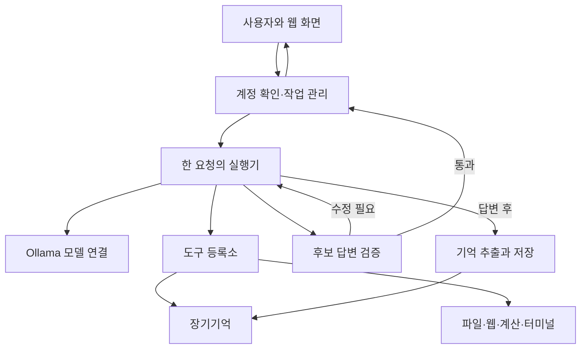
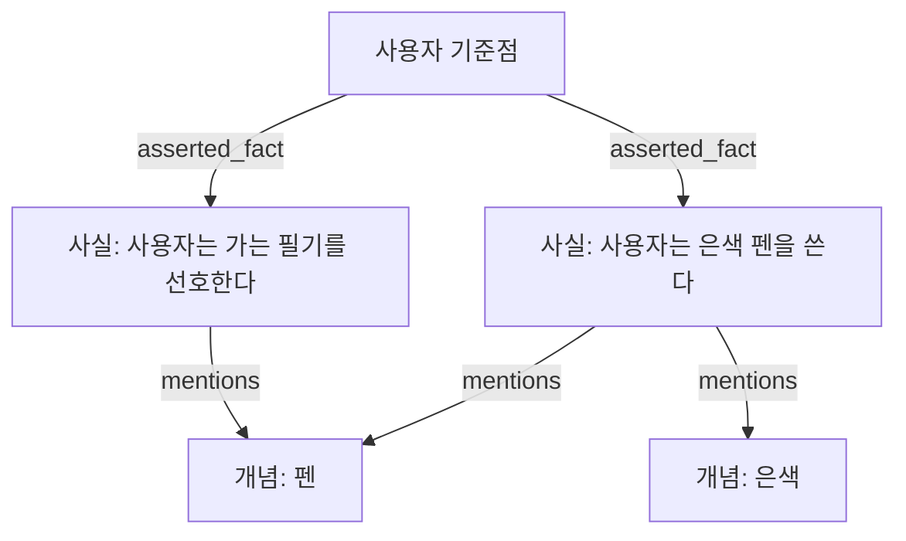
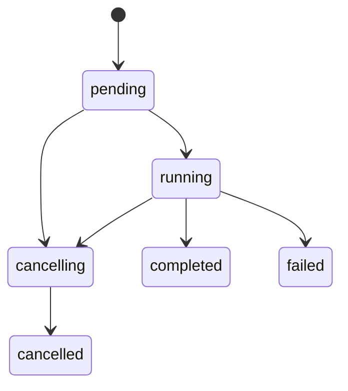

# MAI 전체 재구성 명세서

> MAI를 처음 접하는 사람이, 기존 코드를 복사하지 않고도 같은 구성과 주요 동작을 구현하기 위한 설명서.
>
> 작성일: 2026년 10월 10일. 확인 대상: `FoggyCaligo/MAI_MyAI_sllm`의 `dev`, 커밋 `16f9e5b15e62523f79329a53b927bb053f693a49`.
>
> 문장 분해기 확인 대상: `FoggyCaligo/Sentence_Breaker`, 커밋 `7243e45989b04000cf49825976be9801c44f438c`.

## 0. 이 문서를 어떻게 읽으면 되는가

이 문서에서 말하는 재구성은, 함수 이름과 파일 배치까지 똑같이 복제한다는 뜻은 아니다. 프로그램을 어떤 부분으로 나누는지, 각 부분이 무슨 정보를 받고 무엇을 내보내는지, 어떤 조건에서 다음 단계로 넘어가는지, 무엇을 기억으로 인정하는지를 재현한다는 뜻이다.

예를 들어 원래 코드는 파이썬으로 되어 있지만, 다른 언어로 만들어도 된다. 다만 도구가 실패했는데 성공한 것으로 바꾸거나, 모델이 쓴 문장을 사용자가 말한 사실처럼 저장하면 같은 MAI라고 보기 어렵다. 내부 구현은 바뀔 수 있어도 이런 동작의 의미는 유지해야 한다.

본문에는 세 가지 종류의 설명이 있다.

| 구분 | 의미 |
|---|---|
| 현재 구현 | 확인한 커밋의 실행 코드에서 실제로 일어나는 동작 |
| 설계 의도 | 프롬프트나 기존 설명에 적혀 있는 목표. 코드가 이를 완전히 보장한다는 뜻은 아님 |
| 재구현 권고 | 현재의 빈틈을 개선하고 싶은 경우의 선택지. 현재 구현과 동등한 재현에는 자동으로 포함하지 않음 |

이 구분은 중요하다. 기존 README에는 사전 도구 판단이 없다고 적혀 있지만 실제 코드에서는 연결되어 있다. 검증기 장애를 통과시킨다는 설명도 실제 코드와 다르다. 이 문서는 함수 호출 관계와 데이터 흐름을 기준으로 작성했다. 차이는 25장에 모았다.

또한 문서만으로 원래 모델의 모든 답변 문장을 동일하게 재생할 수는 없다. 모델 가중치, 실행 옵션, 과거 기억 데이터, 문장 분해기의 누적 데이터와 입력 순서가 결과에 영향을 준다. 이 문서의 목표는 **구조와 계약의 재현**이다. 기존 사용자의 기억까지 복원하려면 해당 데이터베이스도 별도로 있어야 한다.

큰 구조를 먼저 이해하려면 1~5장을 읽고, 실행기를 만들려면 6~11장, 기억을 만들려면 12~16장, 사용자에게 제공하는 앱까지 만들려면 17~21장을 읽으면 된다. 22~26장은 구현 순서, 예시, 검증, 제한과 근거다.

## 1. MAI는 무엇인가

MAI는 사용자의 컴퓨터에서 실행되는 개인 AI 프로그램이다. 사용자가 대화로 요청하면 언어 모델이 요청을 해석하고, 필요하면 기억·파일·계산기·웹·터미널 등의 도구를 사용한다. 마지막 답변은 바로 전달하지 않고 검증한다. 답변이 받아들여지면, 그 대화에서 나중에도 필요한 사실을 추려 장기기억에 저장한다.

언어 모델 자체가 기억 데이터베이스는 아니다. 모델을 교체하더라도 사용자의 기억은 별도의 SQLite 파일에 남는다. 모델은 매번 그 파일 전체를 읽는 것이 아니라, 필요한 경우 기억 도구를 호출해서 일부를 가져온다.

따라서 MAI는 크게 다음 다섯 가지가 결합한 프로그램이다.

1. 사용자의 요청을 받아 계정과 대화 문맥을 확인하는 웹 앱.
2. 언어 모델과 실제 도구 실행을 번갈아 진행하는 실행기.
3. 모델이 내놓은 답변을 근거와 비교하는 검증기.
4. 사실을 저장하고 다시 찾는 장기기억.
5. 파일 읽기, 검색, 계산, 터미널 실행 등을 수행하는 구체적인 도구들.

모델에게 “너는 기억할 수 있다”라고 지시하는 것만으로 기억이 생기는 것은 아니다. 실제 저장소, 검색 방식, 저장 허용 기준, 사용자 식별 방식이 있어야 한다. 마찬가지로 “파일을 수정했다”라는 문장을 생성하는 것과 실제 파일을 수정하는 것은 다른 사건이다. MAI는 이 차이를 프로그램의 구조에서 다룬다.

## 2. 처음 보는 사람을 위한 용어

| 용어 | 여기서의 뜻 |
|---|---|
| 모델 | 문맥을 보고 다음 응답 또는 도구 호출을 생성하는 언어 모델 |
| Ollama | 로컬에서 모델을 실행하고 MAI의 요청을 받는 별도 프로그램 |
| 실행기 | 모델을 호출하고, 도구를 실행하고, 결과를 다시 모델에게 주는 제어 프로그램 |
| 한 요청 | 사용자 메시지 하나를 받아 답변 또는 오류를 반환하는 전체 작업 |
| 한 모델 차례 | Ollama의 대화 호출 한 번. 하나의 사용자 요청 안에 여러 번 있을 수 있음 |
| 도구 | 이름, 입력 규칙, 실제 처리 함수가 등록된 기능 |
| 도구 호출 | 모델이 자연어 대신 구조화된 이름과 인자를 반환하는 사건 |
| 입력 규격 | 어떤 필드가 필요하고 각 필드의 자료형·범위가 무엇인지 정의한 규칙 |
| 처리 함수 | 실제 파일·네트워크·계산 등의 작업을 수행하는 함수 |
| 후보 답변 | 아직 사용자에게 전달하지 않은 최종 답변 초안 |
| 근거 | 사용자 원문 중 직접 주장한 내용, 실제 도구 결과 등 사실을 뒷받침하는 자료 |
| 출처 식별자 | 검증과 기억 추출에서 근거를 정확히 가리키는 문자열 |
| 노드 | 기억 그래프에서 사용자 기준점, 사실, 개념 등을 나타내는 항목 |
| 연결 | 두 노드의 관계를 나타내는 항목. 방향·관계 종류·출처 설명을 가짐 |
| 사용자 기준점 | 한 사용자의 기억이 시작되는 고정 노드. 코드 이름은 `anchor` |
| 사실 | 나중에도 사용할 수 있도록 정리한 기억 문장. 코드 이름은 `fact` |
| 개념 | 사실 문장을 분해해서 얻은 검색 좌표. 코드 이름은 `concept` |
| 원문 근거 | 사용자가 입력한 글을 보존한 별도 기록. 코드 이름은 `evidence` |
| 작업 그래프 | 이번 요청에서 가져온 기억을 모아 두는 임시 상태 |
| 색인 | 검색어로 기존 개념 노드의 번호를 찾는 보조 구조 |
| FTS5 | SQLite의 단어 기반 텍스트 검색 기능. 의미 임베딩 검색과 다름 |
| 사전 판단 | 본 실행 전에 반드시 실행해야 할 도구 이름을 정하는 모델 호출 |
| 비동기 작업 | 웹 연결과 분리하여 서버에서 계속 수행하는 작업 |
| `user_id` | 로그인할 때 입력하는 계정 이름 |
| `db_id` | 로그인 이름이 바뀌어도 유지하는 내부 사용자 식별자 |

이후에는 한국어 설명을 우선한다. 실제 구현에 필요한 필드 이름과 도구 이름만 원래 표기를 함께 사용한다.

## 3. MAI를 MAI답게 만드는 규칙

### 3.1 모델의 판단과 프로그램의 확인을 분리한다

무슨 도구가 필요한지는 모델이 판단한다. 그러나 도구 이름이 실제로 등록되어 있는지, 입력이 규격에 맞는지, 처리 함수가 실행되었는지는 프로그램이 확인한다.

예를 들어 “이전 계획을 기억해?”라는 요청에서 `memory_recall`이 필요하다고 정하는 것은 모델의 의미 판단이다. 반면 `memory_recall`이라는 처리 함수가 한 번도 실행되지 않았는데 실행되었다고 처리하는 것은 허용되지 않는다.

사용자 문장에 특정 단어가 들어 있으면 도구를 고르는 문자열 분기표는 현재 설계의 중심이 아니다. “주식”이라는 단어가 있다고 항상 시세 도구를 고르면, 과거 투자 취향을 묻는 질문과 현재 시세를 묻는 질문을 구별하기 어렵다.

### 3.2 자연어와 실제 실행을 섞지 않는다

모델이 “파일을 읽겠습니다”라고 적어도 도구 실행은 아니다. 모델 응답의 구조화된 `tool_calls`에 정확한 이름과 인자가 있어야 한다. 생각 내용이나 본문에서 명령처럼 보이는 문장을 찾아 실행하지 않는다.

### 3.3 실패는 실제 실패로 전달한다

없는 도구, 잘못된 인자, 네트워크 실패, 파일 오류, 명령의 비정상 종료를 빈 성공 결과로 바꾸지 않는다. 실패의 종류와 설명을 모델에게 전달해서 다른 방법을 선택하거나 실패를 설명할 수 있게 한다.

### 3.4 이전 답변은 사용자가 이미 안다는 증거가 아니다

비슷한 질문에 과거에 답했다는 이유로 내용을 생략하지 않는다. 또한 검증에서 거절된 내부 초안은 사용자에게 전달된 대화가 아니다. 모델이 초안을 참고할 수는 있지만 사실 근거나 과거 대화로 취급해서는 안 된다.

### 3.5 기억을 읽는 행위와 새로운 기억을 만드는 행위를 분리한다

“전에 쓰던 펜이 뭐였지?”라는 질문에 기존 기억을 읽었다고 해서, 그 기억을 새롭게 확인된 사실처럼 다시 저장하지 않는다. 읽기만으로 언급 횟수가 늘어나면 자주 검색한 정보가 자주 직접 말한 정보처럼 보이게 된다.

다만 “전에 쓰던 펜이 뭐였지? 지금은 다른 펜으로 바꿨어”라는 메시지는 새 사실을 포함한다. 기억 도구를 썼다는 이유만으로 전체 메시지를 버리지는 않는다.

### 3.6 현재 정보와 과거 기억의 우선순위를 구분한다

장기기억은 과거에 알았던 내용이다. 현재 사용자의 직접 진술이나 현재 도구 결과와 다르면 현재 정보를 우선한다. 현재 시각 역시 모델의 학습 시점에서 추정하지 않고 운영체제 시계를 사용한다.

### 3.7 검색 결과의 범위를 보존한다

일부 행을 읽은 것은 전체 표를 읽은 것이 아니다. 로컬 파일 수정은 원격 저장소 수정과 같지 않다. 도구의 성공은 그 도구가 보고한 범위의 성공이다. 더 넓은 완료 주장을 하려면 그 범위의 결과 근거가 있어야 한다.

### 3.8 반복을 제한하되 일을 많이 했다는 이유로 중단하지 않는다

정상적으로 진행 중인 도구 호출과 모델 차례에 고정 총횟수 상한을 두지 않는다. 대신 같은 호출이 같은 실패를 계속 내는지, 같은 결과 묶음이 그대로 반복되는지 등을 구조적으로 감시한다.

이 규칙은 무한 실행이 절대로 없다는 보장은 아니다. 다른 인자를 계속 생성하거나 빈약한 상태를 다르게 표현하는 반복은 구조 비교를 피할 수 있다. 현재 구현의 감시는 정확히 같은 구조의 반복에 집중한다.

## 4. 전체 구성과 상태의 수명

### 4.1 구성 관계



검증기는 도구를 직접 실행하지 않는다. 문제를 찾으면 실행기로 되돌려 모델이 수정하게 한다. 기억 추출기도 도구를 사용하지 않는다. 이미 허용된 자료만 보고 저장할 사실 후보를 만든다.

### 4.2 어떤 상태를 얼마나 오래 유지하는가

| 상태 | 수명 | 소유자 | 재시작 후 유지 |
|---|---|---|---|
| 계정 설정 | 설정 파일이 유지되는 동안 | 서버 설정 | 유지 |
| 로그인 토큰 | 서버 프로세스 동안 또는 로그아웃까지 | 서버 메모리 | 유지 안 됨 |
| 웹 대화 기록 | 삭제 전까지 | 대화 SQLite | 유지 |
| 사실·개념·연결 | 삭제 전까지 | 기억 SQLite | 유지 |
| 문장 분해 이력 | 삭제 전까지 | 문장 분해 SQLite | 유지 |
| 업로드한 파일 | 삭제·덮어쓰기 전까지 | 계정별 디렉터리 | 유지 |
| 요청 작업 상태 | 서버 프로세스 동안 | 작업 저장소 | 유지 안 됨 |
| 작업 그래프 | 사용자 요청 하나 | 요청 실행기 | 유지 안 됨 |
| 큰 도구 결과 원문 | 사용자 요청 하나 | 결과 저장소 | 유지 안 됨 |
| 반복 감시·검증 수정 횟수 | 사용자 요청 하나 | 도구 반복 실행부 | 유지 안 됨 |
| 모델 연결·추출기 캐시 | 서버 프로세스 동안 | 장기 실행 객체 | 유지 안 됨 |

웹 대화 기록과 장기기억은 별개다. 새 채팅은 최근 대화 기록을 지우지만, 장기기억은 유지한다. 작업 그래프 역시 장기기억 데이터베이스를 복제한 새 저장소가 아니다. 이번 요청에서 읽어 온 노드와 연결을 모은 임시 객체다.

### 4.3 같은 모델을 여러 역할로 사용한다

현재 선택한 대화 모델은 본 답변, 사전 도구 판단, 후보 분석, 근거 검토, 답변 후 사실 추출에 사용된다. 역할마다 별도의 호출과 프롬프트를 사용한다.

| 역할 | 도구 제공 | 생각 모드 |
|---|---|---|
| 본 답변 생성 | 현재 허용된 도구 규격 | 현재 구현에서 기본 `True` |
| 필수 도구 사전 판단 | 실행 가능한 도구 없음. 이름과 설명 목록만 입력 자료로 제공 | `False` |
| 후보 답변 분석 | 없음 | `False` |
| 주장별 근거 검토 | 없음 | `False` |
| 장기기억 사실 추출 | 없음 | `False` |
| 이미지 해석 | 별도의 이미지 모델에 이미지 전달 | 일반 대화 연결 계층과 별도 |

“여러 역할”은 여러 에이전트가 동시에 대화한다는 뜻은 아니다. 현재는 같은 모델에 서로 다른 제한된 일을 순차적으로 맡긴다.

응답의 `model_rounds`는 본 반복 실행기의 차례 수다. 사전 판단·검토·장애 재시도·기억 추출까지 합한 총 모델 호출 횟수가 아니다. 처리 지연을 분석할 때 이 수치만으로 전체 모델 작업량을 판단하지 않는다.

## 5. 서버를 시작할 때 만드는 것

현재 기본 실행 진입점은 `run_server.py`다. 환경 설정을 읽고, 복구 가능한 대화 경로를 설치한 뒤, Uvicorn을 작업자 1개로 실행한다.

시작 시 다음 순서의 준비가 필요하다.

1. 환경 설정을 읽는다.
2. 소유자·체험 계정 설정을 검증한다.
3. 대화 기록 저장소를 연다. 정확히 알려진 옛 표 구조만 새 구조로 옮긴다.
4. 필요한 경우 옛 로그인 이름으로 저장된 대화 기록을 안정된 `db_id`로 옮긴다.
5. 기억 그래프 저장소를 연다.
6. 문장 분해기를 연다.
7. 개념 색인을 열고, 기존 개념 노드와 색인의 누락을 맞춘다.
8. 기억 검색 서비스와 기억 처리 조정자를 만든다.
9. Ollama 연결, 모델별 연결 캐시, 모델별 사실 추출기 캐시를 준비한다.
10. 업로드 디렉터리를 만든다.
11. 설정된 경우 Tailscale Funnel을 시작한다.

소유자 계정이 하나도 없거나, 계정 이름과 내부 식별자가 충돌하면 시작을 실패시킨다. SQLite에 FTS5가 없으면 의미가 다른 검색으로 몰래 대체하지 않는다.

현재 메모리 객체와 로그인·작업 저장소는 한 프로세스 안에 있다. 따라서 작업자 수를 늘리는 것은 단순한 성능 옵션 변경이 아니다. 여러 프로세스가 같은 로그인·작업 상태를 공유하도록 다시 설계해야 한다.

## 6. 사용자 메시지 하나가 처리되는 실제 순서

다음은 기본 웹 화면이 사용하는 비동기 작업 경로를 기준으로 한 순서다.

### 6.1 요청을 서버 작업으로 바꾼다

사용자는 로그인 토큰과 함께 메시지, 대화 식별자, 선택 모델을 보낸다. 서버는 계정을 확인한 뒤 작업 번호를 만든다. 웹 화면은 작업 번호를 즉시 받고 상태를 주기적으로 조회한다. 모델 처리는 별도의 서버 작업에서 계속된다.

동일 로그인 사용자에 대한 작업은 잠금으로 순서대로 실행한다. 서로 다른 계정은 각자의 잠금을 가진다.

### 6.2 최근 대화와 현재 메시지를 준비한다

선택 모델이 계정 권한에 맞는지 확인한다. 현재 세션의 최근 대화 기록을 정해진 메시지 개수만큼 가져온다. 이때 **현재 사용자 메시지를 먼저 덧붙인 뒤 읽으면 안 된다.** 현재 메시지가 본 요청과 최근 문맥에 중복될 수 있기 때문이다.

현재 구현은 최근 문맥을 먼저 읽고, 그 다음 사용자 메시지를 대화 데이터베이스에 저장한다. 따라서 이후 실행이 실패하더라도 사용자 메시지는 대화 기록에 남을 수 있다. 실패한 요청의 정상 답변은 저장되지 않는다.

### 6.3 같은 사용자의 이전 기억 저장을 기다린다

앞선 답변의 기억 추출이 아직 진행 중이면, 같은 `db_id`의 다음 요청은 해당 작업이 끝날 때까지 기다린다. 다른 사용자의 기억 작업은 기다리지 않는다.

이 처리가 없으면 “지금부터 다른 펜을 써”라고 말한 직후 “내 펜이 뭐지?”라고 물었을 때, 새 기억이 아직 저장되지 않아 옛 기억을 읽을 수 있다.

기다리는 요청이 취소되어도 이전 기억 작업 자체를 함께 취소하지 않도록 `shield`에 해당하는 동작을 사용한다.

### 6.4 요청 전용 상태와 도구 목록을 만든다

빈 작업 그래프, 큰 도구 결과 저장소, 계정 역할에 맞는 도구 등록소를 만든다. 선택 모델의 본 연결과 사실 추출기를 가져온다.

메인 정책 프롬프트와 최근 대화를 구성한 다음 실행기에 전달한다. 여기서 장기기억 전체를 자동 주입하지 않는다.

### 6.5 필수 도구를 먼저 판단한다

현재 `AgentRuntime`은 실제 Ollama 연결을 받으면 기본적으로 사전 도구 판단기를 만든다. `MAIRuntime`은 이 실행기를 사용하고 명시적인 요구 집합을 전달하지 않으므로, 현재 웹 실행 경로에서도 사전 판단이 수행된다.

이 호출은 사용자 요청, 최근 사용자·답변 대화, 도구 이름과 설명을 보고 반드시 실행해야 하는 도구 이름 집합을 돌려준다. 자세한 규칙은 7장에 있다.

### 6.6 본 모델·도구 반복을 수행한다

실행 환경 정보, 사용자에게 보여 줄 결과에 관한 규칙, 사용자 메시지, 도구 규격을 모델에 제공한다. 모델이 도구를 요청하면 순서대로 실행하고 결과를 기록한다. 도구 호출 없는 본문을 반환하면 후보 답변으로 처리한다.

### 6.7 후보 답변의 통과 여부를 확인한다

빈 답변인지 확인하고, 필수 도구의 처리 함수가 실행되었는지 확인하고, 숫자 및 2단계 의미 검증을 수행한다. 문제가 있으면 초안을 격리하고 수정 지시를 넣어 다시 모델을 호출한다.

### 6.8 답변을 반환하고 기억 처리를 시작한다

후보가 통과하면 요청 실행기는 답변과 실행 기록을 반환한다. 동시에 기억 추출·저장 작업을 예약한다. 웹 처리부는 정상 답변을 대화 데이터베이스에 저장하고 작업을 완료 상태로 바꾼다.

기억 저장은 답변 반환을 기다리게 하지 않는 후처리다. 다만 6.3의 이유로 같은 사용자의 다음 요청은 기다릴 수 있다.

**현재 원문 기억 저장은 본 모델 실행 전이 아니다.** 후처리에서 사실 추출과 생략 여부 판단을 한 다음 원문을 `evidence`에 넣는다. 따라서 실패한 본 실행, 후처리 도중 서버 종료, 새 사실이 없는 성공적인 기억 조회에서는 원문 기억 표에 저장되지 않을 수 있다. 대화 기록 표의 저장과 혼동해서는 안 된다.

## 7. 필수 도구 사전 판단

### 7.1 필요한 이유

도구가 제공되어 있어도 모델이 이를 쓰지 않고 기억에 없는 내용을 추정하거나 “접근할 수 없다”는 답을 만들 수 있다. 사전 판단은 본 답변과 별개의 짧은 호출에서 필요한 도구를 먼저 정하고, 본 실행이 그 이름들을 실제로 실행했는지 확인하려는 장치다.

### 7.2 입력과 출력

입력은 다음 세 항목이다.

```json
{
  "user_request": "현재 사용자 메시지",
  "recent_dialogue": [
    {"role": "user", "content": "이전 사용자 메시지"},
    {"role": "assistant", "content": "이전 정상 답변"}
  ],
  "available_tools": [
    {"name": "file_read", "description": "등록된 설명"}
  ]
}
```

출력은 추가 필드 없는 다음 구조다.

```json
{"required_tools": ["file_read"]}
```

배열에 들어 있는 이름은 실제 등록된 이름이어야 한다. 중복은 집합으로 합친다. 알려지지 않은 도구 이름이나 잘못된 JSON은 사전 판단 실패다. 자연어에서 이름을 찾아 복구하지 않는다.

도구 입력의 전체 규격은 사전 판단 호출에 주지 않는다. 이름과 설명만 보고 필요성을 판단한다. 실제 인자는 본 모델이 전체 규격을 보고 만든다.

### 7.3 판단 프롬프트가 담아야 할 내용

현재 사용자의 실제 목표를 판단한다. 최근 대화는 “그 파일”, “그때 계획” 같은 지시 대상을 풀기 위한 문맥이다. 필요한 답이나 외부 변경을 현재 대화만으로 알 수 없고 등록 도구가 이를 제공한다면 그 도구를 요구한다.

지역 파일·코드·터미널 요청은 환경에서 해결할 수 있으면 도구를 요구한다. 저장된 사용자 이력은 기억 도구, 현재 웹·시장·시각·계산 정보는 해당 도구를 요구한다. 선택적인 상세 설명만을 위해 도구를 의무화하지 않는다.

이 판단기는 답변을 쓰거나 도구를 실행하거나 인자를 제안하지 않는다. 결과는 이번 실행 동안 고정한다. 실패가 났다고 본 모델이 요구 집합을 임의로 지울 수 없다.

### 7.4 의무를 충족하는 사건

의무 충족은 **성공 여부가 아니라 등록 처리 함수에 도달했는지**로 판단한다. 다음을 구별해야 한다.

| 사건 | 필수 도구 실행으로 인정 |
|---|---|
| 올바른 입력으로 처리 함수가 성공 | 인정 |
| 올바른 입력으로 처리 함수가 시작한 뒤 파일·네트워크 오류 | 인정 |
| 입력 자료형 또는 필수 필드가 잘못됨 | 인정 안 함 |
| 등록되지 않은 이름을 호출 | 인정 안 함 |
| 현재 보정 차례에 노출되지 않은 도구 호출 | 인정 안 함 |
| 반복 감시가 처리 함수 시작 전에 호출을 차단 | 인정 안 함 |

실패도 인정하는 이유는 모델이 실제로 시도했지만 외부 조건 때문에 실패한 경우, 실패를 보고하는 답변을 허용하기 위해서다. 이는 요청이 성공했다는 뜻이 아니다. 결과 주장의 검증은 다른 단계에서 맡는다.

### 7.5 도구를 빼먹고 끝내려 할 때

미실행 이름이 남아 있으면 후보 답변을 거절한다. 그 다음 모델 차례에는 아직 실행되지 않은 도구의 규격만 제공한다. 미실행 도구가 모두 처리 함수에 도달하면 원래 전체 도구 목록을 다시 제공한다.

현재 구조에서는 요구된 이름만 확인한다. `file_read`를 요구했다고 해서 모델이 올바른 파일을 읽었다는 보장은 아니다. 목표에 맞는 대상을 다뤘는지는 답변 검증 및 실제 도구 결과의 범위에서 확인해야 한다.

## 8. 본 모델·도구 반복 실행기

### 8.1 모델 연결의 최소 계약

모델 연결 계층은 한 번의 대화 호출만 책임진다. 도구 실행과 반복 여부는 상위 실행기가 맡는다.

요청에는 대화 목록, 도구 규격 목록, 생각 설정, 모델 옵션, 선택적인 구조화 출력 규격이 있다. 응답에는 다음 네 가지가 있어야 한다.

| 필드 | 내용 |
|---|---|
| `content` | 사용자용 후보 본문 또는 도구 호출 차례의 본문 |
| `thinking` | 모델이 별도 반환한 생각 내용 |
| `tool_calls` | 이름·인자·선택적인 순번을 가진 호출 목록 |
| `assistant_message` | 다음 호출에 그대로 넣을 수 있는 정규화된 응답 메시지 |

현재 Ollama 요청은 `stream=False`다. 글자 단위 스트리밍이 아니라 한 차례가 끝난 뒤 응답을 받는다. 도구·생각 진행 화면은 차례가 끝난 뒤 받은 정보를 갱신해서 보여 준다.

응답의 역할이 `assistant`가 아니거나, 본문·생각이 문자열이 아니거나, 도구 인자가 객체가 아니면 프로토콜 오류다. 본문이나 생각이 없으면 빈 문자열로 정규화한다. 도구 인자가 아예 없으면 빈 객체로 만든다. 인자 문자열을 임의로 JSON 해석하여 고치지는 않는다.

### 8.2 한 차례의 처리

1. 현재 내부 대화에서 거절된 초안을 제외한 모델용 대화를 만든다.
2. 거절된 초안이 있으면 별도 내부 검토 자료로 첨부한다.
3. 필수 도구가 있으면 고정 집합과 미실행 집합을 구조화된 규칙으로 첨부한다.
4. 현재 허용된 도구 규격으로 모델을 한 번 호출한다.
5. 이전 차례의 큰 결과 본문을 이제 짧은 참조로 줄인다.
6. 모델 차례 관찰자에게 생각과 차례 번호를 전달한다.
7. 정규화된 모델 응답을 내부 대화에 추가한다.
8. 도구 호출이 있으면 각 호출을 배열 순서대로 실행한다.
9. 도구 호출이 없으면 빈 본문·필수 도구·최종 검증의 순서로 확인한다.

한 응답에 여러 도구 호출이 들어 있어도 현재 코드는 동시에 실행하지 않는다. 순서대로 실행한다. 파일을 쓰고 읽는 등의 순서가 보존된다.

### 8.3 도구 실행 기록

각 실행에 다음 자료를 남긴다.

```json
{
  "name": "file_read",
  "arguments": {"path": "실제 경로"},
  "ok": true,
  "content": "모델에게 전달한 결과 문자열",
  "error_type": null,
  "handler_started": true,
  "source_content_fingerprint": "원래 결과 내용의 해시",
  "compact_history_content": null
}
```

성공한 반환값이 문자열이면 그대로 사용한다. 그 외에는 JSON으로 직렬화한다. 직렬화할 수 없는 반환값은 도구 결과 계약 위반이다. 알 수 없는 객체를 문자열로 뭉개 성공 결과처럼 만들지 않는다.

일반 도구 예외는 다음과 같은 실패 자료를 생성한다.

```json
{"ok": false, "error_type": "오류 클래스 이름", "message": "오류 설명"}
```

외부 응답에 나가는 도구 기록은 이름, 인자, 성공 여부, 오류 종류, 결과 문자열이다. 내부 감시 필드까지 모두 공개하는 것은 아니다.

### 8.4 빈 답변

도구 호출도 없고 본문도 비어 있으면 한 번 수정 기회를 준다. 다음에도 빈 최종 답변이면 `EmptyFinalResponseError`로 끝난다. 생각 내용이 존재한다는 이유만으로 빈 본문을 정상 답변으로 인정하지 않는다.

### 8.5 거절된 초안의 격리

거절된 초안을 일반 답변 메시지로 계속 넣으면 모델은 “방금 사용자가 그 답을 봤다”고 착각할 수 있다. 그 결과 다음 차례에 “네”나 “알겠어요”처럼 짧은 답만 내거나, 자신의 잘못된 문장을 근거로 사용할 수 있다.

현재 구현은 거절된 답변의 내부 위치를 기록한다. 다음 본 모델 호출에서는 그 위치의 메시지를 일반 대화에서 제외하고 다음 같은 별도 자료로 전달한다.

```json
{
  "rejected_drafts": [
    {"content": "거절된 본문", "delivered": false}
  ]
}
```

이 자료 앞에는 사용자에게 전달되지 않은 내부 검토 자료이며 대화나 사실 근거가 아니라는 지시를 붙인다. 최종 통과 결과의 대화 목록에서도 거절 초안은 제거한다. 검증기에 전달하는 대화에서도 제외한다.

### 8.6 반복 감시

도구 이름과 인자를 정렬된 JSON으로 만들고 SHA-256 해시를 구한다. 결과 내용 역시 해시로 비교한다. 큰 결과의 임의 `result_id`가 바뀌어도 실제 원문 내용의 해시는 유지되므로, 참조 번호만 다른 같은 결과를 진행으로 오인하지 않게 한다.

실패 반복의 기준은 호출 해시, 오류 종류, 결과 해시가 모두 같은 연속 실패다.

| 조건 | 기본 동작 |
|---|---|
| 같은 실패가 연속 3번 | 방법이나 인자를 바꾸라는 경고 |
| 같은 실패가 연속 5번 관찰됨 | 그 이후 동일한 호출을 다시 실행하려 하면 차단 |
| 다른 호출·다른 실패 결과 | 기존 연속 실패 기록을 새 상태로 갱신 |
| 성공한 호출 | 연속 실패 기록 초기화 |
| 같은 도구 차례 결과 묶음이 5번을 초과해 반복 | 진행 없음 경고를 모델에게 전달 |
| 같은 필수 도구 누락 집합으로 종료 시도가 5번을 초과해 반복 | 진행 없음 오류로 실행 실패 |

도구 차례 결과 묶음의 비교는 호출 순서도 포함한다. 같은 도구·인자라도 실제 결과가 바뀌면 구조상 진행으로 취급한다.

일반 도구 반복 감시 오류는 해당 호출의 실패 결과 또는 수정 안내로 모델에 전달된다. 하나의 호출을 차단했다고 같은 차례의 다른 호출 결과까지 무효로 만들지 않는다.

## 9. 도구 등록소와 실행 환경 정보

### 9.1 등록 자료

도구 하나는 이름, 설명, 입력 자료형, 처리 함수, 선택적인 제한 시간, 분류, 부가 정보를 가진다. 이름 중복은 시작 또는 등록 오류다.

모델에게는 다음 형태의 함수 규격을 제공한다.

```json
{
  "type": "function",
  "function": {
    "name": "calculator",
    "description": "도구 설명",
    "parameters": {
      "type": "object",
      "properties": {"expression": {"type": "string"}},
      "required": ["expression"],
      "additionalProperties": false
    }
  }
}
```

현재 입력 검증은 Pydantic의 엄격 모드다. 숫자처럼 보이는 문자열을 정수로 바꾸거나, 알 수 없는 추가 필드를 버리지 않는다. 실제 각 입력의 기본값은 채우지만 규격 위반을 강제 변환으로 고치지 않는다.

### 9.2 처리 함수 실행 방식

비동기 함수는 같은 이벤트 반복부에서 기다린다. 동기 함수는 작업 스레드로 넘긴다. 제한 시간이 설정되어 있으면 해당 호출의 대기를 제한한다.

단, 스레드 대기를 시간 제한으로 끝낸다고 실제 동기 함수가 반드시 중단되는 것은 아니다. 파일·네트워크 처리 자체의 취소 성질도 고려해야 한다. 터미널은 별도의 프로세스 종료 처리가 있어 일반 동기 함수와 다르다.

기억 도구는 비동기 래퍼로 등록한다. 내부 SQLite 작업을 작업 스레드로 넘기면 연결을 만든 스레드와 사용하는 스레드가 달라질 수 있기 때문이다. 현재 구현은 SQLite의 스레드 검사를 무조건 끄는 방법으로 해결하지 않는다.

### 9.3 모델에 알려 주는 실제 환경

도구 이름을 보고 운영체제나 셸을 추측하지 않게, 도구 등록 시 실행 환경을 별도 자료로 등록한다. 같은 환경 식별자를 중복 등록하면 오류다.

터미널은 실제 셸 경로, 셸 종류, 기본 작업 디렉터리, POSIX 문법 사용 여부를 선언한다. 기억 도구는 과거 기억보다 현재 사용자 메시지와 현재 도구 결과를 우선하라는 규칙을 선언한다.

이 자료는 본 모델 호출 앞의 시스템 메시지에 JSON으로 넣는다. 분류나 부가 정보는 의도 분기표가 아니다. 실제 환경에 대한 명시적인 선언이다.

### 9.4 본 모델 정책에 포함할 내용

본 모델 정책은 구성 요소를 설명하는 장식 문구가 아니라 실제 동작 지시다. 원래 영문과 문장 표현은 달라도, 재구현에서는 다음 의미를 유지해야 한다.

1. 현재 요청에 충분히 답한다. 이전에 비슷한 답을 했다는 이유로 사용자의 지식을 가정하거나 생략하지 않는다.
2. 실제 능력은 지금 제공한 도구로 판단한다. 학습된 일반적인 ‘언어 모델은 파일에 접근하지 못한다’는 가정으로 도구를 거절하지 않는다.
3. 사전 학습 지식은 추론에 사용할 수 있지만 사실 주장의 출처로 취급하지 않는다.
4. 현재 대화에 없는 필요한 정보는 사용 가능한 도구로 얻는다. 사용자 이력은 기억, 로컬 내용은 파일·코드·터미널, 이미지 내용은 이미지 도구, 공개 정보는 웹, 현재 한국 시세는 시장, 시간은 시계 도구를 사용한다.
5. 구조 문서도 `file_read`로 읽는다. 실제 공개된 도구 이름과 내부 보조 함수 이름을 혼동하지 않는다.
6. 큰 결과에 번호와 범위가 있으면 생략된 내용을 추정하지 말고 필요한 범위를 후속 읽기로 얻는다.
7. 사용자와 도구의 사실값을 그대로 보존한다. 명시적인 변환 요청 없이 반올림·재해석·정규화하여 다른 값으로 바꾸지 않는다.
8. 원래 관찰과 계산 결과를 구분한다. 매매 이익이 났다는 것만으로 별도로 정한 목표가에 도달했다고 주장하지 않는다.
9. 비슷한 이름의 지표·다른 화면·기간을 서로 바꿔 쓰지 않는다. 차이의 원인을 정의·산식·근거 없이 만들어 내지 않는다.
10. 답변에 중요한 산술은 계산기에서 수행한다. 합계·차이·수익률·비율·가중값·목표 차이를 암산으로 대체하지 않는다.
11. 체험 쓰기 도구의 업로드 경계를 존중한다. 제공됐다는 이유로 임의 로컬 경로를 수정할 수 있다고 말하지 않는다.
12. 도구 결과를 지어내지 않는다. 실패는 실제로 취급하고 요청에 중요한 실패를 최종 답변에 설명한다.
13. 사용자에게 전달하는 답변만으로 요청 결과를 이해할 수 있어야 한다. 내부 실행 출력·로그를 이미 사용자가 읽었다고 가정하지 않는다.

이 규칙에 대한 준수는 프롬프트의 영향과 구조 검증을 함께 통해 얻는다. 모든 지시가 별도의 결정론적 검사로 강제되는 것은 아니다.

## 10. 큰 도구 결과를 전달하는 방법

### 10.1 원문과 모델에 보이는 내용은 다르다

큰 결과를 계속 대화에 넣으면 모델 문맥을 소진한다. 그러나 잘라서 나머지를 버리면 필요한 근거를 읽을 수 없다. 현재 MAI는 요청별 결과 저장소에 도구 반환 문자열을 보존하고 모델에는 범위가 명시된 일부를 준다.

기본 본문 한도는 16,000자다. 최소 설정값은 1,024자다. 읽기 한도는 본문 한도에서 512자를 뺀 값이다. 기본값에서는 15,488자가 된다.

여기서 ‘자’는 문자열 길이 단위다. UTF-8 바이트 수나 토큰 수와 다르다. JSON 메타데이터까지 합한 모델용 문자열이 본문 한도를 넘으면 실제 페이지 내용을 더 줄인다.

### 10.2 최초 전달

한도 이하의 결과는 그대로 전달한다. 한도보다 크면 임의의 `result_id`로 원문을 보관하고 첫 페이지를 반환한다. 첫 줄은 범위 메타데이터 JSON이고 그 다음은 해당 범위의 실제 문자열이다.

```json
{
  "result_id": "이 요청 안에서만 유효한 번호",
  "total_chars": 50000,
  "offset": 0,
  "returned_chars": 15488,
  "next_offset": 15488,
  "complete": false,
  "max_read_chars": 15488,
  "pagination": {
    "page": 1,
    "page_size": 15488,
    "returned_count": 15488,
    "total_count": 50000,
    "total_pages": 4,
    "has_more": true,
    "next_page": 2,
    "next_offset": 15488
  }
}
```

위 숫자는 구조를 설명하는 예시다. 실제 반환 길이는 메타데이터 크기에 따라 더 작아질 수 있다. 다음 범위는 요청한 페이지 크기로 계산하지 말고 **반환된 `next_offset`**을 사용해야 한다.

### 10.3 후속 읽기와 문맥 축소

`tool_result_read(result_id, offset, limit)`로 필요한 범위를 읽는다. offset은 0 이상, limit은 양수이고 해당 요청의 읽기 한도 이하여야 한다. 없는 번호는 오류다.

초기 페이지는 본 모델이 다음 한 차례에서 읽게 한 다음, 그 다음 모델 호출부터 내부 대화의 본문을 짧은 참조로 바꾼다. 전체 원문은 요청별 결과 저장소에 남고, 실행 기록에는 최초 전달된 결과가 남는다.

검증과 기억 추출은 기본적으로 모델에 실제 전달된 실행 결과 범위를 사용한다. 보관되어 있지만 모델이 읽지 않은 나머지를 근거로 몰래 제공하지 않는다. 후속 읽기 결과는 별도의 도구 실행 근거가 된다.

### 10.4 두 종류의 잘림을 구분한다

도구 자체가 파일 본문을 50,000자에서 잘랐을 수 있고, 그 50,000자 결과를 전달 계층에서 다시 나눌 수도 있다. 후속 결과 읽기가 복원하는 것은 **도구가 반환한 문자열 전체**다. 도구 내부에서 이미 제외된 원본 파일의 나머지까지 복원하지 않는다.

따라서 도구의 `truncated`와 결과 저장소의 `complete`는 다른 범위를 말한다. 둘을 합쳐서 “전체 파일을 다 읽었다”고 판단하지 않는다.

## 11. 후보 답변 검증

### 11.1 무엇을 검증하는가

검증기는 답변을 대신 쓰지 않는다. 이미 작성된 후보를 사용자·도구 근거와 비교하여 문제 항목을 돌려준다. 도구 선택이나 추가 작업 요구 역시 검증기의 역할이 아니다.

현재 순서는 숫자 검사, 1단계 후보 분석, 2단계 근거 검토다. 숫자 검사 실패나 명백한 목표 불일치가 있으면 뒤의 모델 검토를 생략할 수 있다.

### 11.2 숫자 검사

사용자 메시지와 모든 도구 결과에서 중요한 숫자를 추출하여 집합을 만든다. 후보에 나온 중요한 숫자가 그 집합 안에 있는지 검사한다. 이전 답변이나 내부 초안의 숫자는 근거로 넣지 않는다.

추출 규칙은 다음과 같다.

1. 줄 시작의 번호 목록 표기, 예를 들어 `1.`은 먼저 제거한다.
2. `2026-10-10`, `2026.10.10`, `2026/10/10` 같은 날짜를 연·월·일 키로 정규화한다.
3. 근거 쪽 날짜는 월·일 별칭도 만든다. 후보가 `8.27`처럼 줄였을 때 해당 근거 날짜가 있으면 허용한다.
4. 숫자와 `만`, `억` 단위를 함께 인식하면 각각 10,000, 100,000,000을 곱한다.
5. 쉼표, 소수, 부호, 백분율을 해석한다. 값 계산에는 Decimal을 사용한다.
6. 평범한 정수 중 절댓값 100 미만은 제외한다. 소수·백분율·쉼표가 있는 값은 이 제외 규칙을 적용하지 않는다.
7. 백분율은 일반 숫자와 다른 키로 보존한다.

근거에 중요한 숫자가 하나도 없으면 현재 숫자 검사는 통과한다. 이 단계는 의미상 사실 검증 전체가 아니다.

예를 들어 사용자 근거가 100과 200이라도 300은 집합에 없으므로, 합계 300을 쓰려면 계산기 결과로 300이 관찰되어 있어야 한다. 또한 값이 근거에 존재해도 다른 열·종목·기간의 값을 가져다 쓴 경우는 이 집합 검사만으로 잡지 못한다. 그것은 다음 단계에서 확인한다.

날짜 형식 검사는 완전한 달력 유효성 검사와 같지 않고, 월·일 별칭도 단순 범위 규칙이다. 작은 정수·단위 표현의 일부 형태는 빠질 수 있다. 숫자 검사의 한계를 의미 검증과 혼동하지 않아야 한다.

### 11.3 1단계: 목표와 주장, 사용자 직접 진술을 분리한다

이 단계는 근거의 충분성을 판단하지 않는다. 세 가지를 추출한다.

| 출력 | 내용 |
|---|---|
| `alignment_verdict` | 요청에 맞음, 맞지 않음, 판단 불확실 |
| `claims` | 후보 안의 중요한 사실 주장과 시간 관련 여부 |
| `user_assertions` | 사용자가 직접 주장한 원문의 연속 발췌와 메시지 위치 |

출력 구조는 다음과 같다.

```json
{
  "alignment_verdict": "aligned",
  "reasons": [],
  "claims": [
    {"claim": "후보의 실제 주장", "temporal": false}
  ],
  "user_assertions": [
    {"message_index": 3, "source_excerpt": "사용자가 직접 쓴 연속된 원문"}
  ]
}
```

허용된 목표 판정 값은 `aligned`, `misaligned`, `uncertain`다. 중요한 요청을 다른 일로 대체하거나 확보한 결과를 보고하지 않고 회피하면 불일치다. 실패한 부분을 정직하게 구분한 부분 답변은 요청에 맞는 것으로 판단할 수 있다.

의견·질문·조언·불확실성 자체를 확정된 사실 주장으로 추출하지 않는다. 다만 그 문장에 중요한 사실 전제가 들어 있으면 해당 전제는 검토할 수 있다. 시간에 따라 진위가 달라지거나 날짜·상대적 시간에 의존하는 주장은 `temporal=true`로 표시한다.

사용자의 “맞아”, “좋아”, “그렇게 해줘”는 이전 답변의 내용 전체를 직접 진술한 것이 아니다. 따라서 이전 답변의 사실을 사용자 근거로 옮겨서는 안 된다.

프로그램은 반환된 메시지 위치가 실제 제공한 사용자 메시지인지, 발췌가 빈 문자열이 아닌지, 검토에 제공한 메시지 본문의 연속 부분 문자열인지 확인한다. 별도의 요약 문장을 사용자 근거로 받지 않고 **발췌 자체를 근거 본문으로 삼는다.**

이 점이 `user_source`의 의미다. 사용자가 실제 말한 근거이지 모델이 사용자의 취향처럼 만들어 낸 문장이 아니다. 새롭게 정리한 “사용자는 은색 만년필을 사용한다”라는 문장을 저장하는 것은 가능하지만, 이를 받쳐 주는 사용자의 직접 발췌 또는 다른 허용 근거가 있어야 한다.

추출된 주장에는 프로그램이 `claim:0`, `claim:1` 같은 번호를 붙인다. 직접 사용자 근거에는 `user:<메시지 위치>:<근거 순번>` 형태의 번호를 붙이고 최신 메시지 여부를 기록한다.

### 11.4 2단계: 각 주장을 근거에 대조한다

입력 자료를 사실 근거와 문맥으로 분리한다. 최근 대화와 현재 요청은 대상을 이해하는 문맥이다. 근거로 사용할 수 있는 것은 직접 사용자 발췌, 순서가 있는 도구 결과, 운영체제의 현재 시각이다.

도구 근거 번호는 `tool:<전체 실행 순번>:<도구 이름>`이다. 최근 일부 결과만 전달하더라도 순번은 전체 실행 목록의 순번을 유지한다.

현재 시각은 검토 직전에 `current_time()`과 같은 구현으로 읽고 `runtime:current_time`으로 제공한다. 시계는 현재 순간을 알려 줄 뿐, 오래된 기사나 시세를 최신으로 만들지 않는다. 실행 서버의 시간대가 사용자 시간대라는 보장도 없다.

각 주장 판정은 `supported`, `unsupported`, `uncertain` 중 하나다. 지원되는 주장에는 정확한 근거 번호가 하나 이상 있어야 한다. 실패한 도구도 오류·표준 출력·진단을 실제 관찰했다는 주장을 지원할 수 있지만, 요청한 작업이 성공했다는 근거가 되어서는 안 된다.

구조화 출력은 다음과 같다.

```json
{
  "evidence_verdict": "supported",
  "coverage_verdict": "sufficient",
  "coverage_reasons": [],
  "reasons": [],
  "claims": [
    {
      "claim_id": "claim:0",
      "verdict": "supported",
      "defect": "none",
      "reason": "",
      "support_ids": ["tool:0:file_read"]
    }
  ],
  "action_verdict": "not_applicable"
}
```

프로그램은 모든 주장에 정확히 한 검토가 있는지 확인한다. 중복·누락·알 수 없는 주장 번호는 오류다. 근거 번호가 실제 목록에 있는지, 지원 판정에 근거가 있는지도 확인한다.

결함 종류는 `none`, `scope_expansion`, `contradiction`, `unsupported_inference`, `missing_evidence`다. 범위 확대는 한 파일·일부 행·로컬 상태를 전체 또는 원격 상태로 확대하는 경우다. 근거 없는 추론은 원인이나 의미를 자료보다 강하게 주장하는 경우다.

### 11.5 정보 활용 부족과 결과 완료를 별도로 본다

정보 활용 검토는 **이미 있는 근거를 버렸는지** 확인한다. 더 검색하면 자료가 있을지 모른다는 이유로 부족 판정을 내리지 않는다. 확보한 구체적 정보를 버리고 일반적인 조언만 내놓으면 `insufficient`가 될 수 있다. 구체적인 이유가 없으면 현재 구현은 불확실로 낮춘다.

외부 상태 변경 요청에 대해 답변이 완료를 주장하면 결과 상태의 근거를 확인한다. 판정은 다음 네 가지다.

| 판정 | 의미 |
|---|---|
| `not_applicable` | 상태 변경 요청이 아니거나, 완료를 주장하지 않는 정직한 부분 답변 |
| `verified` | 후속 관찰 또는 같은 범위의 권위 있는 변경 결과가 완료를 뒷받침 |
| `unverified` | 호출은 시도되었지만 주장한 최종 상태를 확인하지 못함 |
| `contradicted` | 결과 상태가 완료 주장과 직접 충돌 |

모든 쓰기 뒤에 무조건 추가 읽기를 강제하는 규칙은 아니다. 변경 결과가 같은 범위의 최종 상태를 명시적으로 보장하면 그 결과 자체가 충분할 수 있다.

### 11.6 검토에 전달하는 범위

현재 검토 호출은 긴 자료를 모두 받지 않는다.

| 자료 | 현재 한도 |
|---|---|
| 현재 사용자 요청 | 4,000자 |
| 최근 대화 문맥 | 최근 사용자·답변 메시지 10개, 각 1,800자 |
| 사용자 근거 추출용 메시지 | 해당 사용자 메시지 각 1,800자 |
| 후보 답변 | 6,000자 |
| 도구 근거 | 최근 실행 10개, 각 3,500자 |

잘림 함수는 긴 문자열의 앞부분과 뒷부분을 남기고 가운데에 잘림 표시를 넣는다. 따라서 앞서 유용한 결과가 10개 밖으로 밀리거나 긴 자료의 중간이 빠질 수 있다. 검토 결과가 통과해도 읽지 않은 모든 부분을 검증했다는 뜻은 아니다.

현재 발췌 연속성 검사도 원문 전체가 아니라 이 제공용 본문을 기준으로 한다. 따라서 잘림 표시 같은 런타임 삽입 문자열까지 사용자 원문으로 잘못 선택되는 가능성을 완전히 배제하는 별도 원문 대조 검사는 없다. 재구현 개선판에서는 발췌가 잘리지 않은 실제 사용자 원문에도 존재하는지 확인하는 것이 좋다.

### 11.7 수정 횟수와 검증기 장애

문제 항목을 모델에게 전달할 때는 거절 초안이 사용자에게 전달되지 않았으며 완전한 수정 답변을 다시 쓰라고 명시한다. 이미 지원되는 유용한 내용은 보존하게 한다.

| 문제 축 | 현재 수정 기회 |
|---|---|
| 숫자 근거 | 2회 |
| 요청 목표 일치 | 기본 2회 |
| 주장 근거·범위·변경 결과 | 5회 |
| 이미 있는 정보 활용 부족 | 2회 |

복수 축이 실패하면 관련 횟수가 함께 증가한다. 어느 실패 축의 수정 횟수가 이미 소진되었으면 `VerificationRetriesExhausted`로 끝난다. **현재 구현은 정보 활용 부족 횟수가 소진되었다고 그 검사만 끄고 후보를 반환하지 않는다.**

모델 검토 호출의 인프라·형식 실패는 별도의 최대 3회 시도를 가진다. 시간 초과, 일부 네트워크·프로토콜 오류, 구조화 출력 형식 오류, Ollama의 429 또는 5xx 오류 등이 해당한다. 시도 사이에는 짧게 0.25초, 0.5초 기다린다.

유효한 “지원되지 않음” 판단을 마음에 들지 않는다는 이유로 동일 후보에 재판정시키는 것은 이 재시도에 해당하지 않는다. 후보를 수정하는 반복과 호출 장애를 복구하는 반복은 별개다.

세 번 후에도 실패하거나 재시도 대상이 아닌 오류면 검증 실패 예외가 올라간다. 현재 본 실행 경로는 이를 무시하고 후보를 반환하지 않는다. 즉 검증기를 실제 연결한 웹 실행에서는 장애 시 후보를 차단한다. 검증기를 아예 연결하지 않은 하위 테스트 호출의 통과 동작과 혼동하지 않는다.

1단계에서 만든 사용자 발췌의 부분 문자열 검사나 2단계의 근거 번호 대응 검사처럼, 구조화 JSON 파싱 뒤에 하는 무결성 검사는 위 3회 호출 재시도 바깥에 있다. 그 오류가 발생했다고 자동으로 세 번 모델을 다시 부르는 것은 아니다.

## 12. 장기기억의 데이터 구조

### 12.1 세 종류의 실제 생산 노드

현재 새 기억은 사용자 기준점, 사실, 개념으로 만들어진다.



이 그림의 분해 결과는 이해를 위한 가상 예시다. 실제 문장 분해기는 사전이나 띄어쓰기만으로 나누지 않으므로, 반드시 ‘펜’과 ‘은색’으로 나뉜다는 뜻은 아니다.

사용자 원문은 별도 `evidence` 표에 있다. 원문을 생산 그래프의 발화 노드로 다시 만드는 것은 현재 후처리 경로에 없다. `utterance` 노드 종류와 생성 함수는 옛 데이터·하위 호출을 위해 남아 있다.

### 12.2 노드의 정체성

노드 번호와 노드의 정체성 문자열을 구분한다. 번호는 데이터베이스가 할당한 정수다. 정체성 문자열은 같은 항목인지 판단하는 키다.

| 종류 | 정체성 키 | 본문 | 부가 자료 |
|---|---|---|---|
| 기준점 | `anchor:user:<db_id>` | `user_anchor::<db_id>` | 사용자 내부 식별자 |
| 사실 | `fact:<db_id>:<양끝 공백 제거한 사실 문장>` | 사실 문장 | 사용자 내부 식별자 |
| 개념 | `concept:<양끝 공백 제거한 분해 조각>` | 분해 조각 | 기본 빈 객체 |
| 옛 발화 | `utterance:evidence:<원문 번호>` | 원문 | 사용자, 원문 번호, 발화자 |

같은 사실 문장이라도 사용자 내부 식별자가 다르면 다른 사실 노드다. 반면 같은 개념 문자열은 사용자 간에도 하나의 개념 노드를 공유한다.

정체성 비교는 정확한 문자열 일치다. 비슷한 뜻이라고 하나의 노드로 합치지 않는다. ‘은색 펜을 쓴다’와 ‘실버 펜을 사용한다’는 그래프 차원에서는 다른 사실일 수 있다. 사실 추출기에 의미 중복을 줄이라는 지시가 있지만, 저장소가 의미 중복을 보장하여 제거하는 것은 아니다.

이미 있는 사실·개념을 다시 저장하면 번호와 생성 시각은 유지하고, 등장 횟수를 1 올리고, 마지막 관찰 시각을 갱신한다. 기존 기준점을 확인하는 것은 등장 횟수를 올리지 않는다. 조회 역시 등장 횟수를 올리지 않는다.

등장 횟수는 진실의 확률이나 중요도의 직접 측정값이 아니다. 같은 정확한 저장 문장이 다시 받아들여진 횟수다.

### 12.3 연결의 규칙

현재 생산 경로의 연결은 다음 두 가지다.

| 출발 | 도착 | 관계 | 출처 설명 |
|---|---|---|---|
| 사용자 기준점 | 사실 | `asserted_fact` | `user_assertion` |
| 사실 | 개념 | `mentions` | `fact_index` |

같은 출발 번호, 도착 번호, 관계 조합은 한 연결만 존재한다. 중복 삽입은 기존 연결을 재사용한다. 최초 출처 설명과 생성 시각을 새로운 삽입으로 덮어쓰지 않는다.

연결 의미는 모델이 즉석에서 만든 문장이 아니다. 저장 함수가 위처럼 정해진 종류를 사용한다. 다만 현재 SQL은 관계 문자열을 모든 경우에 제한된 열거형으로 검증하지는 않는다. 생산 경로의 고정 사용과 데이터베이스 자체의 제약을 구별해야 한다.

### 12.4 실제 기억 표의 핵심 정의

아래 정의는 독립 구현에서 그대로 사용할 수 있는 현재 핵심 표 구조다.

```sql
PRAGMA foreign_keys = ON;

CREATE TABLE IF NOT EXISTS nodes (
    id INTEGER PRIMARY KEY AUTOINCREMENT,
    identity_key TEXT NOT NULL UNIQUE,
    node_type TEXT NOT NULL
        CHECK (node_type IN ('anchor', 'utterance', 'fact', 'concept')),
    canonical_text TEXT NOT NULL,
    payload_json TEXT NOT NULL DEFAULT '{}',
    occurrence_count INTEGER NOT NULL DEFAULT 1
        CHECK (occurrence_count >= 1),
    created_at TEXT NOT NULL,
    last_seen_at TEXT NOT NULL
);

CREATE TABLE IF NOT EXISTS user_anchors (
    user_id TEXT PRIMARY KEY,
    node_id INTEGER NOT NULL UNIQUE REFERENCES nodes(id) ON DELETE CASCADE
);

CREATE TABLE IF NOT EXISTS evidence (
    id INTEGER PRIMARY KEY AUTOINCREMENT,
    kind TEXT NOT NULL,
    content TEXT NOT NULL,
    created_at TEXT NOT NULL
);

CREATE TABLE IF NOT EXISTS edges (
    id INTEGER PRIMARY KEY AUTOINCREMENT,
    from_node_id INTEGER NOT NULL REFERENCES nodes(id) ON DELETE CASCADE,
    to_node_id INTEGER NOT NULL REFERENCES nodes(id) ON DELETE CASCADE,
    relation TEXT NOT NULL,
    provenance TEXT NOT NULL,
    created_at TEXT NOT NULL,
    UNIQUE(from_node_id, to_node_id, relation)
);

CREATE INDEX IF NOT EXISTS idx_nodes_type ON nodes(node_type);
CREATE INDEX IF NOT EXISTS idx_nodes_text ON nodes(canonical_text);
CREATE INDEX IF NOT EXISTS idx_edges_from ON edges(from_node_id);
CREATE INDEX IF NOT EXISTS idx_edges_to ON edges(to_node_id);
CREATE INDEX IF NOT EXISTS idx_edges_relation ON edges(relation);

CREATE TABLE IF NOT EXISTS memory_concept_exact (
    node_id INTEGER PRIMARY KEY,
    canonical_text TEXT NOT NULL UNIQUE
);

CREATE VIRTUAL TABLE IF NOT EXISTS memory_concept_fts
USING fts5(canonical_text, tokenize='unicode61');
```

기억 시각은 시간대가 있는 UTC ISO 문자열이다. 색인에서는 FTS의 `rowid`를 실제 개념 노드 번호와 같게 둔다. 색인 표가 새 사실의 정체성을 결정하지 않는다. 그래프 저장소가 만든 개념 번호를 색인에 넣는다.

현재 `evidence` 표에는 `db_id` 열이 없다. 현재 사실의 payload에도 원문 번호나 검증 출처 번호 목록이 없다. 원문은 남지만 어떤 사실이 어느 원문·도구에서 왔는지 완전한 대응이 영구 저장되는 구조는 아니다. 이것은 재구현할 때 반드시 인지해야 하는 현재 한계다.

‘원문이 불변’이라는 표현은 현재 API가 원문을 수정하지 않고 삽입하여 보존한다는 계약이다. SQL 트리거로 수정·삭제를 절대 금지한 표라는 뜻은 아니다.

## 13. 문장 분해기까지 다시 만드는 방법

### 13.1 역할과 상태

Sentence_Breaker는 사실 문장을 개념 조각으로 나누기 위한 별도 구성 요소다. 모델 토큰화, 한국어 형태소 분석, 기억 그래프 전체와 같지 않다. 입력된 문자들의 연결 경로를 누적하고 다음 문장에서 과거와 일치하는 연속 경로를 찾는다.

공백과 문장부호도 문자로 취급한다. 중요한 특징은 **분해가 읽기만 하는 함수가 아니라는 것**이다. 기존 이력으로 분해한 뒤 현재 입력의 문자 경로를 누적 저장한다.

MAI는 반환된 조각 중 공백뿐인 조각을 버린다. 그래프에 넣을 때 조각 양끝 공백을 제거한다. 조각 내부 공백은 그대로 남는다.

### 13.2 별도 데이터베이스

| 표 | 핵심 필드 | 의미 |
|---|---|---|
| `alph_nodes` | `alph` 기본키, 생성 시각 | 관찰된 문자 하나 |
| `sentence_layers` | `sentence_id` 기본키, `char_length`, 생성 시각 | 입력 한 번의 고유 층 |
| `alph_links` | 번호, `source_alph`, `target_alph`, `sentence_id`, `position`, 생성 시각 | 그 입력에서 인접 문자가 이어진 위치 |

문자 쌍, 입력 번호·위치, 출발 문자·입력 번호에 색인을 만든다. 같은 문자를 여러 번 본다고 문자 노드를 복제하지 않는다. 그러나 같은 문자 연결이라도 새로운 입력에서는 새로운 연결 행을 넣는다. 입력별 연속 경로를 구별해야 하기 때문이다.

입력 번호는 `sentence-<UUID>` 형태다. 본 알고리즘에 숫자 순서가 필요한 것은 아니다. 각 입력의 경로를 구별할 수 있는 고유 번호면 된다.

### 13.3 각 문자 쌍의 일치 후보를 구한다

입력 문자열을 `c[0]`, `c[1]`, …, `c[n-1]` 문자 배열로 만든다. 각 위치 i에 대해 과거 저장소에서 `c[i] → c[i+1]`과 같은 연결을 찾는다.

그 결과를 `step_matches[i]`라는 집합으로 보관한다. 각 원소는 `(과거 입력 번호, 과거 위치)`다. 같은 문자 쌍이라는 것만으로 충분하지 않고, 같은 과거 입력의 위치가 연속하여 진행되는지 확인해야 한다.

### 13.4 연속 범위를 지원하는 경로 수를 센다

현재 입력의 `[start, end)` 범위가 2자 이상일 때 다음을 한다.

1. 첫 문자 쌍의 후보 집합을 생존 집합으로 둔다.
2. 다음 문자 쌍으로 진행할 때 `(입력 번호, 위치 + 1)`이 다음 후보 집합에도 있는 상태만 남긴다.
3. 어느 단계에서든 생존 집합이 비면 이 범위의 지원 수는 0이다.
4. 마지막 문자 쌍까지 남은 상태 개수가 지원 수다.

따라서 여러 과거 입력의 관계없는 문자 쌍들을 이어 붙여 하나의 범위를 지원한다고 판단하지 않는다. 같은 입력 층에서 위치가 이어져야 한다.

현재 코드는 서로 다른 입력 층의 개수만 세는 것이 아니라 살아남은 `(입력 번호, 위치)` 상태 수를 센다. 한 과거 입력에 같은 부분 문자열이 여러 위치에서 나오면 여러 상태가 지원 수에 들어갈 수 있다.

### 13.5 동적 계획법으로 최종 분해를 선택한다

문자열 끝에서 시작 쪽으로 각 위치의 최적 분해를 계산한다. `best[n]`은 빈 나머지이고 점수·지원된 문자 수·조각 수는 0이다.

각 시작 위치에서 먼저 문자 하나를 단독 조각으로 두는 후보를 만든다. 이 문자는 추가 지원 점수를 받지 않는다. 그 다음 길이 2 이상인 모든 끝 위치를 확인하여, 지원 수가 0이 아닌 범위만 더 긴 후보로 만든다.

길이 L, 지원 수 K인 조각의 추가 점수는 `K × L`이다. 이 점수에 뒤쪽 최적 분해의 점수를 더한다. 선택 비교 순서는 다음 네 값의 사전식 비교다.

1. 전체 지원 점수가 큰 쪽.
2. 전체 지원된 문자 수가 큰 쪽.
3. 현재 선택 조각의 길이가 긴 쪽.
4. 전체 조각 수가 적은 쪽.

정확히 같으면 현재 선택을 유지한다. 끝 위치를 짧은 것부터 순서대로 보므로 동점 처리도 재현에 영향을 준다.

선택한 조각마다 다음 위치를 보관하고, 시작 위치 0에서 그 다음 위치를 따라가며 결과 리스트를 만든다.

### 13.6 현재 입력을 나중에 학습한다

분해를 계산한 **뒤에** 현재 입력의 문자를 저장한다. 현재 문장 자체로 자신의 모든 범위를 지원하게 만들면 첫 입력부터 전체 문장이 하나로 선택될 수 있으므로 순서가 중요하다.

완전히 빈 데이터베이스에 `엄마`를 처음 넣으면 이전 경로가 없어서 한 문자씩 나뉜다. 그 입력이 저장된 뒤 `엄마가`를 넣으면 기존 `엄마` 경로가 더 긴 조각 후보가 된다. 정확한 결과는 다른 누적 경로의 지원 점수에 따라 달라질 수 있다.

### 13.7 재현에 필요한 것과 개선 가능성

같은 분해 코드를 써도 누적 DB와 입력 순서가 다르면 개념 조각이 다르다. 기존 기억과 호환하려면 기존 문장 분해 DB도 보존해야 한다. 현재 MAI는 명시적으로 자기 데이터 경로를 전달하므로, 외부 패키지 기본 DB가 자동으로 복사되어 들어오는 것으로 생각하면 안 된다.

현재 동적 계획법은 여러 범위에 대해 지원 경로를 반복 확인한다. 매우 긴 입력과 많은 일치 경로에서는 계산량이 커질 수 있다. 지원 수 계산을 캐시하거나 경로를 한 번씩 연장하는 최적화는 가능하지만, 점수·동점·입력 후 학습 규칙은 보존해야 한다.

외부 설계 문서에 제안된 경계 일관성 점수나 별도 학습 묶음 표는 확인한 실행 코드에 없다. 현재를 재현하려면 위 네 가지 비교 규칙을 사용한다.

## 14. 기억을 검색하고 넓히는 방법

### 14.1 정확 일치와 FTS5

개념 색인을 열 때 `memory_concept_exact`를 읽어 `개념 문자열 → 노드 번호` 사전을 만든다. 이것이 정확 일치 검색이다.

정확 일치가 충분하지 않으면 FTS5의 어휘 검색을 사용한다. 검색 문자열 전체를 따옴표로 감싼 구문으로 만들고 내부 따옴표를 이스케이프한다. FTS 문법을 사용자가 임의로 삽입하는 것을 막고 온전한 검색 조각을 조회한다.

FTS5 결과는 BM25 값이 작은 순서, 그 다음 노드 번호 순서로 정렬한다. 모델에 제공되는 검색 점수는 BM25 수치 자체가 아니다. 정확 일치는 1.0, 어휘 검색은 순위 r에 대해 `0.5 / r`다. 같은 조회 결과에서 정확 일치가 먼저다.

이 색인은 의미 벡터나 모델별 임베딩을 사용하지 않는다. 모델을 바꾼다고 임베딩 전체를 다시 만들 필요가 없다. 반면 동의어·다른 표현·한국어 조사 변형을 의미상 자동으로 찾는 기능을 보장하지도 않는다.

### 14.2 시작 시 색인을 맞춘다

그래프의 영구 개념 노드 중 색인에 없는 것은 정확 표와 FTS 표에 추가한다. 같은 개념 문자열이 다른 번호에 연결되어 있거나 같은 번호의 텍스트가 다르면 오류다. 누락된 FTS 행은 보완하지만 정체성 충돌을 조용히 합치지 않는다.

옛 벡터 색인 표가 남아 있어도 현재 검색에 사용하지 않는다. 그렇다고 시작 시 몰래 삭제하지도 않는다.

### 14.3 `memory_recall(query)`의 실제 알고리즘

1. 현재 사용자 기준점을 확보한다.
2. 모델이 만든 검색어를 **공백으로만** 나눈다. 문장 분해기를 적용하지 않는다.
3. 같은 검색 조각은 최초 위치를 남기고 중복 제거한다.
4. 각 조각을 개념 색인에서 `limit=1`로 검색한다.
5. 같은 개념 번호가 여러 조각에서 나오면 더 높은 점수를 유지한다.
6. 점수 내림차순, 조각 최초 순서, 노드 번호 순서로 정렬한다.
7. 기본 최대 5개 개념 번호를 검색 시작점으로 선택한다.
8. 새 임시 그래프에 사용자 기준점과 기본 8개의 기준점 사실 문맥을 넣는다.
9. 각 개념 번호의 1단계 이웃을 읽는다.
10. 그 이웃에서 기준점·사실만 남긴다. 개념·발화 노드 및 이들이 필요한 연결은 제거한다.
11. 각 사실에서 현재 사용자 기준점까지의 최단 경로를 찾고, 역시 기준점·사실만 남겨 합친다.
12. 이번 조회 결과를 요청의 작업 그래프에 누적한다.
13. 모델에는 누적 전체가 아니라 **이번 조회에서 만든 결과만** 돌려준다.

검색 조각이 하나도 일치하지 않아도 기준점 사실 문맥은 반환될 수 있다. 따라서 검색 결과에 사실이 있다고 그 사실이 반드시 검색어와 직접 일치한 것이라고 생각하면 안 된다.

기준점 사실 문맥은 `asserted_fact`로 직접 연결된 사실을 등장 횟수 내림차순, 마지막 관찰 시각 내림차순, 노드 번호 내림차순으로 정렬하여 기본 8개를 고른다. 원문 발화 연결은 이 문맥에서 제외한다.

### 14.4 1단계 이웃과 최단 경로

1단계 이웃은 해당 노드에서 나가거나 들어오는 모든 연결과 양끝 노드를 읽는 것이다. 연결 번호 순서로 읽고 노드는 번호로 모은다.

최단 경로는 너비 우선 탐색을 사용한다. 경로를 찾는 동안에는 연결 방향을 무시한다. 그러나 반환하는 연결의 원래 방향·관계·출처 설명은 바꾸지 않는다. 방문 기록과 이전 노드·연결 번호를 보관하여 목적지에서 시작점으로 되짚는다.

최단 경로는 1단계 이웃만 보는 것과 다르다. 여러 단계를 지나 기준점까지 도달할 수 있다. 현재 구현에는 최단 경로 탐색 깊이의 별도 고정 상한이 없다. 명시적 확장의 이웃 단계와 경로 복원 범위를 구별해야 한다.

### 14.5 `memory_search(node_id)`

일반 노드는 1단계 이웃을 확장한다. 각 이웃의 현재 사용자 기준점까지 최단 경로도 추가한다. 그 결과를 작업 그래프에 합치고 이번 확장분만 반환한다.

기준점은 예외다. 현재 사용자 기준점이면 기본 8개 사실 문맥만 반환한다. 다른 사용자의 기준점을 직접 확장하면 권한 오류다.

`memory_recall`과 달리 일반 노드 확장에는 기준점·사실만 남기는 필터가 없다. 따라서 사실에서 개념이 보일 수 있고 옛 발화가 있는 DB에서는 발화도 나타날 수 있다. 더 멀리 이웃을 넓히려면 또 다른 명시적 호출이 필요하다.

### 14.6 `memory_overview(limit)`

검색어 없이 현재 사용자 기준점에 직접 연결된 기억을 최근 순서로 읽는다. 기본 12개, 입력 범위 1~50개다. 마지막 관찰 시각 내림차순, 노드 번호 내림차순이다.

현재 조회문은 `spoke`와 `asserted_fact` 관계를 모두 허용한다. 새 생산 데이터에서는 주로 사실이 나오지만, 옛 `spoke` 발화가 있는 DB에서는 그것도 반환될 수 있다. 이 도구는 작업 그래프에 결과를 합치는 경로를 사용하지 않고 자체 목록을 반환한다.

### 14.7 작업 그래프의 구조

노드 번호를 키로 한 사전, 연결 번호를 키로 한 사전, 확장한 중심 번호 집합을 가진다. 합칠 때 같은 번호는 하나로 유지한다.

반환 스냅샷에는 `nodes`, `edges`, 정렬된 `expanded_node_ids`가 있다. 노드에는 번호·종류·본문·부가 자료·등장 횟수, 연결에는 번호·양끝·관계·출처 설명·생성 시각이 있다.

기억을 읽을 때마다 작업 그래프의 누적 전체를 재전송하지 않는 이유는 문맥 증가를 줄이기 위해서다. 이미 가져온 노드 번호를 다음 도구 호출의 시작점으로 사용할 수 있다는 점은 유지한다.

### 14.8 현재 사용자 격리의 한계

계정에 기억 도구를 묶는 것과 모든 그래프 경로가 사용자별로 필터링된 것은 다르다. 현재 개념은 사용자 간 공유되고, 개념의 이웃 사실을 가져오는 코드에는 모든 사실의 사용자 소유권을 먼저 제한하는 조건이 없다. 일반 `memory_search` 역시 다른 사용자의 기준점을 직접 확장하는 것만 차단하고 모든 일반 노드를 소유권으로 차단하지는 않는다.

따라서 현재 코드만으로 다중 사용자 기억의 완전한 격리가 보장된다고 적으면 안 된다. 공유 개념을 통한 다른 사용자 사실·경로 노출 가능성을 별도로 검토해야 한다.

재구현 권고는 현재 사용자 소유 사실만 검색·확장 결과로 내보내고, 최단 경로가 다른 사용자 소유 노드를 우회하지 못하게 하는 것이다. 다만 이것을 적용하면 현재 코드와는 달라지는 개선이다. 동등 재현 명세와 개선 설계를 구분하여 관리한다.

## 15. 답변 후 무엇을 기억으로 인정하는가

### 15.1 사실 추출의 입력 구분

추출기는 사용자의 최신 메시지, 직전 정상 답변, 최종 답변을 문맥으로 받는다. 그러나 이 세 전체 문자열이 자동으로 사실 근거가 되는 것은 아니다. 실제 지원 자료는 별도 `allowed_fact_sources` 목록으로 만든다.

| 허용 자료 | 조건 |
|---|---|
| 최신 사용자의 직접 진술 | 최종 검증이 만든 사용자 발췌이고 `is_current=true` |
| 이번 요청의 성공한 비기억조회 도구 결과 | 실제 `ok=true`, 기억 조회 도구 세 종류는 제외 |
| 근거가 확인된 최종 주장 | 모든 지원 번호가 위 두 종류에 속함 |

이전 사용자 메시지는 답변 검증의 근거가 될 수 있지만, 현재 후처리의 새 직접 사용자 근거로 반복 제공하지 않는다. 기존 기억 조회는 맥락으로 읽은 옛 기억이지 새 자료가 아니므로 제외한다.

근거가 확인된 최종 주장도 모든 지원 번호가 허용되어야 한다. 예를 들어 옛 기억과 최신 사용자 진술을 함께 지원으로 삼은 주장에는 옛 기억 번호가 들어 있으므로, 현재의 엄격한 필터에서는 새 기억 자료에서 제외한다. 운영체제 시각 번호만으로 지원된 주장 역시 직접 저장 허용 목록에 자동 포함하지 않는다.

### 15.2 출처의 구조

직접 사용자 근거에는 ref, 원문 발췌를 그대로 사용한 content, source_excerpt가 있다. content와 source_excerpt의 양끝 공백 제거 결과는 정확히 같아야 한다.

도구 근거에는 기존 실행 순번을 유지한 ref, tool 이름, 모델에 실제 전달된 content가 있다. 성공 결과라 해도 현재 추출 모델이 모든 의미를 올바르게 이해한다는 보장은 없다.

확인된 최종 주장은 `grounded_final:<순번>`으로 별도 번호를 만들고 지원 번호를 함께 둔다. 같은 기본 출처 번호가 중복되면 오류다.

### 15.3 추출 프롬프트의 의미

추출 모델에는 다음을 요구한다.

1. 허용 출처 목록만 사실 근거로 사용한다.
2. 최신 원문·직전 답변·최종 답변 전체는 문맥일 뿐 독립 지원 자료가 아니다.
3. 승인·동의·평가를 이전 답변 사실의 출처로 바꾸지 않는다.
4. 현재 기억 조회 결과를 다시 만들어 새 도구 근거인 것처럼 사용하지 않는다.
5. 사용자 사실, 변경, 결정, 취향, 계획, 정정, 계속 쓸 프로젝트 상태를 우선한다.
6. 질문·작업 요청·지시 자체와 ‘검색을 요청했다’는 사실은 보통 저장하지 않는다.
7. 순수 기억 질문은 보통 빈 사실 목록이다.
8. 새 직접 진술이 섞인 요청은 그 사실을 보존한다.
9. 근거보다 강한 내용이나 없는 세부사항을 추론하지 않는다.
10. 각 사실은 나중에 문맥 없이 읽어도 이해할 수 있는 문장으로 정리한다.
11. 같은 뜻의 사실을 가능한 한 중복 생성하지 않는다.
12. 각 사실에 정확한 허용 출처 번호를 하나 이상 단다.

출력은 다음 형태다.

```json
{
  "facts": [
    {
      "fact": "사용자는 은색 만년필을 사용한다",
      "source_refs": ["user:3:0"]
    }
  ]
}
```

사용자 원문이 “내가 쓰는 건 은색 만년필이야”라면, 추출 문장은 원문과 똑같을 필요가 없다. 그러나 참조하는 사용자 근거는 실제 발췌여야 한다. 모델이 쓴 요약을 다시 사용자 원문으로 승격시키는 절차는 없다.

### 15.4 구조 검사와 실제 저장

출력 JSON에 추가 필드가 있거나 타입이 다르면 오류다. 각 사실과 출처 목록이 비어 있지 않은지, 번호가 허용 목록에 존재하는지 검사한다. 사실 문장은 양끝 공백을 제거하고 정확 문자열 중복을 제거한다.

이 단계의 기계적 검사는 출처 번호가 존재하는지 확인한다. 사실 의미가 그 출처에서 충분히 도출되는지 다시 독립적으로 검증하는 추가 모델 호출은 없다. 의미 지원은 추출 프롬프트와 앞선 검증에 의존한다.

현재 추출기 반환값은 출처 번호가 포함된 객체가 아니라 사실 문자열 목록이다. 따라서 추출 때 검증한 출처 번호가 그래프에 그대로 저장되지는 않는다.

### 15.5 기억 조회만 한 요청의 생략

다음 세 조건을 동시에 만족하면 후처리 전체 저장을 생략한다.

1. 세 기억 조회 도구 중 하나 이상이 성공했다.
2. 사실 추출이 오류 없이 끝났다.
3. 추출된 사실이 없다.

성공한 기억 조회 도구는 `memory_recall`, `memory_overview`, `memory_search`다. 다른 도구도 썼는지는 이 생략 조건의 필수 요소가 아니다. 비기억 도구를 같이 썼어도 새 사실이 없다면 생략될 수 있다.

반대로 추출이 실패했다면 생략하지 않는다. 새 사용자 사실을 잃었다고 확신할 수 없으므로 원문을 보존하려는 선택이다. 기억 조회를 하지 않은 요청도 빈 사실 목록이라는 이유만으로 원문 저장을 생략하지 않는다.

### 15.6 후처리 저장 순서

1. 성공한 기억 조회와 비기억 도구 결과를 분리한다.
2. 최신 직접 사용자 발췌와 허용된 최종 주장을 모은다.
3. 선택 모델의 추출기를 `think=False`, 도구 없음으로 호출한다.
4. 추출 실패를 기록한다. 이때 사실 목록은 비어 있고 성공 표시가 false다.
5. 15.5의 생략 여부를 판단한다.
6. 생략하지 않으면 사용자 기준점을 만들고 원문을 `user_utterance` 종류로 저장한다.
7. 각 사실의 사용자별 정체성 키로 사실을 만들거나 재사용한다.
8. 기준점에서 사실로 고정 연결을 만든다.
9. 사실 문장을 문장 분해기에 넣는다.
10. 각 조각의 개념을 만들거나 재사용한다.
11. 새 개념만 색인에 추가한다.
12. 사실에서 개념으로 고정 연결을 만든다.

후처리에서 발생한 예외는 로그에 남기고 이미 반환한 정상 답변을 되돌리지 않는다. 여기서 원문·사실·개념·색인·문장 분해 DB를 하나의 전체 트랜잭션으로 묶지는 않는다. 중간 오류가 나면 일부만 저장될 수 있다. 동일 동작을 재현할 때와 원자성을 개선할 때를 구분해야 한다.

### 15.7 원문 출처와 그래프 출처의 차이

현재 도구로 확인한 사용자 관련 사실도 추출에 허용될 수 있다. 그런데 영구 그래프 연결의 출처 설명은 모두 `user_assertion`으로 쓰고 상세 출처 번호를 보존하지 않는다.

따라서 현재 그래프의 `user_assertion` 문자열만으로 ‘사용자가 직접 말한 사실’과 ‘파일·웹에서 확인한 사용자 관련 사실’을 엄밀하게 구분할 수 없다. 상세 출처를 보존하는 것이 설계 의도라 하더라도, 현재 저장 구조가 완전한 출처 추적을 제공한다고 주장해서는 안 된다.

재구현 권고는 사실별 출처 연결 표를 두고, 원문 번호·사용자 식별자·도구 실행 번호·검증 지원 번호를 유지하는 것이다. 이는 현재 생산 구조를 개선하는 별도 변경이다.

## 16. 정정과 충돌을 어떻게 이해해야 하는가

현재 메시지와 도구 결과가 과거 기억보다 우선한다는 규칙은 모델 문맥에 주어진다. 하지만 데이터베이스에 자동으로 ‘옛 사실을 비활성화하고 새 사실을 현재값으로 지정한다’는 완성된 처리 경로는 없다.

“이제 은색 펜이 아니라 검은색 펜을 써”라는 새 사실을 저장할 수 있다. 그러면 옛 사실과 새 사실이 모두 남을 수 있다. 조회 순서와 현재 대화에서의 정정이 판단을 도와주지만, 이것이 명시적인 최신 상태 관리와 같지는 않다.

정정에는 서로 다른 뜻이 있다.

| 정정 | 예 | 기억 영향 |
|---|---|---|
| 사용자 상태 정정 | “내 직장은 바뀌었어” | 새 사용자 사실 후보 |
| 내용 오류 지적 | “그 계산은 틀렸어” | 무엇이 틀렸는지 직접 확인된 범위만 근거 |
| 응답 방식 정정 | “영어 용어를 줄여 줘” | 앞으로 필요한 응답 취향 후보 |
| 단순 승인 | “맞아, 그렇게 해” | 이전 모델 사실 전체의 직접 근거가 아님 |

미래에 완전한 정정 처리를 만들고 싶다면 사실에 유효기간·대체 관계·충돌 상태를 추가할 수 있다. 그러나 원문을 삭제해서 이전 발언이 없었던 것처럼 만드는 것은 원문 보존 의도와 맞지 않는다.

현재를 그대로 재현하는 문서에 대체·충돌 관계가 이미 운영된다고 적지 않는다. 현재는 최신 정보 우선 지시, 정확 문장 기준 사실 재사용, 새 사실 추가가 중심이다.

## 17. 계정과 권한

### 17.1 계정의 세 문자열

계정 설정 한 항목은 `user_id`, `user_pw`, `db_id` 세 문자열이다. 소유자 목록과 체험 목록은 별도로 설정한다.

`user_id`는 로그인 이름이고, `user_pw`는 현재 설계에서 로컬 설정 파일에 평문으로 두는 비밀번호다. `db_id`는 기억·대화·체험 업로드를 계속 연결하는 안정된 내부 이름이다. 로그인 이름을 바꾸더라도 같은 `db_id`를 유지하면 내부 자료의 사용자 연결은 유지할 수 있다.

현재 설정 검사는 빈 문자열, 앞뒤 공백이 있는 로그인·내부 식별자, 중복 이름·중복 내부 식별자, 다른 계정의 로그인 이름과 충돌하는 내부 식별자 등을 다룬다. 설정 한 항목에 임의 필드를 추가하지 않는다.

비밀번호 검사는 `compare_digest`에 해당하는 비교를 사용한다. 로그인 요청의 아이디 앞뒤 공백은 제거하지만 비밀번호 내용을 임의로 바꾸지 않는다.

### 17.2 인증 결과

인증된 주체는 로그인 이름, 내부 식별자, 역할을 가진다. 도구 등록과 모델 제한은 서버가 이 객체를 보고 결정한다. 모델에게 자기 역할을 말하게 하여 권한을 정하지 않는다.

로그인 토큰은 무작위로 만든다. 현재는 같은 로그인 이름으로 새 로그인하면 그 이름의 이전 토큰을 지운다. 서버 재시작 시 토큰은 사라진다. 자동 시간 만료 정책은 현재 코드에 별도로 구현되어 있지 않다.

인증된 API는 `Authorization: Bearer <token>` 헤더를 사용한다. 없는 토큰과 만료·유효하지 않은 토큰은 401이다.

### 17.3 역할별 차이

| 기능 | 소유자 | 체험 |
|---|---|---|
| 기억·시각·계산·웹·시장 | 제공 | 제공 |
| 파일 목록·검색·읽기 | 제공 | 제공 |
| 코드 검색·읽기·Python 구조 분석 | 제공 | 제공 |
| 파일 쓰기·새 파일 | 접근 가능한 로컬 경로 | 자기 업로드 영역 내부 |
| 파일 삭제·이동·복사 | 제공 | 미등록 |
| 터미널 | 제공 | 미등록 |
| 이미지 해석 | 이미지 모델 설정 시 제공 | 이미지 모델 설정 시 제공 |
| 대화 모델 선택 | 설치된 모델 목록 제공 | 설정된 기본 모델만 |

체험 쓰기는 처리 함수에서 실제 경로를 해석하고 업로드 경계 안인지 확인한다. 프롬프트만으로 제한하지 않는다. `..`이나 심볼릭 링크 해석으로 경계를 벗어난 경로는 권한 오류다.

다만 **체험 읽기 전체가 자기 업로드 영역으로 제한되는 것은 아니다.** 현재 파일·코드 읽기 도구는 프로세스가 접근할 수 있는 다른 로컬 경로도 허용한다. 14.8의 기억 격리 한계와 함께, 현재 역할은 완전한 보안 격리 환경이 아니라 도구 종류·쓰기 경로 제한이라는 점을 정확히 이해해야 한다.

소유자는 다른 이름의 모델을 요청할 수 있고 현재 API는 요청마다 설치 목록 포함 여부를 미리 검증하지는 않는다. 실제 사용할 수 없는 모델은 Ollama 호출에서 실패할 수 있다. 체험 모델 변경 시도는 서버가 403으로 거절한다.

### 17.4 업로드 경로

소유자는 업로드 루트를 쓴다. 체험 계정은 `업로드 루트/trials/<db_id의 SHA-256 앞 24자리>`를 쓴다. 내부 식별자가 경로 문자나 한글이어도 안전한 고정 디렉터리를 만들고, 로그인 이름 변경이 업로드 경로를 바꾸지 않게 한다.

업로드는 파일 이름이 단일 이름인지 검증하고, 최종 경로의 부모가 계정 업로드 디렉터리인지 다시 확인한다. 임의 임시 이름에 파일을 1MiB 단위로 쓰고, 완료되면 원자적인 이름 교체로 최종 이름을 바꾼다. 같은 이름의 기존 업로드는 이 교체로 덮어쓸 수 있다.

실패하면 남은 임시 업로드를 정리한다. 성공 결과는 파일 이름, 실제 절대 경로, 바이트 수, 업로더 로그인 이름이다. 웹 화면은 이 절대 경로를 사용자 입력란에 붙여 모델이 이후 읽을 대상을 알게 한다.

## 18. 모든 생산 도구의 입력과 의미

이 장의 기본값은 확인한 코드의 입력 모델과 등록 함수 기준이다. 일반 입력은 추가 필드를 허용하지 않으며 엄격한 자료형 검사를 거친다. 도구 설명은 모델의 선택에 영향을 주므로, 재구현에서도 아래 역할·범위·부분 결과 표시를 설명에 포함해야 한다.

### 18.1 기억과 실행 보조

| 도구 | 입력 | 출력·동작 |
|---|---|---|
| `memory_recall` | `query`: 비어 있지 않은 문자열 | 14.3의 기준점·사실 조회 결과. 요청 작업 그래프에 합침 |
| `memory_overview` | `limit`: 정수, 기본 12, 1~50 | 현재 사용자 기준점과 최근 기억 목록 |
| `memory_search` | `node_id`: 양의 정수 | 선택 노드 확장분. 요청 작업 그래프에 합침 |
| `tool_result_read` | `result_id`: 비어 있지 않은 문자열, `offset`: 0 이상 정수, `limit`: 양의 정수 | 요청 안에 보관된 정확한 결과의 범위. 한도 검사 |
| `current_time` | 빈 객체 | local_iso·utc_iso, timezone_name, utc_offset_seconds, 로컬 date·time |
| `calculator` | `expression`: 문자열, 길이 1~500 | 입력 수식과 정확 계산 결과 문자열 |

현재 시각은 시스템 시계를 읽는다. 기억 저장에는 UTC를 사용하지만 답변의 현재 시각 도구는 로컬과 UTC를 모두 제공한다. 사용자의 시간대를 따로 확립하지 않았으면 서버의 로컬 날짜를 사용자의 오늘로 단정하지 않는다.

계산기는 문자열을 Python AST로 분석하여 숫자, 괄호, 단항 부호, `+`, `-`, `*`, `/`, `%`, `**`만 허용한다. 임의 `eval`을 사용하지 않는다. 함수·이름·속성 접근·불리언·비숫자 상수는 거절한다.

계산은 Decimal 정밀도 40자리에서 한다. 거듭제곱 지수는 정수이고 절댓값 100 이하여야 한다. 결과는 소수점 지수 표기 대신 일반 문자열로 내보내고 끝의 불필요한 0을 제거한다. `%`는 나머지 연산이다. 수익률 백분율은 나눗셈 후 100을 곱하는 수식으로 전달해야 한다.

### 18.2 파일 읽기 도구

| 도구 | 입력과 기본값 | 출력 |
|---|---|---|
| `file_list` | `path="."`, `recursive=false`, `max_items=500` 정수 1~10,000 | root, 항목별 path·name·type·size·modified_ns, 잘림·집합 범위 |
| `file_search` | `root="."`, 필수 `pattern`, `max_results=200` 정수 1~5,000 | 파일·디렉터리 이름 또는 상대 경로 glob 일치 목록, 잘림·집합 범위 |
| `file_read` | 필수 `path`, `encoding="utf-8-sig"`, `max_chars=null` 또는 양의 정수 | 실제 경로, 읽은 본문, 잘림, 인코딩, 구조 문서이면 형식·요약 정보 |

경로는 홈 표기를 확장하고 상대 경로면 설정 작업 디렉터리에 붙인 뒤 해석한다. 작업 디렉터리가 설정되어 있지 않으면 프로세스 현재 디렉터리를 쓴다. 없는 경로와 파일·디렉터리 종류 오류는 실패다.

`file_search`는 내용 검색이 아니다. 이름 검색에는 glob을 사용하고, 내용 검색에는 `code_search`를 사용한다. 파일 목록과 검색 결과는 운영체제 열거 순서에 영향을 받는다. 임의로 정렬했다고 재현했다고 생각하면 정확한 제한 결과는 달라질 수 있다.

집합 범위에는 `returned_count`, `total_count`, `has_more`, `complete`가 있다. 일부이면 전체 개수는 `null`일 수 있다. `file_search`와 `code_search`는 한도에 도달한 순간 잘림으로 표시할 수 있어, 정확히 그 수만 존재해도 보수적으로 일부라고 표시될 수 있다.

### 18.3 파일 쓰기 도구

| 도구 | 입력과 기본값 | 의미 |
|---|---|---|
| `file_write` | 필수 path·content, `encoding="utf-8"` | 기존 파일 전체 본문 교체. 없는 파일이면 실패 |
| `file_create` | 필수 path, `content=""`, `encoding="utf-8"`, `create_parents=false`, `lifecycle="persistent"` | 새 파일 배타 생성. 이미 있으면 실패 |
| `file_delete` | 필수 path, `recursive=false` | 파일 삭제 또는 디렉터리 삭제. 비어 있지 않은 디렉터리는 recursive 필요 |
| `file_move` | 필수 source·destination, `create_parents=false` | 이동·이름 변경. 실제 이동 목적 경로 반환 |
| `file_copy` | 필수 source·destination, `create_parents=false` | 파일 또는 디렉터리 복사 |

쓰기·생성 결과는 실제 path와 bytes를 반환한다. 생성은 lifecycle도 반환한다. 삭제는 deleted, 이동·복사는 source와 실제 destination을 반환한다. 경로는 소유자에게 저장소 내부로 제한되지 않는다. 실제 OS 권한은 여전히 적용된다.

체험 계정의 쓰기·생성은 별도 래퍼가 자기 업로드 경계를 확인한 뒤 같은 파일 함수를 호출한다. 체험에게 삭제·이동·복사 이름은 아예 노출하지 않는다.

### 18.4 임시 파일의 수명

`file_create`의 lifecycle은 `persistent` 또는 `temporary`다. 사용자가 보관할 산출물은 기본 persistent다. 이번 요청만을 위한 점검·계산 보조 파일이면 temporary로 지정할 수 있다.

요청별 임시 파일 장부는 생성한 절대 경로를 기억한다. 추적 중인 파일을 이동하면 새 경로로 옮겨 추적하고, 삭제하면 장부에서 뺀다. 현재 복사는 원본의 임시 속성을 복사본으로 자동 승계하지 않는다.

정상 실행과 최종 검증이 끝난 뒤 장부의 파일을 삭제한다. 실패 실행에서는 예외 경로에 정상 정리가 연결되지 않아 임시 파일이 남을 수 있다. 임시 파일이 디렉터리로 바뀌거나 삭제에 실패하면 정리 오류다. 이미 없어졌다면 넘어간다.

이 장부는 정해진 파일 생성 도구로 등록한 파일만 추적한다. 터미널이 임의로 만든 파일은 자동 임시 파일로 인식하지 않는다.

### 18.5 구조 문서 읽기

문서별 읽기 함수는 있지만 모델에게 별도 `document_read` 도구를 등록하지 않는다. 모두 `file_read`에서 확장자로 나눈다.

| 형식 | 처리 방식 | 보존·누락되는 범위 |
|---|---|---|
| PDF | pypdf로 페이지별 텍스트 추출 | 텍스트 중심. 스캔 이미지 자동 OCR 보장 없음 |
| DOCX | 문단과 표 셀 문자열 추출 | 문단 뒤에 표 내용을 이어 붙임. 원래 배치·시각 순서의 완전한 재현 아님 |
| XLSX | openpyxl 읽기 전용, `data_only=True` | 모든 시트의 셀 값을 읽음. 수식 재계산 안 함. 저장된 캐시가 없으면 값이 없을 수 있음 |
| CSV | 지정 인코딩과 csv.reader | 행·열 문자열. 필요하면 cp949를 명시 |
| PPTX | 슬라이드별 텍스트가 있는 도형 읽기 | 이미지·도표 시각 정보와 모든 내부 객체를 해석하는 기능 아님 |

구조 문서는 기본 50,000자에서 평탄화 본문을 자른다. 일반 텍스트의 기본 `max_chars=null`과 다르다. 결과 전달 계층의 페이지 기능은 이 내부 잘림을 되돌리지 않는다.

각 형식의 요약 정보는 PDF 페이지 수, DOCX 문단·표 수, XLSX 시트 이름·행 수, CSV 행 수·인코딩, PPTX 슬라이드 수다. XLSX의 평탄화 문자열에는 시트 구분 내용이 충분히 보존되지 않을 수 있으므로 시트별 정밀 분석 도구가 있는 것처럼 사용하지 않는다.

현재 문서 수정 기능은 별도 구조 문서 도구로 제공되지 않는다. 소유자가 바이너리 문서를 수정하려면 터미널과 설치된 라이브러리 등을 이용해야 한다. `file_write`가 DOCX나 XLSX 구조를 유지하여 수정해 주는 함수는 아니다.

### 18.6 코드 도구

| 도구 | 입력과 기본값 | 출력 |
|---|---|---|
| `code_search` | root=".", 필수 query, mode="literal" 또는 "regex", case_sensitive=false, include_globs=[], exclude_globs=[], encoding="utf-8", start_line=1, end_line=null, max_results=200, max_file_bytes=2,000,000 | 경로, 상대 경로, 1기준 행·열, 일치 행 원문, 검색 조건, 잘림·집합 범위 |
| `code_read` | 필수 path, start_line=1, end_line=null, encoding="utf-8" | 경로, 시작·끝·전체 행 수, 행 번호와 본문 목록 |
| `code_symbols` | 필수 path, 필수 parser="python", encoding="utf-8" | Python AST 구조의 클래스·함수·비동기 함수·메서드 정보 |

검색의 행 제한은 각 파일에 따로 적용한다. max_results는 1~5,000, 시작·끝 행은 1 이상이다. end_line이 start_line보다 작은 경우는 오류다. 대상이 파일이면 그 한 파일을 읽고 디렉터리면 재귀 탐색한다.

이름 필터는 상대 경로에 적용한다. 크기가 너무 큰 파일이나 읽기 인코딩을 해석할 수 없는 파일은 내용 검색에서 생략될 수 있다. 현재 범위 메타데이터만으로 접근 가능한 모든 파일을 반드시 검사했다고 보장되는 것은 아니다.

Python 구조 분석은 표준 AST를 사용한다. 다른 언어를 문자열 모양으로 추정해서 파싱한 결과처럼 돌려주지 않는다. 각 결과의 필드는 name, qualified_name, kind, line, end_line이다. kind는 class, function, method, async_function, async_method다. 현재는 상속·함수 매개변수 상세를 반환하지 않는다. qualified_name은 포함 클래스 이름을 따라 만들고 포함 함수 이름까지 모두 경로화하는 것은 아니다.

### 18.7 터미널

`terminal_run`의 입력은 비어 있지 않은 command와 선택적인 cwd다. 모델이 timeout 값을 전달할 수는 없다. 등록할 때 정한 기본 제한 시간은 현재 120초다.

Windows에서는 실제 COMSPEC 또는 cmd.exe, 그 외에는 `/bin/sh` 계열로 셸 명령을 실행한다. MAI를 PowerShell에서 시작했다고 터미널 도구도 PowerShell이라는 뜻은 아니다. 셸 종류와 기본 디렉터리를 모델 환경 정보에 명시한다.

출력은 command, cwd, shell, stdout, stderr, returncode, timed_out이다. 비정상 종료와 시간 초과는 예외로 만든다. 예외 설명 안에도 관찰한 출력·종료 정보를 남긴다.

시간 초과 또는 취소에서는 프로세스 계열을 정리한다. POSIX에서는 새 세션의 프로세스 그룹을 종료하고, Windows에서는 `taskkill /T /F`에 해당하는 동작을 사용한다. 취소·실패가 앞서 수행한 파일 변경을 되돌리는 것은 아니다.

일반 도구 등록소의 별도 제한 시간은 터미널에 중복 적용하지 않는다. 내부 프로세스 시간 제한과 정리 절차를 사용한다.

### 18.8 웹 검색·본문 읽기

| 도구 | 입력과 기본값 | 처리 |
|---|---|---|
| `web_search` | 비어 있지 않은 query, max_results=15 정수 1~15 | DDGS 검색의 3개 페이지를 조회하여 URL 중복 제거 후 제한 개수 반환 |
| `web_fetch` | 비어 있지 않은 url, max_chars=50,000 정수 1~500,000 | 알려진 공개 HTTP(S) 주소의 텍스트 읽기 |

검색은 페이지별 요청 개수를 전체 제한의 3분의 1 올림으로 계산한다. 지역은 `kr-ko`, 안전 검색은 `moderate`, 제공자 호출 제한은 10초다. 제목은 최대 200자, 요약은 최대 240자로 줄이고 rank를 붙인다. 결과는 query, provider, provider_pages, results다.

검색 결과 요약과 페이지 본문은 같은 자료가 아니다. 중요한 주장은 필요한 페이지 본문을 읽어 확인하도록 설명해야 한다.

본문 읽기는 scheme, 사용자 인증정보 없는 URL, 호스트 존재 여부를 확인하고 DNS 주소가 공개 주소인지 검사한다. 루프백·사설 주소를 거절한다. 자동 리디렉션을 끄고 최대 5번의 새 주소를 매번 검사한다.

HTML·XHTML·일반 텍스트만 허용한다. HTML에서는 script·style·noscript·template을 제거하고 제목·텍스트를 추출한다. 출력은 입력 URL, 최종 URL, 상태 코드, 콘텐츠 형식, 제목, 본문, 잘림이다. 현재 웹 읽기는 JavaScript를 실제 브라우저처럼 실행하는 기능이 아니다.

DNS 검증은 현재 방식의 접근 검사다. 모든 네트워크 공격과 DNS 변경을 완전히 방지하는 네트워크 격리 환경을 구현한 것으로 확대해서 설명하지 않는다.

### 18.9 한국 주식 시장 자료

`market_data`는 비어 있지 않은 query 문자열 하나를 받는다. 네이버 모바일 금융의 검색 자동완성에서 최대 5개 후보를 확인하고 첫 후보를 선택한다. 그 종목의 기본 정보와 통합 정보를 조회한다.

현재 요청 주소는 다음 세 종류다.

```text
https://m.stock.naver.com/front-api/search/autoComplete
https://m.stock.naver.com/api/stock/{code}/basic
https://m.stock.naver.com/api/stock/{code}/integration
```

검색에는 query와 target=stock을 사용한다. 반환 JSON의 result·items·종목 code·name, 통합 정보의 totalInfos 구조를 검사한다. 이름 후보가 여러 개라도 임의의 의미 추론으로 종목을 결정하지 않고 제공자 첫 순위를 사용했다는 근거를 반환한다.

결과에는 provider, query, resolution, stock, quote, valuation, range_52w, foreign_rate, source가 있다. 시세에는 가격·전일 대비·변동률·방향·시장 상태·거래 시각, 평가 지표에는 시가총액·PER·EPS·예상 PER/EPS·PBR·BPS·배당 수익률·배당이 있다.

원래 값의 문자열·단위를 임의로 숫자로 바꾸지 않는다. 없는 지표는 null일 수 있다. 제공자가 보고한 거래 시각을 현재 운영체제 시각과 혼동하지 않는다. 이름은 시세와 평가 지표 조회 도구지만 증권 계좌 접근·주문·전체 이력 다운로드 도구는 아니다.

이 주소들은 저장소 구현이 사용하는 외부 경로다. 문서 작성 중 실제 제공자 서비스를 호출하여 현재 작동을 확인한 것은 아니다. 외부 서비스 형식이 변하면 명시적인 프로토콜 실패를 반환해야 한다.

### 18.10 이미지 해석

`VISION_MODEL`이 비어 있으면 `image_analyze` 이름 자체를 등록하지 않는다. 설정되면 별도 Ollama 이미지 모델을 사용한다.

입력은 비어 있지 않은 path와 question이다. question의 기본 의미는 이미지를 정확히 설명하고 요청에 필요한 세부사항을 추출하라는 것이다. 파일 존재·종류·20MiB 이하 크기를 확인하고 실제 이미지 바이트를 모델에 보낸다.

등록 제한 시간은 현재 120초다. 결과는 path, model, analysis다. 분석 문자열이 비어 있으면 실패다. 이 호출은 일반 `OllamaAdapter`를 거치지 않아 본 모델의 300초 제한과 같은 경로가 아니다.

이미지 분석 결과는 도구 관찰로 사용할 수 있지만, 실제 이미지의 모든 글자·숫자가 정확히 인식됐다는 결정론적 보장은 없다. 숫자 보존 검증은 이후 응답 단계에서 적용한다.

## 19. 웹 앱, 작업 상태, 대화 기록

### 19.1 대화 기록 표

기억 DB와 별도로 대화 DB에 다음 표를 둔다.

```sql
CREATE TABLE IF NOT EXISTS web_chat_messages (
    id INTEGER PRIMARY KEY AUTOINCREMENT,
    db_id TEXT NOT NULL,
    session_id TEXT NOT NULL,
    role TEXT NOT NULL CHECK (role IN ('user', 'assistant')),
    content TEXT NOT NULL,
    created_at REAL NOT NULL,
    metadata_json TEXT
);

CREATE INDEX IF NOT EXISTS idx_web_chat_messages_db_session
ON web_chat_messages(db_id, session_id, id);
```

문맥 복원은 최신 N개를 역순으로 골라 다시 시간 순서로 정렬한다. N은 메시지 수이지 왕복 대화 수가 아니다. 기본 실행에서는 12개가 대략 6번의 사용자·답변 쌍에 해당한다. 실패한 요청의 사용자 메시지만 남는 경우에는 이 대응이 정확하지 않다.

정상 답변의 metadata에는 모델·모델 차례 수·도구 기록이 들어갈 수 있다. 메인 모델에는 역할과 본문을 중심으로 전달하고, 화면 복원은 메타데이터도 읽는다.

옛 `chat_messages` 표가 있더라도 정확히 알려진 이전 구조가 아니면 그대로 보존한다. `web_chat_messages`가 모르는 구조라면 임의 변경을 거절한다. 사용자가 보관하던 다른 표를 같은 이름이라는 이유로 덮어쓰지 않는다.

### 19.2 API 계약

| 경로 | 인증 | 요청·결과 |
|---|---|---|
| `GET /` | 불필요 | 실제 설치된 웹 화면 |
| `GET /health` | 불필요 | status·model·vision_model·tailscale_funnel |
| `POST /login` | 불필요 | user_id·user_pw → token·user_id·db_id·role |
| `GET /me` | 필요 | 인증된 계정 정보 |
| `POST /logout` | 필요 | 현재 토큰 제거 |
| `GET /models` | 필요 | 역할별 허용 모델 목록·기본 모델 |
| `POST /upload` | 필요 | multipart 파일 → 이름·실제 경로·크기·업로더 |
| `GET /session/{session_id}` | 필요 | 현재 사용자 최근 대화와 메타데이터 |
| `DELETE /session/{session_id}` | 필요 | 해당 사용자·세션 대화 기록만 삭제 |
| `POST /chat` | 필요 | 직접 대화 처리. message·session_id·model → 답변·모델·차례·도구 |
| `POST /chat/jobs` | 필요 | 같은 대화 입력 → job_id·초기 상태 |
| `GET /chat/jobs/active` | 필요 | 현재 로그인 사용자의 진행 중 작업 |
| `GET /chat/jobs/{job_id}` | 필요 | 현재 로그인 사용자의 해당 작업 스냅샷 |
| `DELETE /chat/jobs/{job_id}` | 필요 | 해당 작업 취소·현재 상태 |

작업 API의 다른 사용자 작업 또는 없는 작업은 404로 돌려주어 조회할 수 없게 한다. 일반 요청 입력은 추가 필드를 금지한다. 대화 입력의 session_id 기본값은 `default`, model 기본값은 null이다.

정상 대화 응답의 핵심 구조는 다음과 같다.

```json
{
  "answer": "사용자에게 보여 줄 완전한 답변",
  "model": "실제 선택 모델",
  "model_rounds": 3,
  "tools": [
    {
      "name": "calculator",
      "arguments": {"expression": "수식"},
      "ok": true,
      "error_type": null,
      "result": "관찰된 결과 문자열"
    }
  ]
}
```

### 19.3 복구 가능한 서버 작업

작업 하나는 무작위 번호, 로그인 사용자, 상태, 생성·갱신 시각, 정상 또는 실패 응답, 오류 설명, 비동기 작업 핸들, 도구 기록, 마지막 생각, 모델 차례 번호를 가진다.



기본 작업 보존 시간은 24시간이고 설정된 보존 시간이 짧아도 최소 300초다. 종료된 작업만 오래된 항목 정리 대상이다. 활성 작업은 시간만 지났다고 자동 삭제하지 않는다. 정리 함수는 저장소 접근 때 호출되며 별도 영구 작업 데이터베이스가 있는 것은 아니다.

동일 로그인 사용자 작업은 잠금으로 직렬화한다. 모델 차례가 완료되면 마지막 생각·차례 번호를 갱신하고, 각 도구 실행이 끝나면 도구 기록을 추가한다. 이것이 웹 진행 화면의 자료다.

브라우저가 끊겨도 작업은 계속될 수 있지만 서버 프로세스가 재시작되면 이 작업 상태는 사라진다. 재접속 복구와 서버 재시작 복구를 구별한다.

취소하면 상태를 cancelling으로 바꾸고 비동기 작업을 취소한 뒤 cancelled로 바꾼다. 완료·실패·취소된 작업에 대한 취소는 false다. 이미 외부에 반영된 변경을 되돌리는 기능은 아니다.

### 19.4 실제 웹 화면 설치 방식

원본 HTML만 읽으면 로그인 비밀번호나 새 채팅 버튼, 복구 대화 동작을 놓칠 수 있다. 기본 실행 진입점은 기존 `/` 경로를 교체하고 HTML에 비밀번호 입력, 새 채팅 버튼, 복구 대화 스크립트, 비밀번호 처리 스크립트를 삽입한다.

따라서 `run_server.py`를 통하지 않고 서버 앱만 직접 시작하면 같은 생산 화면이 아닐 수 있다. 독립 구현에서는 HTML을 동적으로 문자열 교체할 필요는 없지만, 최종 화면과 동작은 함께 제공해야 한다.

현재 최종 화면의 의미 있는 동작은 다음과 같다.

1. 아이디와 비밀번호로 로그인한다. 아이디는 다시 입력하기 쉽도록 브라우저에 기억할 수 있지만 비밀번호 저장과는 별개다.
2. 인증 토큰은 sessionStorage에 둔다.
3. 소유자는 모델을 선택하고 체험은 기본 모델을 사용한다.
4. 기본 대화 식별자를 `default`로 고정하여 같은 계정의 PC·휴대폰이 서버 기록을 이어 볼 수 있게 한다.
5. 업로드가 끝나면 실제 파일 경로를 입력 내용에 추가한다.
6. 대화는 서버 작업으로 시작하고 약 1.5초 간격으로 조회한다.
7. 진행 중 작업 번호는 localStorage에도 보관하고, 활성 작업 조회로 다른 접속에서도 이어 볼 수 있다.
8. 도구 기록과 마지막 완료된 모델 차례의 생각을 갱신한다.
9. 정상 답변을 마크다운으로 표시하고 실행 기록을 접어서 볼 수 있게 한다.
10. 새 채팅은 활성 작업을 먼저 취소한 다음 해당 세션 기록과 화면을 지운다. 장기기억은 삭제하지 않는다.

마크다운은 HTML 특수문자를 먼저 이스케이프하고 코드·강조·링크·목록·표 등을 렌더링한다. 모델 본문을 임의 HTML로 실행하지 않는다. 표는 좁은 화면에서 가로 스크롤할 수 있어야 한다.

생각 내용은 현재 화면에 표시될 수 있지만 최종 답변과 동일한 승인된 사실 본문은 아니다. 실제 도구 로그가 화면에 있더라도 답변은 사용자가 요청한 결과를 자체적으로 설명해야 한다. 내부 로그를 읽어야만 알 수 있는 답변을 목표로 삼지 않는다.

## 20. 설정, 의존성, 실행 조건

### 20.1 확인한 기술 구성

현재 구현은 Python 3.11 이상을 요구한다. 웹은 FastAPI와 Uvicorn, 입력 검증은 Pydantic 2, 모델 연결은 Ollama, HTTP는 httpx, 검색은 DDGS, HTML 해석은 BeautifulSoup을 사용한다.

문서는 pypdf·python-docx·openpyxl·python-pptx로 읽는다. 설정 파일은 python-dotenv, 업로드는 python-multipart를 사용한다. 개발 검증에는 pytest가 있다. 문장 분해기는 별도 Git 저장소의 패키지다.

이는 같은 이름의 라이브러리를 반드시 써야 한다는 뜻은 아니다. 다른 라이브러리를 선택하면 엄격한 입력 검사, 구조화 응답, 취소·시간 제한, 문서 값 해석 규칙이 같게 동작하는지 확인해야 한다.

### 20.2 설정값과 실제 연결 여부

| 설정 | 예시·기본값 | 현재 사용 의미 |
|---|---|---|
| `OLLAMA_HOST` | `http://127.0.0.1:11434` | Ollama 주소 |
| `MAIN_MODEL` | `ornith-1.5:9b` | 기본 대화 모델 |
| `OLLAMA_REQUEST_TIMEOUT_SECONDS` | 300 | 일반 Ollama 연결 호출 한 번의 제한 시간 |
| `VISION_MODEL` | 예시 `gemma4:12b`, 없으면 비활성 | 별도 이미지 모델 |
| `OLLAMA_THINK` | 예시 true | 예시에는 있으나 현재 생산 모델 생성은 본 True·추출 False를 직접 지정 |
| `TOOL_TIMEOUT_SECONDS` | 예시 60 | 예시에는 있으나 현재 일반 등록 제한을 일괄 덮어쓰는 연결 없음 |
| `TERMINAL_TIMEOUT_SECONDS` | 예시 120 | 예시에는 있으나 현재 등록 기본 120을 환경에서 읽어 바꾸는 연결 없음 |
| `MAX_INLINE_TOOL_RESULT_CHARS` | 16,000 | 모델용 도구 결과 전체 문자열 한도 |
| `MEMORY_DB_PATH` | `./data/memory.sqlite3` | 기억 그래프와 개념 색인 |
| `SENTENCE_BREAKER_DB_PATH` | `./data/sentence_breaker.sqlite3` | 별도의 문장 분해 누적 이력 |
| `CHAT_DB_PATH` | `./data/chat.sqlite3` | 웹 대화 기록 |
| `OWNER_USERS` | 계정 객체 배열 JSON | 소유자 계정. 하나 이상 필요 |
| `TRIAL_USERS` | 계정 객체 배열 JSON | 선택적인 체험 계정 |
| `MAI_CWD` | 비어 있으면 프로세스 디렉터리 | 상대 로컬 경로·명령의 기본 디렉터리 |
| `MAI_UPLOAD_ROOT` | `./mai_uploads` | 업로드 루트 |
| `MAI_HOST` | `127.0.0.1` | HTTP 바인딩 주소 |
| `MAI_PORT` | 8000 | HTTP 포트 |
| `SESSION_HISTORY_MESSAGES` | 기본 진입점·예시 12 | 문맥과 복원 화면의 최근 메시지 수 |
| `TAILSCALE_FUNNEL` | 예시 true, 코드 미설정 false | 공개 Funnel 연결 사용 |
| `TAILSCALE_SERVE` | 사용 종료 | true면 시작 거절 |

서버의 문맥 제한 함수만 보면 미설정 기본값은 24다. 그러나 기본 진입점이 미설정 값을 12로 넣는다. 따라서 진입점과 함수를 구분하지 않고 어느 하나만 기본값이라고 적으면 혼동된다.

선택 모델에 별도의 `MEMORY_MODEL`은 없다. 현재 대화의 선택 모델을 사실 추출에 재사용한다. 모델 목록 캐시와 추출기 캐시는 모델 이름별이다.

### 20.3 실제 제한 시간

| 작업 | 현재 생산 기본 제한 |
|---|---|
| 본 모델·사전 판단·검증·사실 추출의 Ollama 한 호출 | 일반 연결에서 300초 |
| 검증기 자체의 추가 대기 제한 | 기본 없음. 일반 연결 제한은 적용 |
| 사실 추출기 자체의 추가 대기 제한 | 기본 없음. 일반 연결 제한은 적용 |
| 파일·코드 도구 | 등록 기본 60초 |
| 웹·시장 도구 | 등록 기본 30초 |
| 계산기 | 등록 기본 10초 |
| 현재 시각 | 등록 기본 10초 |
| 이미지 도구 | 등록 기본 120초 |
| 터미널 명령 | 내부 기본 120초 |

전체 사용자 요청이 300초 안에 끝난다는 뜻은 아니다. 한 차례가 300초이고 검증·재시도·추출 등 별도 호출이 있다. 현재 고정 15초 최종 검토 제한은 기본 경로에 없다.

### 20.4 독립 실행 준비

새로 구현할 경우 다음 준비가 필요하다.

1. 지원되는 Python 또는 선택한 언어 실행 환경.
2. 도구 호출과 구조화 출력을 처리할 수 있는 로컬 모델 서버.
3. 기본 모델의 실제 설치 및 한 호출 검증.
4. 선택적인 이미지 모델.
5. FTS5를 사용할 수 있는 SQLite.
6. 새 기억·대화·문장 분해 파일의 쓰기 가능한 경로.
7. 서로 충돌하지 않는 계정 설정.
8. 필요한 도구가 접근할 실제 작업 디렉터리.
9. 웹 도구를 사용할 경우 해당 외부 네트워크 접근.
10. 공개 접속이 필요하면 설치·인증된 Tailscale과 Funnel 사용 조건.

현재 저장소 패키지 설치는 의존 라이브러리를 설치하고, `python run_server.py`가 기본 실행이다. 다른 운영체제에서도 상대 경로와 실제 셸 문법을 확인해야 한다.

기존 환경의 재현에는 모델 이름뿐 아니라 정확한 모델 산출물, 의존성 버전, 세 DB와 업로드 파일이 필요하다. 확인한 pyproject는 버전 범위를 사용하고 문장 분해기를 main으로 참조하므로, 완전히 고정된 재현 환경 자체를 제공하는 잠금 파일과 같지는 않다.

### 20.5 Tailscale 연결

Funnel을 사용할 때 실행 파일을 확인하고 `tailscale funnel --bg --yes <port>`에 해당하는 동작을 수행한다. 이후 상태 명령의 출력이 비어 있거나 실패하면 시작 오류다.

현재 종료 함수는 Funnel을 끄지 않는다. 배경 연결을 유지하고 내부 상태 문자열만 비운다. 서버가 종료되면 웹 처리 자체는 멈추지만 Funnel 설정이 자동으로 제거되는 것은 아니다.

공개 접속 여부는 배포 설정이고, 모델·기억·검증의 핵심 개념과는 분리된다. 같은 핵심 MAI를 로컬 접속만으로 먼저 재구현할 수 있다.

## 21. 오류, 취소, 종료, 초기화

### 21.1 오류가 발생하는 층

| 위치 | 예 | 현재 처리 |
|---|---|---|
| 설정·시작 | 계정 충돌, FTS5 없음 | 시작 실패 |
| 인증 | 비밀번호 불일치, 없는 토큰 | 인증 오류 |
| 모델 선택 | 체험의 다른 모델 요청 | 403 |
| 사전 도구 판단 | 잘못된 JSON, 없는 이름 | 본 실행 전 실패. 도구 기록 없음 가능 |
| 모델 연결 | 시간 초과, 비정상 프로토콜 | 본 실행 실패 문맥 보존 |
| 도구 입력 | 잘못된 타입, 없는 필드 | 모델에 실제 실패 결과. 처리 함수 미시작 |
| 도구 실행 | 파일 오류, 네트워크, 명령 비정상 종료 | 모델에 실제 실패 결과. 처리 함수 시작 기록 |
| 결과 직렬화 | JSON으로 만들 수 없는 반환값 | 실행 오류 |
| 최종 검증 | 수정 기회 소진, 검토기 장애 | 승인 답변 없이 실행 실패 |
| 임시 파일 정리 | 삭제 실패 | 정상 결과 반환 전 실패 가능 |
| 기억 후처리 | 추출·저장 실패 | 로그. 앞서 반환한 답변 유지 |
| 사용자 취소 | 실행 중 중단 | 작업 취소. 이미 한 변경은 유지될 수 있음 |

현재 본 반복 실행 중 예외는 원래 오류 종류·설명, 내부 대화, 이미 실행한 도구, 모델 차례 수를 가진 `AgentRunFailure`로 감싼다. 서버는 실패 응답에도 확보한 도구 기록을 포함할 수 있다.

기존 README가 설명한 `FailureAnswerFinalizer`에 해당하는 ‘실행 실패 뒤 도구 없이 마지막 부분 답변 생성’은 확인한 실행 코드에 없다. 실제로는 서버의 실패 응답으로 이어진다. 이를 추가하고 싶다면 별도 기능으로 구현해야 한다.

### 21.2 종료

장기 실행 객체는 추적 중인 기억 후처리를 취소하고, 문장 분해기·개념 색인·그래프 연결을 닫는다. 로그인 세션도 사라진다. 정상 종료 때 모든 기억 작업이 반드시 끝날 때까지 기다려 내구성을 보장하는 구조는 아니다.

작업 저장소에는 작업 종료 보조 함수가 있지만 기본 서버 수명주기에서 모든 작업 종료를 명시적으로 기다리는 완성된 연결로 확대 해석하면 안 된다. 실행 서버의 종료 동작과 각 함수의 존재를 따로 확인해야 한다.

### 21.3 새 채팅과 체험 초기화

새 채팅은 해당 웹 세션의 기록 삭제다. 기억 DB, 문장 분해 이력, 업로드를 모두 지우는 기능이 아니다.

체험 초기화는 별도 관리 프로그램이다. 실행 서버가 꺼져 있는지 확인하고, 설정된 정확한 체험 로그인 이름을 안정된 내부 식별자로 변환한다. 소유자 계정은 대상이 아니다. 미리 보기와 명시적 실행 옵션을 구분한다.

기억 초기화에서는 사용자 기준점 및 그 사용자의 사실·옛 발화 노드를 삭제하고, 연결을 정리한다. 어디에도 연결되지 않은 개념만 색인과 그래프에서 제거한다. 다른 사용자가 공유하는 개념을 함께 지우지 않는다.

웹 대화는 알려진 표 구조에서 해당 내부 식별자만 지운다. 체험 업로드는 그 사용자 디렉터리만 지운다. 문장 분해기의 전체 누적 이력은 사용자별로 연결되지 않아 이 절차로 사용자별로 되돌릴 수 없다.

현재 원문 근거 삭제 대상은 옛 발화 payload의 evidence_id에서 수집한다. 생산 사실 경로는 원문과 사실의 번호 연결이 없으므로, 새 생산 원문이 체험 초기화에서 모두 제거된다고 보장할 수 없다. 이는 출처 연결 누락과 연결된 운영 한계다.

이 문서는 초기화 기능의 재구현 의미를 설명한다. 문서 작성 과정에서 실제 사용자 자료를 초기화하거나 삭제하지 않았다.

## 22. 독립 구현의 최소 인터페이스와 의사코드

### 22.1 바꿔도 되는 구현과 유지할 계약

| 구성 요소 | 필요한 최소 연산 |
|---|---|
| 모델 연결 | 대화·규격 입력으로 본문·생각·정규 도구 호출 반환 |
| 도구 등록소 | 등록, 정확 이름 조회, 엄격 입력 검사, 규격 출력, 실행, 환경 정보 출력 |
| 필수 도구 판단기 | 요청·최근 대화·도구 설명 → 고정 이름 집합 |
| 반복 실행기 | 도구·후보·실패 기록 관리, 반복 감시, 검증 수정 |
| 검증기 | 후보·대화·실행 결과 → 통과 여부·문제·직접 사용자 근거·지원 주장 |
| 그래프 저장소 | 노드 정체성, 원문 삽입, 고정 연결, 1단계 이웃, 기준점 사실, 최단 경로 |
| 개념 색인 | 새 개념 번호 등록, 검색, 시작 시 누락 동기화 |
| 문장 분해기 | 누적 경로로 분해 후 입력 학습 |
| 기억 검색 서비스 | 검색 시작점·이웃·기준점 경로·도구별 결과 투영 |
| 사실 추출기 | 허용 출처와 문맥 → 출처 번호를 가진 사실 후보 검사 후 사실 목록 |
| 후처리 조정자 | 이전 작업 대기, 추출, 생략, 원문·사실·개념 저장 |
| 대화 저장소 | 사용자·세션별 추가, 최근 읽기, 세션 삭제, 알려진 옛 구조 이동 |
| 작업 저장소 | 생성, 직렬 잠금, 진행·종료·실패·취소, 사용자별 상태 조회 |

이 인터페이스는 특정 클래스를 강제하지 않는다. 같은 계약을 보존하면 여러 함수를 합치거나 저장소 계층을 바꿀 수 있다.

### 22.2 사용자 요청 전체

아래는 구조를 설명하는 의사코드다. 실행 가능한 코드 전체를 제공한다는 뜻은 아니다.

```python
async def 사용자_요청(계정, 세션, 요청문, 선택모델):
    모델 = 계정의_모델_권한_확인(선택모델)
    최근대화 = 대화저장소.최근읽기(계정.db_id, 세션, 메시지한도)
    대화저장소.추가(계정.db_id, 세션, "user", 요청문)

    await 같은사용자의_이전기억작업_완료대기(계정.db_id)
    작업그래프 = 새_작업그래프()
    결과저장소 = 새_요청별결과저장소()
    도구목록 = 역할에_맞게_등록(계정, 작업그래프, 결과저장소)

    요구집합 = await 필수도구판단(요청문, 최근대화, 도구목록.설명)
    결과 = await 본반복실행(
        정책 + 최근대화 + 사용자결과규칙 + 요청문,
        도구목록, 요구집합, 검증기, 결과저장소
    )

    기억작업 = 예약(답변후_기억처리(요청문, 결과, 계정, 모델))
    사용자별_기억작업[계정.db_id] = 기억작업
    대화저장소.추가(계정.db_id, 세션, "assistant", 결과.본문, 결과.기록)
    return 결과
```

실제 코드에서는 대화 저장과 모델 실행이 서버·장기 실행 객체로 나뉜다. 위 의사코드는 의미 순서를 보이기 위해 묶었다. 성공 답변을 대화 DB에 추가하는 함수 호출은 기억 작업을 기다리지 않는다.

### 22.3 본 반복 실행

```python
async def 본반복실행(대화, 등록소, 고정요구, 검증기, 결과저장소):
    실행기록 = []
    처리함수도달 = set()
    거절초안 = []
    현재도구 = 등록소.전체규격()
    수정횟수 = 축별_0()

    while True:
        모델대화 = 거절초안을_일반대화에서_제외(대화)
        모델대화 += 별도_초안검토자료(거절초안)
        모델대화 += 고정요구와_미실행목록(고정요구, 처리함수도달)
        응답 = await 모델.대화(모델대화, 현재도구)
        이전_큰결과_본문을_참조로_축소()
        대화.추가(응답.정규메시지)

        if 응답.도구호출:
            for 호출 in 응답.도구호출:
                반복감시.실행전확인(호출)
                실행 = await 엄격검사후_실제도구실행(호출)
                실행기록.추가(실행)
                if 실행.처리함수시작:
                    처리함수도달.add(실행.이름)
                대화.추가(실행.모델용결과)
                반복감시.결과확인(실행)
            현재도구 = 미실행보정중이면_남은규격_그외_전체규격()
            continue

        빈답변_한번보정_또는_실패(응답)
        미실행 = 고정요구 - 처리함수도달
        if 미실행:
            초안격리(응답)
            반복감시.같은누락반복확인(미실행)
            현재도구 = 등록소.해당규격만(미실행)
            대화.추가(미실행도구_실행지시)
            continue

        판정 = await 검증기.검토(응답.본문, 승인대화, 실행기록)
        if not 판정.통과:
            초안격리(응답)
            실패축의_수정기회_확인후증가(판정, 수정횟수)
            대화.추가(판정.완전수정답변지시)
            continue

        거절초안을_정상대화에서_제거()
        return 정상_결과(응답, 실행기록, 판정)
```

반복 감시가 호출 하나를 막는 경우에는 현재 코드처럼 실패 기록을 만들어 다른 호출을 이어갈 수 있게 구현해야 한다. 위는 핵심 분기만 간단히 표현했다.

### 22.4 기억 후처리

```python
async def 답변후_기억처리(요청문, 결과, 계정, 모델):
    최신사용자근거 = 결과.검증.최신직접발췌만()
    새도구근거 = 결과.실행중_성공하고_기억조회아닌것()
    지원주장 = 전체지원이_허용근거안에있는_최종주장()

    try:
        사실들 = await 추출기.허용근거로만_추출(
            최신사용자근거, 새도구근거, 지원주장,
            요청문과_직전답변과_최종답변은_문맥으로만
        )
        추출성공 = True
    except Exception:
        실패로그()
        사실들 = []
        추출성공 = False

    if 성공한기억조회가있고 and 추출성공 and not 사실들:
        return

    원문 = 기억저장소.원문추가(요청문)
    기준점 = 기억저장소.사용자확보(계정.db_id)
    for 문장 in 사실들:
        사실 = 사용자별_정확문장으로_생성또는재사용(문장)
        기준점과_사실을_고정관계로_연결()
        for 조각 in 문장분해기.분해후학습(문장):
            개념, 새로생김 = 정확조각으로_생성또는재사용(조각)
            if 새로생김:
                개념색인.추가(개념.번호, 개념.본문)
            사실과_개념을_고정관계로_연결()
```

현재 finish_turn은 원문 객체를 입력으로 받지만 사실에 evidence_id를 연결하지 않는다. 위의 원문 변수도 원문 보존 사건을 나타낼 뿐, 현재 구현에 없는 영구 출처 연결을 만들어 낸다는 뜻은 아니다.

## 23. 처음부터 만들 때의 순서

### 23.1 첫 단계: 모델과 구조화 호출

먼저 한 번의 모델 요청에서 본문·생각·도구 호출을 정확히 분리한다. 가짜 모델 응답으로 도구 인자 객체와 잘못된 응답의 처리를 확인한다. 자연어 명령 해석은 만들지 않는다.

그 다음 계산기와 현재 시각 도구를 등록하고, 도구 호출 → 실제 결과 → 다음 모델 차례 → 본문 종료까지 연결한다. 이때 도구 실패를 모델에 전달하는 경로를 먼저 만든다.

### 23.2 두 번째 단계: 사전 판단과 종료 조건

필수 도구 고정 집합, handler_started, 미실행 규격 제한, 빈 답변 재시도, 거절 초안 격리를 만든다. 정상 호출 횟수 전체를 제한하는 대신 정확 구조 반복 감시를 붙인다.

여기까지는 기억 없이도 검증할 수 있다. 존재하지 않는 도구와 타입 오류를 실제 처리 함수 실패와 구분하는 것이 우선이다.

### 23.3 세 번째 단계: 최종 검증

숫자 검사, 후보 분석, 근거 검토를 순서대로 붙인다. 발췌 연속성, 주장 번호, 지원 번호의 구조 검사를 구현한다. 검토 호출 재시도와 후보 수정 횟수는 따로 관리한다.

이 단계에서 승인·동의가 직접 사실 근거로 바뀌지 않는지 확인한다. 모델 프롬프트의 의도만으로 통과했다고 믿지 말고 구조 검사도 수행한다.

### 23.4 네 번째 단계: 기억 저장소와 검색

모델 없이 그래프 표와 개념 색인을 구현한다. 정확 정체성·중복 연결·등장 횟수·색인 동기화를 검증한다. 문장 분해기도 별도로 만들고 누적 이력에 따른 결과를 확인한다.

그 다음 검색어 공백 분리, 조각당 시작점 하나, 전체 시작점 최대 5개, 기준점 문맥 8개, 결과의 기준점·사실 투영, 명시적 확장과 결과 차이를 연결한다.

### 23.5 다섯 번째 단계: 사실 추출과 후처리

허용 근거 목록, 최신 사용자 발췌만 사용, 기억 조회 재사용 방지, 전체 지원 번호 필터, 사실별 출처 번호 검사를 구현한다. 읽기만 한 요청 생략과 혼합 새 사실 보존을 확인한다.

후처리를 비동기로 분리하고 같은 사용자 다음 요청의 대기를 연결한다. 서로 다른 사용자까지 불필요하게 기다리지 않게 한다.

### 23.6 여섯 번째 단계: 앱과 실제 도구

계정 역할, 로그인 토큰, 안정된 내부 식별자, 대화 저장, 업로드 경계, 서버 작업, 취소·복구, 새 채팅을 만든다. 실제 파일·코드·문서·웹·시장·터미널·이미지 도구를 연결한다.

실제 도구 연결 뒤에는 가짜 응답 테스트만으로 완료하지 않는다. 로컬에서 안전한 작은 파일·명령을 대상으로 본문과 실제 결과 상태가 일치하는지 확인한다. 외부 제공자 기능은 네트워크가 허용된 환경에서 별도 검증한다.

### 23.7 동등 구현과 개선판을 분리한다

현재를 재현하는 첫 판에서는 상태 수명·판정·실패 정책을 그대로 구현한다. 사용자 격리 강화, 영구 출처 대응, 전체 트랜잭션, 교정 관계, 검토 자료 잘림 개선 등을 추가할 때는 ‘현재 MAI와 달라진 점’으로 기록한다.

현재 한계를 무심코 보완한 뒤 원래 동작과 결과를 비교하면 어떤 차이 때문에 결과가 달라졌는지 알기 어렵다. 재현과 개선은 둘 다 할 수 있지만 기준점을 명확히 해야 한다.

## 24. 구현 완료를 판단하는 처리 예시와 검증 항목

### 24.1 새 사용자 사실을 기억한다

입력: “내가 쓰는 건 은색 만년필이야.”

가능한 정상 흐름은 다음과 같다. 이 요청은 현재 대화에 필요한 정보가 있어 사전 판단이 빈 집합일 수 있다. 본 모델이 답변을 만든다. 후보 분석은 사용자 원문에서 직접 진술한 발췌를 얻는다. 답변이 통과하면 후처리가 그 발췌를 허용 출처로 주고 ‘사용자는 은색 만년필을 사용한다’라는 문장을 추출한다.

원문과 사실 문장은 다른 문자열이어도 된다. 사용자 기준점·사실·분해된 개념·고정 연결이 생긴다. 실제 분해 조각은 초기 문장 분해 DB에 의존한다.

검증해야 할 것은 원문 발췌가 실제 메시지에 존재하는지, 사실의 출처 번호가 허용 목록에 있는지, 동일 사용자의 동일 문장을 다시 저장했을 때 새 사실 노드가 아니라 횟수가 갱신되는지다.

### 24.2 승인만으로 기억이 오염되지 않는다

직전 답변: “당신은 은색 펜을 사용합니다.”

현재 사용자: “맞아. 그렇게 정리해 줘.”

사용자가 승인했다는 이유만으로 직전 모델 답변 전체가 직접 사용자 발췌가 되어서는 안 된다. 사용자 발췌에 ‘맞아’가 존재한다는 형식 검사만으로 본 사실의 지원이 확보된 것은 아니다. 승인 배제의 의미 판단도 필요하다.

반면 “맞아. 내가 실제로 쓰는 건 은색 펜이야”에는 뒤의 직접 진술이 있으므로 그 범위는 근거가 될 수 있다.

### 24.3 기억 질문과 새 사실이 섞인다

현재 사용자: “내가 전에 쓰던 펜 기억해? 지금은 검은색 펜으로 바꿨어.”

기억 도구가 성공했고 새 사실도 추출됐으면 저장을 생략하지 않는다. ‘지금은 검은색 펜으로 바꿨어’라는 최신 발췌가 새 근거다. 옛 기억 조회 결과는 새 사실의 출처 목록에 넣지 않는다.

다음 요청은 이 후처리가 끝난 뒤 시작하도록 기다린다. 그래프의 옛 사실은 자동 삭제되지 않을 수 있지만 모델은 현재 메시지를 우선해야 한다.

### 24.4 중요한 계산을 확인한다

현재 사용자: “100,000원에 산 걸 110,000원에 팔면 수익률은?”

계산 도구에 `(110000-100000)/100000*100`을 전달하여 결과를 확보한다. 답변의 수익률은 계산 결과의 백분율 의미를 보존한다. 거래비용 등 사용자나 도구에 없는 숫자를 임의로 끼워 넣지 않는다.

숫자 집합에 원래 금액이 있다는 것과 수익률 산식이 맞는 것은 별개다. 의미 검토에서 매매 금액·수익률·목표 도달을 서로 바꿔 쓰지 않아야 한다.

### 24.5 실패 후 다른 방법을 선택한다

파일 읽기가 경로 오류로 실패하면 실패 결과를 모델에게 준다. 같은 존재하지 않는 경로를 같은 방식으로 반복하면 경고·차단 대상이다. 파일 검색으로 정확한 경로를 찾은 뒤 다른 인자로 다시 읽는 것은 구조상 다른 호출이다.

입력 규격 오류로 처리 함수가 시작하지 않았다면 필수 도구 의무는 남는다. 파일이 없어 처리 함수가 실패했다면 실행 의무는 충족될 수 있지만 요청 결과는 실패로 설명해야 한다.

### 24.6 일부 결과를 전체로 확대하지 않는다

파일 검색이 200개에서 멈췄고 `complete=false`다. 답변은 관찰한 200개의 범위를 말해야 한다. ‘이 폴더의 모든 파일은 200개다’는 전체 수 주장에 필요한 근거가 없다.

큰 결과의 첫 페이지에서 일부 종목만 읽었다면 ‘이 종목이 전체 1위다’라고 결론 내릴 수 없다. 다음 페이지를 읽거나 관찰한 범위 안에서의 비교라고 제한한다.

### 24.7 파일 변경 완료의 범위를 확인한다

사용자: “이 파일에 문장을 추가해 줘.”

정확한 파일을 읽고 기존 내용을 보존하여 새 본문을 만든 다음 쓰기 도구를 실행한다. 반환 결과가 실제 본문 상태를 충분히 보장하지 않는다면 후속 읽기로 확인할 수 있다. 답변은 로컬 파일 변경을 말한다. 원격 Git 저장소까지 업데이트됐다고 주장하지 않는다.

터미널이 오류 종료하면서 일부 파일을 이미 썼다면, 실패 코드만 보고 모든 작업이 아무 변화 없이 끝났다고 단정하지 않는다. 결과 상태가 필요한 범위는 추가 관찰하거나 미확인으로 구분한다.

### 24.8 서버 작업 복구와 새 채팅

작업 실행 중 브라우저를 닫고 같은 서버에 다시 접속하면 로그인 후 활성 작업을 찾아 상태 조회를 이어갈 수 있다. 서버 자체를 재시작하면 같은 작업 번호가 남아 있다는 보장은 없다. 이미 저장된 정상 대화는 DB에서 복원할 수 있다.

새 채팅을 누르면 활성 작업 취소가 먼저 끝나고 해당 세션 대화가 삭제되어야 한다. 장기기억을 함께 초기화해서는 안 된다.

### 24.9 자동 검증 시나리오

아래는 새 구현의 확인 기준이다. 이 문서 작성 과정에서 아래 모든 통합 시나리오를 실제 모델로 수행했다는 뜻은 아니다.

| 분야 | 필수 검증 |
|---|---|
| 모델 연결 | 잘못된 역할·본문 타입·인자 타입 거절, 정상 호출 보존 |
| 도구 등록 | 중복 이름 거절, 추가 인자 거절, 엄격 타입, 동기·비동기 실행 |
| 사전 판단 | 없는 이름 거절, 요구 고정, 처리 함수 미시작과 실행 실패 구별 |
| 본 반복 | 도구 배열 순서, 빈 답변 1회 보정, 초안 격리, 정상 총횟수 상한 없음 |
| 반복 감시 | 같은 실패 3회 경고·5회 후 차단, 다른 결과에서 진행 구별 |
| 결과 페이지 | 원문 보존, 메타데이터 포함 한도, next_offset 연속 읽기, 다음 차례 후 축소 |
| 숫자 | 날짜·단위·쉼표·퍼센트·목록 번호, 이전 답변 숫자 배제, 계산 결과 지원 |
| 후보 분석 | 직접 원문 발췌만 허용, 승인 배제, 부분 답변 정렬 판단 |
| 근거 검토 | 주장 번호 1대1, 지원 번호 유효성, 실패 결과와 성공 결과 구별 |
| 검증 재시도 | 인프라 재시도와 후보 수정 분리, 횟수 소진 시 차단 |
| 그래프 | 사용자별 사실·공유 개념, 정확 정체성, 연결 중복, 조회 시 횟수 미증가 |
| 색인 | 정확 우선, FTS 보조, 누락 동기화, 충돌 명시 실패 |
| 문장 분해 | 연속 층·위치, 점수와 동점, 분해 후 입력 학습 |
| 기억 조회 | 공백 검색 조각, 조각당 1개, 5개 시작점, 8개 기준점 문맥, 조회·확장 차이 |
| 사실 추출 | 현재 발췌만, 기억 재활용 금지, 허용 출처 번호, 새 사실 혼합 보존 |
| 기억 작업 | 같은 사용자 대기, 다른 사용자 비대기, 추출 실패 원문 보존 시도 |
| 계정 | 안정된 db_id, 체험 모델 제한, 체험 쓰기 경계, 다른 사용자 작업 404 |
| 대화 | 최신 N개 순서, 새 채팅 기억 유지, 알려지지 않은 옛 표 보존 |
| 실제 도구 | 문서 내부 잘림, 실패 stdout/stderr, 시간 제한·취소, 임시 파일 수명 |

현재 사용자 격리의 한계를 개선하기로 했다면 공유 개념·임의 노드 번호·최단 경로를 통한 다른 사용자 자료 노출이 차단되는 테스트를 별도로 추가해야 한다. 이는 개선판의 필수 검증이고 현재 동등 재현의 동작과는 구분한다.

## 25. 기존 설명과 실제 코드의 차이, 남은 한계

### 25.1 재구현을 틀리게 만들 수 있는 차이

| 항목 | 기존 설명 또는 쉽게 할 수 있는 오해 | 확인한 실행 코드 |
|---|---|---|
| 필수 도구 판단 | 생산 경로에는 사전 판단 없음 | AgentRuntime이 실제 Ollama 연결에서 기본 판단기를 만들고 실행 |
| 최종 의미 검토 | 모델 검토 한 번 | 후보 분석과 주장 근거 검토의 2단계 |
| 검증기 장애 | 후보를 그대로 반환 | 재시도 후 예외. 웹 경로에서 승인 답변 차단 |
| 정보 활용 보정 소진 | 해당 축만 포기하고 종료 | 현재 반복부는 소진 실패에서 예외 |
| 실행 실패 답변 | 마지막 부분 답변 생성기 존재 | 확인한 코드에는 연결된 구현 없음. 오류 응답 |
| 원문 저장 시점 | 본 모델 실행 전 | 성공 답변 후 추출·생략 판단 다음 저장 |
| 원문 항상 보존 | 모든 입력이 기억 evidence에 남음 | 성공한 조회에 새 사실 없으면 생략, 실행 실패·후처리 중단에도 누락 가능 |
| 전체 원문 출처 추적 | 사실에서 원문으로 완전 대응 | 생산 사실 payload에 evidence_id·출처 번호 없음 |
| 사실 출처 종류 | 직접 사용자·도구 출처 영구 구분 | 추출 때 구분하지만 영구 연결은 user_assertion으로 통일 |
| 개념 검색 | 의미 임베딩 | 정확 일치와 FTS5 어휘 검색 |
| 조회 검색어 분해 | Sentence_Breaker로 검색어도 분해 | 검색어는 공백 분리만 |
| 모든 기억 도구 결과 | 항상 기준점·사실만 | recall은 해당 필터, 일반 search·옛 overview는 다름 |
| 명시적 확장 | 언제나 정확히 한 단계 결과 | 이웃은 한 단계지만 기준점까지 최단 경로도 추가 |
| 체험 읽기 | 자기 업로드만 읽음 | 읽기·코드 경로는 더 넓음. 쓰기만 업로드 제한 |
| 기억 사용자 격리 | 계정에 묶었으니 완전 격리 | 공유 개념 이웃·일반 노드·경로에 별도 소유권 제한 한계 |
| 환경 옵션 | 예시 옵션 모두 동작 | 일부 think·timeout 옵션은 현재 생산 연결에서 안 읽음 |
| 작업 복구 | 서버 재시작까지 복구 | 프로세스 메모리. 브라우저 재접속과 서버 재시작은 다름 |
| 임시 파일 | 모든 종료에서 삭제 | 정상 최종 통과 뒤 정리. 실패에서는 남을 수 있음 |

이 차이를 설명하는 것은 사용자 목표를 추정해 새 동작을 선택하려는 것이 아니다. 기존 문구만 보고 처음부터 만들면 실제 MAI와 다른 프로그램을 만들 수 있으므로, 재현 기준을 정확히 세우기 위한 것이다.

### 25.2 현재 재구현에 반드시 인정할 제한

첫째, 같은 모델이 생성과 검토를 맡기 때문에 모델의 의미 판단 오류가 완전히 독립적이지 않다. 구조 검사는 잘못된 번호·타입·원문 불일치를 막지만 모든 의미 오류를 제거하지는 않는다.

둘째, 검토 입력의 개수·길이 제한 때문에 긴 작업의 모든 자료가 검토 모델에 전달되는 것은 아니다. 숫자 집합 검사와 의미 검토의 자료 범위도 다르다.

셋째, 장기기억은 모든 원문·최종 주장·추론을 자동으로 저장하는 시스템이 아니다. 직접 근거와 허용 출처의 필터를 통과한 사실만 새로 저장한다. 사용자의 요청이 길어 검토에서 잘리면 직접 진술 추출이 누락될 수 있다.

넷째, 최신 사실이 옛 사실을 자동으로 대체하는 완전한 상태 관리와 출처 추적은 아직 없다. 원문·사실·색인·분해 이력의 저장도 한 전체 트랜잭션이 아니다.

다섯째, 도구 접근은 프로세스 권한과 실제 외부 환경에 의존한다. 현재 도구 제한은 OS 수준의 완전한 샌드박스와 같지 않다. 역할·쓰기 경계·웹 주소 검사를 실제 제공 범위 이상으로 설명하지 않는다.

여섯째, 모델과 문장 분해 DB가 같지 않으면 표현·사실 분해·검색 결과가 달라질 수 있다. 재현 목표는 동일 문장이 아니라 동일 계약과 관찰 가능한 동작의 의미다.

## 26. 근거 파일과 재현 자료

### 26.1 확인 대상의 고정 주소

- [MAI 확인 커밋](https://github.com/FoggyCaligo/MAI_MyAI_sllm/tree/16f9e5b15e62523f79329a53b927bb053f693a49)
- [Sentence_Breaker 확인 커밋](https://github.com/FoggyCaligo/Sentence_Breaker/tree/7243e45989b04000cf49825976be9801c44f438c)

MAI의 dev는 작성 시 확인한 대상이다. 사용자의 실제 컴퓨터가 같은 커밋인지, 로컬 미커밋 수정이나 환경 설정이 무엇인지는 이 문서 작성에서 확인하지 않았다. 원격 코드의 현재 구조와 설치 현장의 실행 결과를 같다고 단정하지 않는다.

### 26.2 개념별 근거 파일

다음 경로는 위 고정 커밋 안의 경로다. 이동하는 dev·main의 최신 파일을 나중에 읽으면 이 문서와 다를 수 있다.

| 설명 범위 | 근거 파일 |
|---|---|
| 생산 조합, 본 정책, 모델 재사용, 후처리 | `mai/app/runtime.py` |
| 사전 판단의 기본 연결, 환경 주입, 임시 파일 범위 | `mai/agent/runtime.py` |
| 실제 반복, 요구 누락, 초안 격리, 수정 횟수, 실행 기록 | `mai/agent/loop.py` |
| 고정 필수 집합과 사전 판단 | `mai/agent/requirements.py`, `mai/agent/tool_planner.py` |
| 반복 구조 비교 | `mai/agent/guards.py` |
| 숫자·2단계 검토·지원 번호·장애 재시도 | `mai/agent/verification.py` |
| 결과 원문 저장·페이지·참조 축소 | `mai/agent/tool_results.py` |
| 모델 자료형·Ollama 정규화·한 호출 시간 제한 | `mai/llm/models.py`, `mai/llm/ollama.py` |
| 도구 등록·엄격 검사·실행 방식 | `mai/tools/registry.py` |
| 기억 표·정체성·이웃·경로 | `mai/memory/graph/schema.py`, `mai/memory/graph/repository.py` |
| 정확·FTS5 색인 | `mai/memory/index/sqlite_fts.py` |
| 조회·투영·기준점 문맥 | `mai/memory/recall/service.py` |
| 요청별 작업 그래프 | `mai/memory/working.py` |
| 기억 도구 등록과 현재 우선 규칙 | `mai/memory/tools.py` |
| 기억 저장 조정·원문·사실·개념 연결 | `mai/memory/runtime.py` |
| 조회 요청 생략과 새 도구 근거 필터 | `mai/memory/admission.py` |
| 허용 출처 구성·추출 입력·출처 검사 | `mai/memory/extraction/service.py` |
| 문장 분해 연결 | `mai/memory/segmenter.py` |
| 외부 분해 실제 알고리즘 | Sentence_Breaker의 `src/sentence_breaker/lang_graph.py` |
| 계정·안정된 내부 식별자 | `mai/app/access.py` |
| 업로드 계정 경로 | `mai/app/uploads.py` |
| 대화 표와 알려진 옛 구조 이동 | `mai/app/chat_sessions.py` |
| 로그인·모델·업로드·기본 API·시작 종료 | `mai/app/server.py` |
| 복구 API 설치와 작업 실행 | `mai/app/resumable_chat.py` |
| 작업 상태·계정 잠금·취소·보존 | `mai/app/chat_jobs.py` |
| 최종 화면과 비밀번호·복구 동작 | `mai/app/static/index.html`, `login-password.js`, `resumable-chat.js` |
| 실제 기본 실행 진입점 | `run_server.py` |
| Funnel | `mai/app/tailscale.py` |
| 도구 계약과 의미 | `mai/tools/filesystem.py`, `code.py`, `documents.py`, `terminal.py`, `calculator.py`, `time.py`, `web.py`, `market.py`, `images.py`, `artifacts.py`, `local.py` |
| 설정 예시·의존성 | `.env.example`, `pyproject.toml` |
| 체험 초기화 범위 | `reset_trial.py` |

기존 `README.md`, `WORKING_CONTRACT.md`, `MEMORY_V1.md`, `RUN_UI.md`, `TOOL_RESULT_PAGINATION.md`도 설명 의도를 비교하는 데 사용했다. 이 문서의 현재 동작 판단에서는 위 실행 코드를 우선했다.

### 26.3 참고할 기존 테스트

재구현의 판단 기준을 더 구체화할 때 다음 테스트 묶음을 함께 읽을 수 있다.

| 분야 | 테스트 파일 예 |
|---|---|
| 반복·등록·사전 판단 | `test_agent_runtime.py`, `test_agent_guards.py`, `test_tool_registry.py`, `test_llm_tool_preflight.py` |
| 최종 근거 검토 | `test_final_grounding_verifier.py`, `test_temporal_grounding_prompts.py` |
| 큰 결과 | `test_tool_results.py`, `test_collection_scope_metadata.py` |
| 기억 추출과 승인 | `test_fact_extractor.py`, `test_memory_approval_context.py`, `test_memory_admission.py` |
| 기억 저장·조회 | `test_memory_runtime.py`, `test_memory_v1.py`, `test_sqlite_fts_index.py`, `test_production_c_runtime.py` |
| 후속 요청 대기 | `test_memory_read_after_write.py` |
| 계정·대화·복구 | `test_access_policy.py`, `test_auth_sessions.py`, `test_chat_sessions.py`, `test_chat_jobs.py` |
| 실제 도구·임시 파일 | `test_local_tools.py`, `test_code_tools.py`, `test_external_tools.py`, `test_temporary_artifacts.py`, `test_uploads.py` |

각 경로는 MAI 저장소의 `tests/` 아래에 있다. 테스트 이름에 오래된 설계명이 남을 수 있다. 파일 이름만으로 현재 생산 경로를 판단하지 않고 실제 호출 관계와 테스트 내용을 확인한다.

### 26.4 기존 상태까지 재현할 때 보존할 자료

| 자료 | 필요한 이유 |
|---|---|
| 정확한 소스 커밋과 로컬 변경 기록 | 확인한 구조와 실제 설치 코드 차이 확인 |
| 정확한 모델 산출물·실행 옵션 | 생성·검토·추출 의미 판단 재현 |
| 의존성의 정확한 버전 | API·타입·문서 해석 차이 방지 |
| 기억 SQLite | 기존 사실·개념·관계·색인 보존 |
| 문장 분해 SQLite | 기존 분해 경계와 입력 이력 보존 |
| 대화 SQLite | 최근 문맥·화면 복원 |
| 업로드와 참조하는 로컬 파일 | 요청의 실제 자료 보존 |
| 내부 식별자와 환경 설정 | 사용자 자료와 계정·작업 디렉터리 연결 |

비밀번호나 실제 사용자 원문은 이 문서에 포함하지 않았다. 이 문서가 설명하는 표 구조와 가상 예시는 실제 개인 데이터 사본이 아니다.


