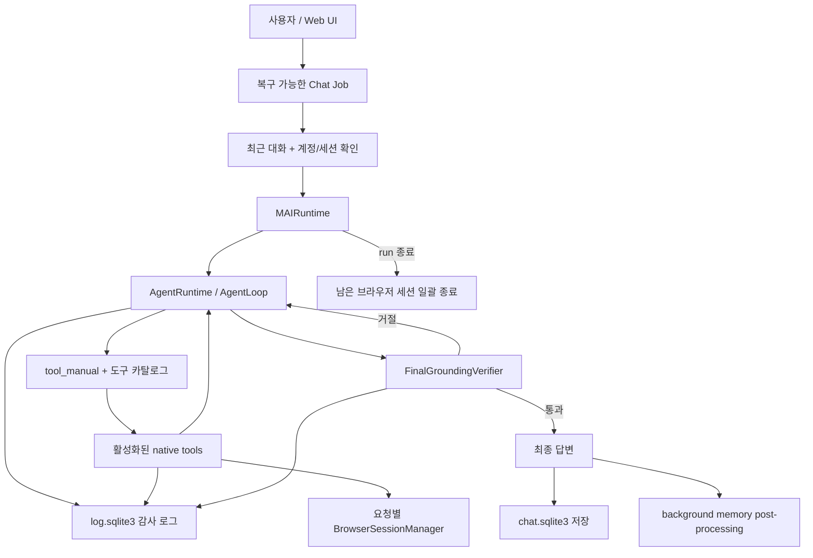
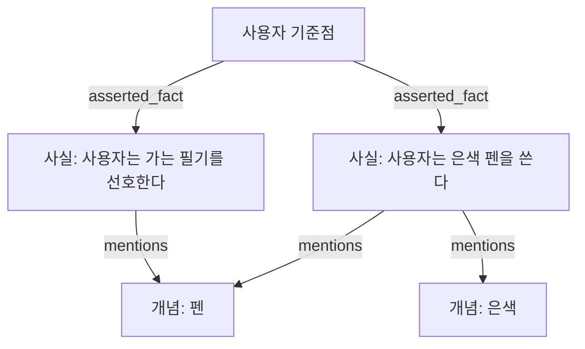

# MAI 전체 재구성 명세서

> MAI를 처음 접하는 사람이, 기존 코드를 복사하지 않고도 같은 구성과 주요 동작을 구현하기 위한 설명서.
>
> 갱신일: 2026년 11월 4일. 확인 대상: `FoggyCaligo/MAI_MyAI_sllm`의 `dev`, 커밋 `ef4833078349a3799881d2307b5d0e8b00164ee7`.
>
> 문장 분해기 알고리즘 설명의 별도 기준(이번 로컬 코드 대조에서 외부 저장소를 재검증하지 않음): `FoggyCaligo/Sentence_Breaker`, 커밋 `7243e45989b04000cf49825976be9801c44f438c`.

## 0. 이 문서를 어떻게 읽으면 되는가

이 문서에서 말하는 재구성은, 함수 이름과 파일 배치까지 똑같이 복제한다는 뜻은 아니다. 프로그램을 어떤 부분으로 나누는지, 각 부분이 무슨 정보를 받고 무엇을 내보내는지, 어떤 조건에서 다음 단계로 넘어가는지, 무엇을 기억으로 인정하는지를 재현한다는 뜻이다.

예를 들어 원래 코드는 파이썬으로 되어 있지만, 다른 언어로 만들어도 된다. 다만 도구가 실패했는데 성공한 것으로 바꾸거나, 모델이 쓴 문장을 사용자가 말한 사실처럼 저장하면 같은 MAI라고 보기 어렵다. 내부 구현은 바뀔 수 있어도 이런 동작의 의미는 유지해야 한다.

본문에는 세 가지 종류의 설명이 있다.

| 구분 | 의미 |
|---|---|
| 현재 구현 | 확인한 커밋의 실행 코드에서 실제로 일어나는 동작 |
| 설계 의도 | 프롬프트나 기존 설명에 적혀 있는 목표. 코드가 이를 완전히 보장한다는 뜻은 아님 |
| 재구현 권고 | 현재의 빈틈을 개선하고 싶은 경우의 선택지. 현재 구현과 동등한 재현에는 자동으로 포함하지 않음 |

이 구분은 중요하다. 현재 production 기본 경로는 `tool_manual` 기반 lazy native activation을 사용하고, verifier도 factual grounding과 선택적 answer-quality 단계로 분리되어 있다. 이 문서는 README의 개괄 문구보다 실제 composition root와 호출 관계를 우선해 작성했다. 의도적 절충과 남은 한계는 25장에 모았다.

또한 문서만으로 원래 모델의 모든 답변 문장을 동일하게 재생할 수는 없다. 모델 가중치, 실행 옵션, 과거 기억 데이터, 문장 분해기의 누적 데이터와 입력 순서가 결과에 영향을 준다. 이 문서의 목표는 **구조와 계약의 재현**이다. 기존 사용자의 기억까지 복원하려면 해당 데이터베이스도 별도로 있어야 한다.

큰 구조를 먼저 이해하려면 1~5장을 읽고, 실행기를 만들려면 6~11장, 기억을 만들려면 12~16장, 사용자에게 제공하는 앱까지 만들려면 17~21장을 읽으면 된다. 22~26장은 구현 순서, 예시, 검증, 제한과 근거다.

## 1. MAI는 무엇인가

MAI는 사용자의 컴퓨터에서 실행되는 개인 AI 프로그램이다. 사용자가 대화로 요청하면 언어 모델이 요청을 해석하고, 필요하면 기억·파일·계산기·웹·터미널 등의 도구를 사용한다. 마지막 답변은 바로 전달하지 않고 검증한다. 답변이 받아들여지면, 그 대화에서 나중에도 필요한 사실을 추려 장기기억에 저장한다.

언어 모델 자체가 기억 데이터베이스는 아니다. 모델을 교체하더라도 사용자의 기억은 별도의 SQLite 파일에 남는다. 모델은 매번 그 파일 전체를 읽는 것이 아니라, 필요한 경우 기억 도구를 호출해서 일부를 가져온다.

따라서 MAI는 크게 다음 다섯 가지가 결합한 프로그램이다.

1. 사용자의 요청을 받아 계정과 대화 문맥을 확인하는 웹 앱.
2. 언어 모델과 실제 도구 실행을 번갈아 진행하는 실행기.
3. 모델이 내놓은 답변을 근거와 비교하는 검증기.
4. 사실을 저장하고 다시 찾는 장기기억.
5. 파일 읽기, 검색, 계산, 터미널 실행 등을 수행하는 구체적인 도구들.

모델에게 “너는 기억할 수 있다”라고 지시하는 것만으로 기억이 생기는 것은 아니다. 실제 저장소, 검색 방식, 저장 허용 기준, 사용자 식별 방식이 있어야 한다. 마찬가지로 “파일을 수정했다”라는 문장을 생성하는 것과 실제 파일을 수정하는 것은 다른 사건이다. MAI는 이 차이를 프로그램의 구조에서 다룬다.

## 2. 처음 보는 사람을 위한 용어

| 용어 | 여기서의 뜻 |
|---|---|
| 모델 | 문맥을 보고 다음 응답 또는 도구 호출을 생성하는 언어 모델 |
| Ollama | 로컬에서 모델을 실행하고 MAI의 요청을 받는 별도 프로그램 |
| 실행기 | 모델을 호출하고, 도구를 실행하고, 결과를 다시 모델에게 주는 제어 프로그램 |
| 한 요청 | 사용자 메시지 하나를 받아 답변 또는 오류를 반환하는 전체 작업 |
| 한 모델 차례 | 선택한 로컬 백엔드의 대화 호출 한 번. 하나의 사용자 요청 안에 여러 번 있을 수 있음 |
| 도구 | 이름, 입력 규칙, 실제 처리 함수가 등록된 기능 |
| 도구 호출 | 모델이 자연어 대신 구조화된 이름과 인자를 반환하는 사건 |
| 입력 규격 | 어떤 필드가 필요하고 각 필드의 자료형·범위가 무엇인지 정의한 규칙 |
| 처리 함수 | 실제 파일·네트워크·계산 등의 작업을 수행하는 함수 |
| 후보 답변 | 아직 사용자에게 전달하지 않은 최종 답변 초안 |
| 근거 | 사용자 원문 중 직접 주장한 내용, 실제 도구 결과 등 사실을 뒷받침하는 자료 |
| 출처 식별자 | 답변 검증에서 근거를 가리키는 문자열. 현재 기억 추출 출력에는 출처 번호가 없음 |
| 노드 | 기억 그래프에서 사용자 기준점, 사실, 개념 등을 나타내는 항목 |
| 연결 | 두 노드의 관계를 나타내는 항목. 방향·관계 종류·출처 설명을 가짐 |
| 사용자 기준점 | 한 사용자의 기억이 시작되는 고정 노드. 코드 이름은 `anchor` |
| 사실 | 나중에도 사용할 수 있도록 정리한 기억 문장. 코드 이름은 `fact` |
| 개념 | 사실 문장을 분해해서 얻은 검색 좌표. 코드 이름은 `concept` |
| 원문 근거 | 사용자가 입력한 글을 보존한 별도 기록. 코드 이름은 `evidence` |
| 작업 그래프 | 이번 요청에서 가져온 기억을 모아 두는 임시 상태 |
| 색인 | 검색어로 기존 개념 노드의 번호를 찾는 보조 구조 |
| FTS5 | SQLite의 단어 기반 텍스트 검색 기능. 의미 임베딩 검색과 다름 |
| 비동기 작업 | 웹 연결과 분리하여 서버에서 계속 수행하는 작업 |
| `user_id` | 로그인할 때 입력하는 계정 이름 |
| `db_id` | 로그인 이름이 바뀌어도 유지하는 내부 사용자 식별자 |

이후에는 한국어 설명을 우선한다. 실제 구현에 필요한 필드 이름과 도구 이름만 원래 표기를 함께 사용한다.

## 3. MAI를 MAI답게 만드는 규칙

### 3.1 모델의 판단과 프로그램의 확인을 분리한다

무슨 도구가 필요한지는 모델이 판단한다. 그러나 도구 이름이 실제로 등록되어 있는지, 입력이 규격에 맞는지, 처리 함수가 실행되었는지는 프로그램이 확인한다.

예를 들어 “이전 계획을 기억해?”라는 요청에서 `memory_search`이 필요하다고 정하는 것은 모델의 의미 판단이다. 반면 `memory_search`이라는 처리 함수가 한 번도 실행되지 않았는데 실행되었다고 처리하는 것은 허용되지 않는다.

사용자 문장에 특정 단어가 들어 있으면 도구를 고르는 문자열 분기표는 현재 설계의 중심이 아니다. “주식”이라는 단어가 있다고 항상 시세 도구를 고르면, 과거 투자 취향을 묻는 질문과 현재 시세를 묻는 질문을 구별하기 어렵다.

### 3.2 자연어와 실제 실행을 섞지 않는다

모델이 “파일을 읽겠습니다”라고 적어도 도구 실행은 아니다. 모델 응답의 구조화된 `tool_calls`에 정확한 이름과 인자가 있어야 한다. 생각 내용이나 본문에서 명령처럼 보이는 문장을 찾아 실행하지 않는다.

### 3.3 실패는 실제 실패로 전달한다

없는 도구, 잘못된 인자, 네트워크 실패, 파일 오류, 명령의 비정상 종료를 빈 성공 결과로 바꾸지 않는다. 실패의 종류와 설명을 모델에게 전달해서 다른 방법을 선택하거나 실패를 설명할 수 있게 한다.

### 3.4 이전 답변은 사용자가 이미 안다는 증거가 아니다

비슷한 질문에 과거에 답했다는 이유로 내용을 생략하지 않는다. 또한 검증에서 거절된 내부 초안은 사용자에게 전달된 대화가 아니다. 모델이 초안을 참고할 수는 있지만 사실 근거나 과거 대화로 취급해서는 안 된다.

### 3.5 기억을 읽는 행위와 새로운 기억을 만드는 행위를 분리한다

“전에 쓰던 펜이 뭐였지?”라는 질문에 기존 기억을 읽었다고 해서, 그 기억을 새롭게 확인된 사실처럼 다시 저장하지 않는다. 읽기만으로 언급 횟수가 늘어나면 자주 검색한 정보가 자주 직접 말한 정보처럼 보이게 된다.

다만 “전에 쓰던 펜이 뭐였지? 지금은 다른 펜으로 바꿨어”라는 메시지는 새 사실을 포함한다. 기억 도구를 썼다는 이유만으로 전체 메시지를 버리지는 않는다.

### 3.6 현재 정보와 과거 기억의 우선순위를 구분한다

장기기억은 과거에 알았던 내용이다. 현재 사용자의 직접 진술이나 현재 도구 결과와 다르면 현재 정보를 우선한다. 현재 시각 역시 모델의 학습 시점에서 추정하지 않고 운영체제 시계를 사용한다.

### 3.7 검색 결과의 범위를 보존한다

일부 행을 읽은 것은 전체 표를 읽은 것이 아니다. 로컬 파일 수정은 원격 저장소 수정과 같지 않다. 도구의 성공은 그 도구가 보고한 범위의 성공이다. 더 넓은 완료 주장을 하려면 그 범위의 결과 근거가 있어야 한다.

### 3.8 반복을 제한하되 일을 많이 했다는 이유로 중단하지 않는다

정상적으로 진행 중인 도구 호출과 모델 차례에 고정 총횟수 상한을 두지 않는다. 대신 같은 호출이 같은 실패를 계속 내는지, 같은 결과 묶음이 그대로 반복되는지 등을 구조적으로 감시한다.

이 규칙은 무한 실행이 절대로 없다는 보장은 아니다. 다른 인자를 계속 생성하거나 빈약한 상태를 다르게 표현하는 반복은 구조 비교를 피할 수 있다. 현재 구현의 감시는 정확히 같은 구조의 반복에 집중한다.


## 4. 전체 구성과 상태의 수명

### 4.1 현재 production 구성 관계

현재 기본 경로는 별도 planner가 먼저 모든 도구 필요성을 결정하는 구조가 아니다. 기본값에서는 main agent가 첫 라운드에 받은 **도구 카탈로그와 `tool_manual`**을 보고 필요한 도구를 활성화하고, 다음 라운드부터 해당 native schema를 직접 호출한다.



도구 목록은 등록소의 구조적 메타데이터다. 모델은 문자열 규칙으로 도구 이름의 의미를 추측하지 않는다. 첫 라운드에는 상세 인자 schema가 전부 노출되지 않고, `tool_manual(tools=[...])`로 정확한 등록 이름을 활성화한 뒤 다음 라운드에 해당 schema가 추가된다.

현재 코드에는 별도 사전 planner, frozen required-tool 집합 또는 이를 켜는 설정 경로가 없다.

### 4.2 상태의 수명과 저장 위치

| 상태 | 수명 | 저장 위치/소유자 | 프로세스 재시작 후 |
|---|---|---|---|
| 계정 설정 | 설정 파일이 유지되는 동안 | `.env` | 유지 |
| 로그인 Bearer token | 로그인~로그아웃 또는 서버 종료 | 서버 메모리 | 유지 안 됨 |
| Web 대화 기록 | 삭제 전까지 | `CHAT_DB_PATH` / `web_chat_messages` | 유지 |
| 감사·디버깅 기록 | 삭제 전까지 | `LOG_DB_PATH` / `runs`, `steps` | 유지 |
| 장기기억 그래프 | 삭제 전까지 | `MEMORY_DB_PATH` | 유지 |
| 문장 분해기 이력 | 삭제 전까지 | `SENTENCE_BREAKER_DB_PATH` | 유지 |
| 업로드 파일 | 삭제/덮어쓰기 전까지 | 계정별 upload directory | 유지 |
| 음성 프로필 | 재등록/삭제 전까지 | `VOICE_PROFILE_DIR` | 유지 |
| resumable chat job 계산 상태 | 서버 프로세스 동안 | `ChatJobStore` | 유지 안 됨 |
| Working Graph | 사용자 요청 하나 | `MAIRuntime` | 유지 안 됨 |
| tool result 원문 | 사용자 요청 하나 | `ToolResultStore`; 별도 audit 원문은 DB에 보존 | 재열람 상태는 유지 안 됨 |
| Chromium browser session | 사용자 요청 하나 | `BrowserSessionManager` | 유지 안 됨 |
| 반복 guard / verifier retry 횟수 | 사용자 요청 하나 | `AgentLoop` | 유지 안 됨 |
| 모델 adapter / fact extractor cache | 서버 프로세스 동안 | `MAIRuntime` | 유지 안 됨 |

`chat.sqlite3`, `memory.sqlite3`, `log.sqlite3`는 역할이 다르다. 대화 DB는 사용자에게 보이는 대화 기록, memory DB는 장기기억 그래프, log DB는 감사·디버깅 기록이다. `log.sqlite3`의 내용은 agent나 memory 입력으로 다시 읽어 넣지 않는다.

### 4.3 같은 chat model을 여러 역할로 사용한다

현재 선택된 chat model은 역할에 따라 서로 다른 호출 방식으로 사용된다.

| 역할 | tools | think | 비고 |
|---|---|---|---|
| main agent | `tool_manual` + 활성화된 native tools | 기본 `True` | 실제 답변/도구 실행 |
| factual grounding reviewer | 없음 | `False` | claim/evidence/action outcome 검증; Python 숫자 대조가 불일치하면 같은 호출에 숫자 검토 통합 |
| answer quality reviewer | 없음 | `False` | factual pass 후 선택적 alignment/coverage 검증 |
| memory fact extractor | 없음 | `False` | 최종 답변 뒤 비동기 기억 추출 |

검증기는 외부 도구를 실행하지 않는다. 구조화된 `read_requests`로 성공한 기존 출처를 재열람할 수 있다. reviewer가 실패했다고 문자열 fallback으로 의미를 복원하지 않으며, 현재 구현은 retryable infrastructure/structured-output 오류를 최대 3회 재시도한 뒤에도 실패하면 그 실패를 상위로 전달한다.

`model_rounds`는 main `AgentLoop`의 라운드 수다. verifier와 memory extractor 호출 수는 포함하지 않는다.

## 5. 서버를 시작할 때 만드는 것

현재 기본 실행 진입점은 `run_server.py`다. 환경 설정을 읽고, 복구 가능한 대화 경로를 설치한 뒤, Uvicorn을 작업자 1개로 실행한다.

시작 시 다음 순서의 준비가 필요하다.

1. 환경 설정을 읽는다.
2. 소유자·체험 계정 설정을 검증한다.
3. 대화 기록 저장소를 연다. 정확히 알려진 옛 표 구조만 새 구조로 옮긴다.
4. 필요한 경우 옛 로그인 이름으로 저장된 대화 기록을 안정된 `db_id`로 옮긴다.
5. 기억 그래프 저장소를 연다.
6. 문장 분해기를 연다.
7. 개념 색인을 열고, 기존 개념 노드와 색인의 누락을 맞춘다.
8. 기억 검색 서비스와 기억 처리 조정자를 만든다.
9. 선택한 Ollama/llama.cpp 백엔드 연결과 모델별 adapter·사실 추출기 캐시를 준비한다.
10. 업로드 디렉터리를 만든다.
11. 설정된 경우 Tailscale Funnel을 시작한다.

소유자 계정이 하나도 없거나, 계정 이름과 내부 식별자가 충돌하면 시작을 실패시킨다. SQLite에 FTS5가 없으면 의미가 다른 검색으로 몰래 대체하지 않는다.

현재 메모리 객체와 로그인·작업 저장소는 한 프로세스 안에 있다. 따라서 작업자 수를 늘리는 것은 단순한 성능 옵션 변경이 아니다. 여러 프로세스가 같은 로그인·작업 상태를 공유하도록 다시 설계해야 한다.


## 6. 사용자 메시지 하나가 처리되는 실제 순서

### 6.1 Web job과 감사 로그를 먼저 만든다

기본 Web UI는 `POST /chat/jobs`로 resumable job을 만든다. 작업 시작 시 `LOG_DB_PATH`의 audit run도 함께 생성하고 사용자의 원문을 `user` role로 기록한다. 같은 `user_id`의 job은 lock을 사용해 순차 실행한다.

직접 `POST /chat` 경로도 감사 로그를 남기지만, 일반 화면은 resumable job 경로를 사용한다.

### 6.2 최근 대화와 현재 사용자 메시지를 분리한다

서버는 먼저 `SESSION_HISTORY_MESSAGES` 범위의 기존 대화를 읽고, 그 뒤 현재 사용자 메시지를 `chat.sqlite3`에 저장한다. 따라서 현재 메시지가 최근 문맥에 중복되어 main model에 두 번 들어가지 않는다.

모델에게 전달되는 대화 범위와 UI에 영구 저장된 전체 대화 기록은 동일한 개념이 아니다.

### 6.3 같은 사용자의 직전 memory 후처리를 기다린다

같은 `db_id`의 이전 응답에서 background memory write가 아직 끝나지 않았다면 다음 요청은 `asyncio.shield`로 그 작업을 기다린다. 직전 턴에서 새로 말한 사실이 바로 다음 질문의 recall에 반영되도록 하기 위한 순서 보장이다.

### 6.4 요청별 실행 상태를 만든다

각 요청마다 새로 만든다.

- `WorkingGraph`
- `ToolResultStore`
- `BrowserSessionManager`
- 계정 권한에 맞는 `ToolRegistry`
- 선택 chat model의 adapter와 `OllamaFactExtractor` 참조(모델별 캐시 재사용)

browser session은 요청 종료 시 성공/실패와 관계없이 `close_all()`로 정리한다.

### 6.5 authoritative runtime context를 주입한다

`AgentRuntime`은 도구 등록소의 model context와 `current_time()` 결과를 구조화 JSON으로 system context에 넣는다. 현재 시각, working directory, memory temporal precedence 같은 실행 환경 사실을 모델이 학습 지식이나 문자열 추측으로 대신하지 않게 한다.

### 6.6 기본 경로에서는 main agent가 직접 도구를 고른다

첫 main model round에는 상세 native tool schema 전체가 아니라 다음 두 가지가 제공된다.

1. 등록된 도구의 `name`과 `category` 카탈로그.
2. run-local activation tool인 `tool_manual` schema.

모델이 도구가 필요하다고 판단하면 예를 들어 `tool_manual(tools=["memory_search","web_search"])`처럼 정확한 이름을 활성화한다. 다음 round부터 그 도구들의 native schema가 추가되고 직접 호출할 수 있다. 활성화된 schema는 해당 run 동안 유지된다.

도구 사용 필요성은 본 모델이 판단하며, 사전에 required-tools 집합을 고정하는 단계는 없다.

### 6.7 도구 실행과 large-result pagination

활성화되지 않은 도구를 직접 호출하거나, 등록되지 않은 이름을 `tool_manual`에 넣거나, schema를 위반한 인자를 보내면 구조적 실패다. handler exception과 timeout도 실패로 기록한다.

큰 결과는 `ToolResultStore`가 bounded model view만 본문에 넣고 원문은 request-local store에 남긴다. 추가 범위가 필요하면 `tool_result_read`를 활성화하고 result id/offset/limit로 읽는다.

### 6.8 candidate final을 검증한다

도구 호출 없이 content가 나오면 candidate final로 취급한다.

1. 빈 답변 구조를 확인한다.
2. Python으로 숫자·날짜를 근거와 대조한다.
3. factual grounding과 action outcome을 검토한다. 숫자 대조에서 불일치한 값이 있으면 **같은 요청**에 숫자검증 지침을 추가하고 `numeric_verdict`·`numeric_reason`을 필수로 받는다.
4. numeric/factual/action 검사를 통과하고 `MAI_ANSWER_QUALITY_REVIEW=true`일 때만 answer-quality를 검토한다. 배포 설정은 `false`다.
5. 거절되면 본 모델의 교정 라운드로 돌아가며 새 후보도 처음부터 검증한다. 축별 재시도 예산이 소진되면 오류다.

거절된 초안은 factual evidence가 아니다. 본 모델에는 가장 최근 거절 초안과 피드백만 다시 넣으며 이전 초안들은 audit log에 남긴다.

### 6.9 최종 답변을 저장하고 memory 후처리를 예약한다

검증을 통과하면 `MAIRuntime`은 memory 후처리 비동기 작업을 예약한 뒤 실행 결과를 반환한다. Web 처리 계층이 그 결과의 assistant 답변을 persistent chat에 저장하고 job을 완료한다. 기억 작업 완료까지 기다린 뒤 답변을 공개하는 구조는 아니다.

후처리는 이번 사용자 원문, 직전 assistant 문맥, 현재 최종 답변, 성공한 비기억조회 실행의 최초 model-visible 결과를 사용한다. 현재 최종 답변은 문맥 전용이며 기존 기억 조회 결과는 새 근거에서 제외한다.

### 6.10 fatal failure

main loop가 최종적으로 실패하면 `AgentRunFailure`에 이미 관찰된 tool execution, model round 수, 마지막 rejected candidate를 포함한 failure context가 보존된다. Web job 경로는 이 오류를 숨기지 않고 failed 상태와 error message를 chat/audit에 남긴다. 마지막 verifier 거절 초안이 있다면 사용자가 “아무 답도 없었다”고 오해하지 않도록 failure detail에 함께 보여 줄 수 있다.


## 7. 도구 선택과 lazy native activation

### 7.1 production 기본은 별도 planner가 아니다

현재 실행 경로는 사용자 요청 전에 별도 planner를 호출하지 않는다. 본 모델이 **카탈로그 → `tool_manual` → native tool** 순서로 도구를 선택한다. 과거 planner 설정이나 클래스를 사용할 수 있는 경로도 현재 코드에 없다.

### 7.2 `tool_manual`의 계약

`AgentLoop`가 제공하는 run-local 도구다. `tools`로 정확한 등록 이름을 활성화하며 다음 라운드부터 schema를 제공한다. 한 번 활성화한 도구는 run 동안 유지한다.

`retain_evidence`에는 `{result_id, ranges: [{offset, length}]}`를 넣어 이미 관측한 원문의 필요한 부분을 선택한다. `tools=[]`로 발췌 선택만 수행할 수 있다. 선택 범위는 해당 결과의 기존 선택을 교체하며 빈 ranges는 선택을 지운다. 활성화와 발췌 변경은 검사를 모두 통과한 뒤 적용한다.

- 없는 이름: `UnknownToolError`
- 잘못된 입력 구조: `ToolArgumentsError`
- 아직 활성화하지 않은 실제 도구 호출: `ToolUnavailableInRoundError`
- 없는 결과 ID·겹치거나 범위를 벗어난 발췌·결과 예산 초과: 명시적 오류

별칭 추측이나 자연어 해석으로 실행 대상을 보정하지 않는다.

### 7.3 required-tool gate의 구현 범위

현재 required-tool gate는 구현되어 있지 않다. lazy activation은 schema 노출과 실제 호출 가능성을 제어하지만, 특정 사용자 요청에 반드시 어떤 도구를 쓰도록 강제하는 사전 계획 계약은 아니다.

## 8. 본 모델·도구 반복 실행기

### 8.1 한 round의 입력

각 main round는 다음을 조합한다.

- authoritative runtime context
- 기본 system policy
- 최근 대화와 현재 사용자 요청
- 도구 카탈로그
- `tool_manual`
- 이전 round에서 활성화된 native tool schema
- 필요한 경우 가장 최근 rejected candidate + correction contract
- 선택적 frozen required-tools 상태

모델의 자연어 본문이나 `<think>` 문자열을 파싱해 도구 호출로 바꾸지 않는다. Ollama native `tool_calls`만 실행 계약이다.

### 8.2 tool call 처리

tool call은 순서대로 실행하고 각 실행은 다음 정보를 남긴다.

- tool name
- arguments
- handler started 여부
- 성공/실패
- error type
- model-visible content
- 필요하면 large-result id

실패한 tool result도 model에는 실패로 전달한다. 실패를 빈 성공값으로 바꾸거나 특정 error string을 보고 임의의 semantic route를 선택하지 않는다.

### 8.3 감사 로그와 UI progress

resumable job에서는 observer callback으로 다음을 동시에 갱신한다.

- `model_think_step`: 모델 thinking
- `model`: candidate content와 tool_calls
- `tool_log`: tool 결과와 성공/실패
- `verifier_step`: rejection feedback 또는 final accepted

이 기록은 `log.sqlite3`에 append-only로 남고 model/memory context로 다시 주입되지 않는다.

### 8.4 rejected draft 격리

verifier가 candidate를 거절하면 그 candidate는 사용자에게 전달된 assistant message도, 사실 근거도 아니다.

다음 correction round에는 최신 rejected draft와 최신 verifier feedback만 system correction context로 다시 붙인다. 오래된 rejected draft/thinking/feedback는 model prompt에서 제거하되 audit log에는 남긴다.

unsupported claim마다 correction contract는 다음 둘 중 하나를 요구한다.

- **remove**: 근거가 있는 범위로 줄이거나 삭제
- **re-observe**: 해당 claim을 직접 확립하는 tool evidence를 새로 얻기

간접 목록, bounded history, 과거 rejected draft를 새 근거처럼 사용할 수 없다.

### 8.5 반복 guard

global `AGENT_MAX_ROUNDS`나 성공 호출의 고정 누적 상한은 없다. 동일 인자·동일 결과의 실패 streak, 같은 tool-round 결과, 같은 구조화된 verifier defect의 무진행 반복을 제한한다. 인자나 결과가 바뀌면 구조적 진전으로 본다.

배포 설정은 `AGENT_MAX_IDENTICAL_CALLS=3`, `AGENT_MAX_IDENTICAL_FAILURES=2`, `AGENT_MAX_NO_PROGRESS_ROUNDS=2`다. 이름과 달리 첫 키는 현재 동일 실패 경고 시점에 쓰며, 런타임은 `min(3, 2)=2`로 경고 시점을 정한다. 두 번의 동일 실패를 모델에게 보여준 다음 같은 호출을 다시 시도할 때 차단한다. 도구 라운드와 검증 defect의 동일 상태 반복에도 별도 무진행 검사를 적용한다.

guard는 tool 이름이나 오류 문구의 의미를 해석해 다른 기능으로 자동 우회하지 않는다.

### 8.6 empty final과 최종 failure context

content가 비어 있고 tool call도 없으면 한 번 구조적 재시도를 허용한다. 다시 빈 final이면 `EmptyFinalResponseError`다.

어떤 fatal exception이 발생하더라도 `AgentRunFailure`는 가능한 범위에서 이미 실행한 tool 기록, model round 수, 마지막 rejected draft를 `AgentFailureContext`에 보존한다. 실패를 성공 답변으로 바꾸는 별도 recovery agent는 현재 production contract의 핵심 경로가 아니다.

## 9. 도구 등록소와 실행 환경 정보

### 9.1 등록 자료

도구 하나는 이름, 설명, 입력 자료형, 처리 함수, 선택적인 제한 시간, 분류, 부가 정보를 가진다. 이름 중복은 시작 또는 등록 오류다.

모델에게는 다음 형태의 함수 규격을 제공한다.

```json
{
  "type": "function",
  "function": {
    "name": "calculator",
    "description": "도구 설명",
    "parameters": {
      "type": "object",
      "properties": {"expression": {"type": "string"}},
      "required": ["expression"],
      "additionalProperties": false
    }
  }
}
```

현재 입력 검증은 Pydantic의 엄격 모드다. 숫자처럼 보이는 문자열을 정수로 바꾸거나, 알 수 없는 추가 필드를 버리지 않는다. 실제 각 입력의 기본값은 채우지만 규격 위반을 강제 변환으로 고치지 않는다.

### 9.2 처리 함수 실행 방식

비동기 함수는 같은 이벤트 반복부에서 기다린다. 동기 함수는 작업 스레드로 넘긴다. 제한 시간이 설정되어 있으면 해당 호출의 대기를 제한한다.

단, 스레드 대기를 시간 제한으로 끝낸다고 실제 동기 함수가 반드시 중단되는 것은 아니다. 파일·네트워크 처리 자체의 취소 성질도 고려해야 한다. 터미널은 별도의 프로세스 종료 처리가 있어 일반 동기 함수와 다르다.

기억 도구는 비동기 래퍼로 등록한다. 내부 SQLite 작업을 작업 스레드로 넘기면 연결을 만든 스레드와 사용하는 스레드가 달라질 수 있기 때문이다. 현재 구현은 SQLite의 스레드 검사를 무조건 끄는 방법으로 해결하지 않는다.

### 9.3 모델에 알려 주는 실제 환경

도구 이름을 보고 운영체제나 셸을 추측하지 않게, 도구 등록 시 실행 환경을 별도 자료로 등록한다. 같은 환경 식별자를 중복 등록하면 오류다.

터미널은 실제 셸 경로, 셸 종류, 기본 작업 디렉터리, POSIX 문법 사용 여부를 선언한다. 기억 도구는 과거 기억보다 현재 사용자 메시지와 현재 도구 결과를 우선하라는 규칙을 선언한다.

이 자료는 본 모델 호출 앞의 시스템 메시지에 JSON으로 넣는다. 분류나 부가 정보는 의도 분기표가 아니다. 실제 환경에 대한 명시적인 선언이다.

### 9.4 본 모델 정책에 포함할 내용

본 모델 정책은 구성 요소를 설명하는 장식 문구가 아니라 실제 동작 지시다. 원래 영문과 문장 표현은 달라도, 재구현에서는 다음 의미를 유지해야 한다.

1. 현재 요청에 충분히 답한다. 이전에 비슷한 답을 했다는 이유로 사용자의 지식을 가정하거나 생략하지 않는다.
2. 실제 능력은 지금 제공한 도구로 판단한다. 학습된 일반적인 ‘언어 모델은 파일에 접근하지 못한다’는 가정으로 도구를 거절하지 않는다.
3. 사전 학습 지식은 추론에 사용할 수 있지만 사실 주장의 출처로 취급하지 않는다.
4. 현재 대화에 없는 필요한 정보는 사용 가능한 도구로 얻는다. 사용자 이력은 기억, 로컬 내용은 파일·코드·터미널, 이미지 내용은 이미지 도구, 공개 정보는 웹, 현재 한국 시세는 시장, 시간은 시계 도구를 사용한다.
5. 구조 문서도 `file_read`로 읽는다. 실제 공개된 도구 이름과 내부 보조 함수 이름을 혼동하지 않는다.
6. 큰 결과에 번호와 범위가 있으면 생략된 내용을 추정하지 말고 필요한 범위를 후속 읽기로 얻는다.
7. 사용자와 도구의 사실값을 그대로 보존한다. 명시적인 변환 요청 없이 반올림·재해석·정규화하여 다른 값으로 바꾸지 않는다.
8. 원래 관찰과 계산 결과를 구분한다. 매매 이익이 났다는 것만으로 별도로 정한 목표가에 도달했다고 주장하지 않는다.
9. 비슷한 이름의 지표·다른 화면·기간을 서로 바꿔 쓰지 않는다. 차이의 원인을 정의·산식·근거 없이 만들어 내지 않는다.
10. 답변에 중요한 산술은 계산기에서 수행한다. 합계·차이·수익률·비율·가중값·목표 차이를 암산으로 대체하지 않는다.
11. 체험 쓰기 도구의 업로드 경계를 존중한다. 제공됐다는 이유로 임의 로컬 경로를 수정할 수 있다고 말하지 않는다.
12. 도구 결과를 지어내지 않는다. 실패는 실제로 취급하고 요청에 중요한 실패를 최종 답변에 설명한다.
13. 사용자에게 전달하는 답변만으로 요청 결과를 이해할 수 있어야 한다. 내부 실행 출력·로그를 이미 사용자가 읽었다고 가정하지 않는다.

이 규칙에 대한 준수는 프롬프트의 영향과 구조 검증을 함께 통해 얻는다. 모든 지시가 별도의 결정론적 검사로 강제되는 것은 아니다.

## 10. 큰 도구 결과를 전달하는 방법

### 10.1 원문과 모델 입력

Production은 일반 도구 결과를 크기에 관계없이 `ToolResultStore.capture()`에 보관한다. 원문은 immutable 문자열이며 run-local `result_id`와 SHA-256을 가진다. 본 모델에는 최초 bounded page를 한 라운드 보여준다.

배포 `settings.yaml`은 `MAX_INLINE_TOOL_RESULT_CHARS=8000`이다. `MAIRuntime`을 직접 구성하고 환경변수도 없으면 내부 기본값은 10,666이다. `ToolResultStore`는 최소 1,024자를 요구하며 `max_read_chars = max_inline_chars - 512`이므로 배포 설정의 읽기 상한은 7,488자다. 메타데이터를 포함한 결과가 예산을 넘으면 실제 본문은 더 작아질 수 있다. 단위는 Python Unicode 문자이며 토큰·UTF-8 바이트가 아니다.

### 10.2 페이지와 발췌

최초 페이지 첫 줄의 JSON에는 `result_id`, `total_chars`, `offset`, `returned_chars`, `next_offset`, `complete`, `max_read_chars`, `pagination`을 담는다. 후속 범위는 계산으로 추측하지 말고 반환된 `next_offset`을 사용한다.

본 모델이 `tool_manual.retain_evidence`로 `{result_id, ranges: [{offset, length}]}`를 선택하면 다음 문맥에 해당 원문 그대로의 발췌와 참조만 남긴다. 선택이 없으면 발췌는 비어 있고 원문 참조만 남는다. 별도 요약 LLM은 호출하지 않는다.

### 10.3 원문 재열람과 감사 기록

본 모델은 `tool_result_read(result_id, offset, limit)`로 원문을 읽는다. 읽은 페이지는 같은 원본 ID에 속하며 새 관측으로 중첩 저장하지 않는다. factual verifier도 같은 선택 발췌로 시작하고 필요하면 구조화된 `read_requests`로 성공한 기존 출처를 재열람한다. 외부 도구를 다시 실행하지 않는다.

기억 추출은 최종 발췌 대신 성공한 비기억조회 실행의 최초 `context_content`를 사용한다. audit의 `tool_log`에는 동기·분리된 Web job 모두 원문 전체와 `result_id`를 저장하지만 이 로그를 모델에 자동 주입하지 않는다. 요청이 종료되면 해당 run의 재열람 상태는 끝난다.

### 10.4 도구 내부의 잘림

도구가 파일을 `max_chars`에서 잘랐을 수 있고 반환 문자열을 전달 계층에서 다시 나눌 수 있다. 재열람은 도구가 반환한 문자열까지만 복원한다. 원본 파일에서 도구가 읽지 않은 나머지는 다시 도구로 요청해야 한다. `truncated`, 결과 페이지의 `complete`, collection metadata의 범위는 각각 구분한다.

상세 필드와 collection 계약은 [TOOL_RESULT_PAGINATION.md](TOOL_RESULT_PAGINATION.md)를 참고한다.

## 11. 후보 답변 검증

현재 `FinalGroundingVerifier`는 Python 숫자 대조, 숫자검증을 필요에 따라 통합한 factual review, 선택적 quality review 순서로 동작한다. 후보를 직접 고쳐서 반환하지 않고 본 모델에 교정을 요청한다.

### 11.1 숫자와 사실 근거

Python은 후보의 숫자·날짜를 사용자 메시지, 성공한 원문 도구 결과, 이전 승인 대화의 값과 대조한다. 단순 토큰 대조가 실패하면 같은 factual 요청에 숫자의 의미적 동등성 지침과 대상 값을 추가한다. 이때 응답에 `numeric_verdict`와 `numeric_reason`이 필수다. 별도 숫자검증 LLM 호출은 없다. Python 예외를 의미 검토로 덮지 않는다.

factual reviewer는 claim별 `supported | unsupported | uncertain`, defect(`none | scope_expansion | contradiction | unsupported_inference | missing_evidence`), 전체 `evidence_verdict`, `action_verdict`, reasons와 retry summary를 반환한다. 표현·번역 차이가 의미와 지시 대상을 보존하면 모순으로 취급하지 않는다.

사용자 원문, 성공한 관측 도구 결과, authoritative runtime clock, 이전에 승인된 대화가 근거다. 이전 승인 답변은 당시 알려진 상태의 근거이며 변하는 외부 상태가 지금도 같다는 증거는 아니다. 후보·거절 초안·검증 피드백은 근거가 아니다.

### 11.2 reviewer 입력과 재열람

현재 요청은 최대 4,000자, 후보는 최대 6,000자로 전달한다. user/assistant 대화 문맥, 사용자 메시지 근거 목록, 이전 승인 대화도 별도 필드에 들어가므로 필드 간 중복이 있다. 모든 입력에 하나의 고정 총량 제한을 적용하는 구조는 아니다.

성공한 실제 관측만 원래 실행 순번의 `tool:<index>`로 제공한다. 실패 실행과 `tool_manual`, `tool_result_read`는 새 관측에서 제외한다. 최초 입력은 원문 발췌·참조이며 reviewer는 `read_requests` 또는 최종 `review`를 구조화된 응답으로 선택한다.

재열람은 성공한 출처만 허용한다. 같은 요청 묶음의 중복·중첩 범위는 정리하고 아직 제공하지 않은 원문만 추가한다. 전부 이미 받은 범위면 `already_provided` 상태를 명시하며, 새 문자가 없는 라운드가 두 번 연속이면 `ReviewerEvidenceReadError`다. 새 문자가 추가되면 이 진행 예산은 초기화한다. 없는/실패한 출처와 잘못된 범위는 즉시 오류다.

### 11.3 action과 선택적 quality

도구 성공은 해당 도구 계약의 성공 근거다. 더 넓은 완료를 주장하려면 같은 범위의 resulting-state evidence가 필요하다.

`MAI_ANSWER_QUALITY_REVIEW=true`이고 numeric/factual/action을 통과해야 별도 quality 검토를 한다. 배포 설정은 `false`다. quality는 요청·대화 문맥·후보·factual 요약을 받으며 원문 도구 로그 전체는 받지 않는다. 정합성과 이미 관측한 중요한 정보의 누락을 검토하며, 더 조사할 가능성 자체를 coverage 실패로 판단하지 않는다.

### 11.4 교정 예산과 장애

본 모델의 교정 예산은 numeric 2회, coverage 2회, semantic 기본 2회, evidence/action 5회다. 소진 뒤에도 통과하지 못하면 오류이며 해당 검증을 끄고 답변을 통과시키지 않는다.

reviewer의 timeout·provider·필수 structured-output 오류에는 별도 최대 3회 시도 예산이 있다. 유효한 supported/unsupported 판정을 재추첨하지 않는다. 실패가 지속되면 원래 오류를 전파하며, 마지막 후보는 검증 미통과 진단으로만 보존한다.

### 11.5 선택적 출처 메타데이터

claim의 `evidence_refs`는 `source_id`, `location`, 짧은 원문 `quote`를 가질 수 있다. 이는 선택적 보조 자료다. 잘못된 개별 참조는 경고와 함께 제외하며 이것만으로 사실 판정을 바꾸거나 HTTP 오류·재시도를 만들지 않는다. 필수 verdict/schema 계약과 선택적 메타데이터의 처리를 구분한다.

세부 응답 형태, 인용 검증 범위, 한계는 [verifier.md](verifier.md)를 따른다.

## 12. 장기기억의 데이터 구조

### 12.1 세 종류의 실제 생산 노드

현재 새 기억은 사용자 기준점, 사실, 개념으로 만들어진다.



이 그림의 분해 결과는 이해를 위한 가상 예시다. 실제 문장 분해기는 사전이나 띄어쓰기만으로 나누지 않으므로, 반드시 ‘펜’과 ‘은색’으로 나뉜다는 뜻은 아니다.

사용자 원문은 별도 `evidence` 표에 있다. 원문을 생산 그래프의 발화 노드로 다시 만드는 것은 현재 후처리 경로에 없다. `utterance` 노드 종류와 생성 함수는 옛 데이터·하위 호출을 위해 남아 있다.

### 12.2 노드의 정체성

노드 번호와 노드의 정체성 문자열을 구분한다. 번호는 데이터베이스가 할당한 정수다. 정체성 문자열은 같은 항목인지 판단하는 키다.

| 종류 | 정체성 키 | 본문 | 부가 자료 |
|---|---|---|---|
| 기준점 | `anchor:user:<db_id>` | `user_anchor::<db_id>` | 사용자 내부 식별자 |
| 사실 | `fact:<db_id>:<양끝 공백 제거한 사실 문장>` | 사실 문장 | 사용자 내부 식별자 |
| 개념 | `concept:<양끝 공백 제거한 분해 조각>` | 분해 조각 | 기본 빈 객체 |
| 옛 발화 | `utterance:evidence:<원문 번호>` | 원문 | 사용자, 원문 번호, 발화자 |

같은 사실 문장이라도 사용자 내부 식별자가 다르면 다른 사실 노드다. 반면 같은 개념 문자열은 사용자 간에도 하나의 개념 노드를 공유한다.

정체성 비교는 정확한 문자열 일치다. 비슷한 뜻이라고 하나의 노드로 합치지 않는다. ‘은색 펜을 쓴다’와 ‘실버 펜을 사용한다’는 그래프 차원에서는 다른 사실일 수 있다. 사실 추출기에 의미 중복을 줄이라는 지시가 있지만, 저장소가 의미 중복을 보장하여 제거하는 것은 아니다.

이미 있는 사실·개념을 다시 저장하면 번호와 생성 시각은 유지하고, 등장 횟수를 1 올리고, 마지막 관찰 시각을 갱신한다. 기존 기준점을 확인하는 것은 등장 횟수를 올리지 않는다. 조회 역시 등장 횟수를 올리지 않는다.

등장 횟수는 진실의 확률이나 중요도의 직접 측정값이 아니다. 같은 정확한 저장 문장이 다시 받아들여진 횟수다.

### 12.3 연결의 규칙

현재 생산 경로의 연결은 다음 두 가지다.

| 출발 | 도착 | 관계 | 출처 설명 |
|---|---|---|---|
| 사용자 기준점 | 사실 | `asserted_fact` | `user_assertion` |
| 사실 | 개념 | `mentions` | `fact_index` |

같은 출발 번호, 도착 번호, 관계 조합은 한 연결만 존재한다. 중복 삽입은 기존 연결을 재사용한다. 최초 출처 설명과 생성 시각을 새로운 삽입으로 덮어쓰지 않는다.

연결 의미는 모델이 즉석에서 만든 문장이 아니다. 저장 함수가 위처럼 정해진 종류를 사용한다. 다만 현재 SQL은 관계 문자열을 모든 경우에 제한된 열거형으로 검증하지는 않는다. 생산 경로의 고정 사용과 데이터베이스 자체의 제약을 구별해야 한다.

### 12.4 실제 기억 표의 핵심 정의

아래 정의는 독립 구현에서 그대로 사용할 수 있는 현재 핵심 표 구조다.

```sql
PRAGMA foreign_keys = ON;

CREATE TABLE IF NOT EXISTS nodes (
    id INTEGER PRIMARY KEY AUTOINCREMENT,
    identity_key TEXT NOT NULL UNIQUE,
    node_type TEXT NOT NULL
        CHECK (node_type IN ('anchor', 'utterance', 'fact', 'concept')),
    canonical_text TEXT NOT NULL,
    payload_json TEXT NOT NULL DEFAULT '{}',
    occurrence_count INTEGER NOT NULL DEFAULT 1
        CHECK (occurrence_count >= 1),
    created_at TEXT NOT NULL,
    last_seen_at TEXT NOT NULL
);

CREATE TABLE IF NOT EXISTS user_anchors (
    user_id TEXT PRIMARY KEY,
    node_id INTEGER NOT NULL UNIQUE REFERENCES nodes(id) ON DELETE CASCADE
);

CREATE TABLE IF NOT EXISTS evidence (
    id INTEGER PRIMARY KEY AUTOINCREMENT,
    kind TEXT NOT NULL,
    content TEXT NOT NULL,
    created_at TEXT NOT NULL
);

CREATE TABLE IF NOT EXISTS edges (
    id INTEGER PRIMARY KEY AUTOINCREMENT,
    from_node_id INTEGER NOT NULL REFERENCES nodes(id) ON DELETE CASCADE,
    to_node_id INTEGER NOT NULL REFERENCES nodes(id) ON DELETE CASCADE,
    relation TEXT NOT NULL,
    provenance TEXT NOT NULL,
    created_at TEXT NOT NULL,
    UNIQUE(from_node_id, to_node_id, relation)
);

CREATE INDEX IF NOT EXISTS idx_nodes_type ON nodes(node_type);
CREATE INDEX IF NOT EXISTS idx_nodes_text ON nodes(canonical_text);
CREATE INDEX IF NOT EXISTS idx_edges_from ON edges(from_node_id);
CREATE INDEX IF NOT EXISTS idx_edges_to ON edges(to_node_id);
CREATE INDEX IF NOT EXISTS idx_edges_relation ON edges(relation);

CREATE TABLE IF NOT EXISTS memory_concept_exact (
    node_id INTEGER PRIMARY KEY,
    canonical_text TEXT NOT NULL UNIQUE
);

CREATE VIRTUAL TABLE IF NOT EXISTS memory_concept_fts
USING fts5(canonical_text, tokenize='unicode61');
```

기억 시각은 시간대가 있는 UTC ISO 문자열이다. 색인에서는 FTS의 `rowid`를 실제 개념 노드 번호와 같게 둔다. 색인 표가 새 사실의 정체성을 결정하지 않는다. 그래프 저장소가 만든 개념 번호를 색인에 넣는다.

현재 `evidence` 표에는 `db_id` 열이 없다. 현재 사실의 payload에도 원문 번호나 검증 출처 번호 목록이 없다. 원문은 남지만 어떤 사실이 어느 원문·도구에서 왔는지 완전한 대응이 영구 저장되는 구조는 아니다. 이것은 재구현할 때 반드시 인지해야 하는 현재 한계다.

‘원문이 불변’이라는 표현은 현재 API가 원문을 수정하지 않고 삽입하여 보존한다는 계약이다. SQL 트리거로 수정·삭제를 절대 금지한 표라는 뜻은 아니다.

## 13. 문장 분해기까지 다시 만드는 방법

### 13.1 역할과 상태

Sentence_Breaker는 사실 문장을 개념 조각으로 나누기 위한 별도 구성 요소다. 모델 토큰화, 한국어 형태소 분석, 기억 그래프 전체와 같지 않다. 입력된 문자들의 연결 경로를 누적하고 다음 문장에서 과거와 일치하는 연속 경로를 찾는다.

공백과 문장부호도 문자로 취급한다. 중요한 특징은 **분해가 읽기만 하는 함수가 아니라는 것**이다. 기존 이력으로 분해한 뒤 현재 입력의 문자 경로를 누적 저장한다.

MAI는 반환된 조각 중 공백뿐인 조각을 버린다. 그래프에 넣을 때 조각 양끝 공백을 제거한다. 조각 내부 공백은 그대로 남는다.

### 13.2 별도 데이터베이스

| 표 | 핵심 필드 | 의미 |
|---|---|---|
| `alph_nodes` | `alph` 기본키, 생성 시각 | 관찰된 문자 하나 |
| `sentence_layers` | `sentence_id` 기본키, `char_length`, 생성 시각 | 입력 한 번의 고유 층 |
| `alph_links` | 번호, `source_alph`, `target_alph`, `sentence_id`, `position`, 생성 시각 | 그 입력에서 인접 문자가 이어진 위치 |

문자 쌍, 입력 번호·위치, 출발 문자·입력 번호에 색인을 만든다. 같은 문자를 여러 번 본다고 문자 노드를 복제하지 않는다. 그러나 같은 문자 연결이라도 새로운 입력에서는 새로운 연결 행을 넣는다. 입력별 연속 경로를 구별해야 하기 때문이다.

입력 번호는 `sentence-<UUID>` 형태다. 본 알고리즘에 숫자 순서가 필요한 것은 아니다. 각 입력의 경로를 구별할 수 있는 고유 번호면 된다.

### 13.3 각 문자 쌍의 일치 후보를 구한다

입력 문자열을 `c[0]`, `c[1]`, …, `c[n-1]` 문자 배열로 만든다. 각 위치 i에 대해 과거 저장소에서 `c[i] → c[i+1]`과 같은 연결을 찾는다.

그 결과를 `step_matches[i]`라는 집합으로 보관한다. 각 원소는 `(과거 입력 번호, 과거 위치)`다. 같은 문자 쌍이라는 것만으로 충분하지 않고, 같은 과거 입력의 위치가 연속하여 진행되는지 확인해야 한다.

### 13.4 연속 범위를 지원하는 경로 수를 센다

현재 입력의 `[start, end)` 범위가 2자 이상일 때 다음을 한다.

1. 첫 문자 쌍의 후보 집합을 생존 집합으로 둔다.
2. 다음 문자 쌍으로 진행할 때 `(입력 번호, 위치 + 1)`이 다음 후보 집합에도 있는 상태만 남긴다.
3. 어느 단계에서든 생존 집합이 비면 이 범위의 지원 수는 0이다.
4. 마지막 문자 쌍까지 남은 상태 개수가 지원 수다.

따라서 여러 과거 입력의 관계없는 문자 쌍들을 이어 붙여 하나의 범위를 지원한다고 판단하지 않는다. 같은 입력 층에서 위치가 이어져야 한다.

현재 코드는 서로 다른 입력 층의 개수만 세는 것이 아니라 살아남은 `(입력 번호, 위치)` 상태 수를 센다. 한 과거 입력에 같은 부분 문자열이 여러 위치에서 나오면 여러 상태가 지원 수에 들어갈 수 있다.

### 13.5 동적 계획법으로 최종 분해를 선택한다

문자열 끝에서 시작 쪽으로 각 위치의 최적 분해를 계산한다. `best[n]`은 빈 나머지이고 점수·지원된 문자 수·조각 수는 0이다.

각 시작 위치에서 먼저 문자 하나를 단독 조각으로 두는 후보를 만든다. 이 문자는 추가 지원 점수를 받지 않는다. 그 다음 길이 2 이상인 모든 끝 위치를 확인하여, 지원 수가 0이 아닌 범위만 더 긴 후보로 만든다.

길이 L, 지원 수 K인 조각의 추가 점수는 `K × L`이다. 이 점수에 뒤쪽 최적 분해의 점수를 더한다. 선택 비교 순서는 다음 네 값의 사전식 비교다.

1. 전체 지원 점수가 큰 쪽.
2. 전체 지원된 문자 수가 큰 쪽.
3. 현재 선택 조각의 길이가 긴 쪽.
4. 전체 조각 수가 적은 쪽.

정확히 같으면 현재 선택을 유지한다. 끝 위치를 짧은 것부터 순서대로 보므로 동점 처리도 재현에 영향을 준다.

선택한 조각마다 다음 위치를 보관하고, 시작 위치 0에서 그 다음 위치를 따라가며 결과 리스트를 만든다.

### 13.6 현재 입력을 나중에 학습한다

분해를 계산한 **뒤에** 현재 입력의 문자를 저장한다. 현재 문장 자체로 자신의 모든 범위를 지원하게 만들면 첫 입력부터 전체 문장이 하나로 선택될 수 있으므로 순서가 중요하다.

완전히 빈 데이터베이스에 `엄마`를 처음 넣으면 이전 경로가 없어서 한 문자씩 나뉜다. 그 입력이 저장된 뒤 `엄마가`를 넣으면 기존 `엄마` 경로가 더 긴 조각 후보가 된다. 정확한 결과는 다른 누적 경로의 지원 점수에 따라 달라질 수 있다.

### 13.7 재현에 필요한 것과 개선 가능성

같은 분해 코드를 써도 누적 DB와 입력 순서가 다르면 개념 조각이 다르다. 기존 기억과 호환하려면 기존 문장 분해 DB도 보존해야 한다. 현재 MAI는 명시적으로 자기 데이터 경로를 전달하므로, 외부 패키지 기본 DB가 자동으로 복사되어 들어오는 것으로 생각하면 안 된다.

현재 동적 계획법은 여러 범위에 대해 지원 경로를 반복 확인한다. 매우 긴 입력과 많은 일치 경로에서는 계산량이 커질 수 있다. 지원 수 계산을 캐시하거나 경로를 한 번씩 연장하는 최적화는 가능하지만, 점수·동점·입력 후 학습 규칙은 보존해야 한다.

외부 설계 문서에 제안된 경계 일관성 점수나 별도 학습 묶음 표는 확인한 실행 코드에 없다. 현재를 재현하려면 위 네 가지 비교 규칙을 사용한다.

## 14. 기억을 검색하고 넓히는 방법

### 14.1 정확 일치와 FTS5

개념 색인을 열 때 `memory_concept_exact`를 읽어 `개념 문자열 → 노드 번호` 사전을 만든다. 이것이 정확 일치 검색이다.

정확 일치가 충분하지 않으면 FTS5의 어휘 검색을 사용한다. 검색 문자열 전체를 따옴표로 감싼 구문으로 만들고 내부 따옴표를 이스케이프한다. FTS 문법을 사용자가 임의로 삽입하는 것을 막고 온전한 검색 조각을 조회한다.

FTS5 결과는 BM25 값이 작은 순서, 그 다음 노드 번호 순서로 정렬한다. 모델에 제공되는 검색 점수는 BM25 수치 자체가 아니다. 정확 일치는 1.0, 어휘 검색은 순위 r에 대해 `0.5 / r`다. 같은 조회 결과에서 정확 일치가 먼저다.

이 색인은 의미 벡터나 모델별 임베딩을 사용하지 않는다. 모델을 바꾼다고 임베딩 전체를 다시 만들 필요가 없다. 반면 동의어·다른 표현·한국어 조사 변형을 의미상 자동으로 찾는 기능을 보장하지도 않는다.

### 14.2 시작 시 색인을 맞춘다

그래프의 영구 개념 노드 중 색인에 없는 것은 정확 표와 FTS 표에 추가한다. 같은 개념 문자열이 다른 번호에 연결되어 있거나 같은 번호의 텍스트가 다르면 오류다. 누락된 FTS 행은 보완하지만 정체성 충돌을 조용히 합치지 않는다.

옛 벡터 색인 표가 남아 있어도 현재 검색에 사용하지 않는다. 그렇다고 시작 시 몰래 삭제하지도 않는다.


### 14.3 `memory_search(keyword, limit=None)`의 실제 알고리즘

현재 `RecallService.recall_query()`는 다음 순서를 따른다.

1. `query.strip()`이 비어 있으면 실패한다.
2. 현재 `user_id`의 anchor를 찾는다. 없으면 실패한다.
3. query를 **공백 기준 chunk**로 나누고 같은 chunk를 중복 제거한다.
4. 각 chunk마다 Concept FTS index에서 최대 `concept_limit`개의 후보를 가져온다. 기본 `concept_limit`은 12다.
5. 같은 Concept node가 여러 chunk에서 잡히면 더 높은 score를 남긴다.
6. Concept 후보를 score 우선으로 다시 정렬하고 전체 seed를 `concept_limit`개로 제한한다.
7. 각 seed Concept의 one-hop neighborhood에서 현재 `user_id` 소유 Fact만 모은다.
8. 하나의 Fact가 여러 Concept과 연결되면 그 Fact의 score는 연결된 seed 중 가장 높은 score를 사용한다.
9. Fact를 score 내림차순으로 정렬한다. 동점은 안정적인 encounter order로 정한다.
10. `limit`이 있으면 **이 최종 Fact 순위에** 적용한다.
11. 각 선택 Fact에서 현재 user anchor까지 shortest path가 존재하는지 확인하고, model-visible working graph에는 anchor와 Fact만 합친다.

즉 `memory_search(keyword="주제", limit=5)`는 “Concept 후보를 5개만 찾는다”는 뜻이 아니라 **관련성 순으로 최종 Fact를 최대 5개 반환한다**는 뜻이다.

현재 recall query 자체에는 Sentence_Breaker를 다시 적용하지 않는다. Sentence_Breaker는 저장 시 Concept canonicalization 쪽에서 사용되고, recall entry는 whitespace chunk + lexical Concept index 검색을 사용한다.

검색 결과가 비거나 약하다는 것은 “기억이 없다”는 증명이 아니다. query 표현을 바꾸거나 관련 node를 `memory_search`로 확장할 수 있다.

### 14.4 1단계 이웃과 최단 경로

1단계 이웃은 해당 노드에서 나가거나 들어오는 모든 연결과 양끝 노드를 읽는 것이다. 연결 번호 순서로 읽고 노드는 번호로 모은다.

최단 경로는 너비 우선 탐색을 사용한다. 경로를 찾는 동안에는 연결 방향을 무시한다. 그러나 반환하는 연결의 원래 방향·관계·출처 설명은 바꾸지 않는다. 방문 기록과 이전 노드·연결 번호를 보관하여 목적지에서 시작점으로 되짚는다.

최단 경로는 1단계 이웃만 보는 것과 다르다. 여러 단계를 지나 기준점까지 도달할 수 있다. 현재 구현에는 최단 경로 탐색 깊이의 별도 고정 상한이 없다. 명시적 확장의 이웃 단계와 경로 복원 범위를 구별해야 한다.

### 14.5 `memory_search(node_id)`

일반 노드는 one-hop과 각 이웃의 현재 사용자 anchor까지 경로를 작업 그래프에 합치고 이번 결과만 반환한다. 자신의 anchor는 기본 5개 Fact 문맥만 반환하고 다른 사용자 anchor는 거부한다.

내부 그래프에는 Concept·연결·옛 Utterance가 있을 수 있지만 `model_snapshot()`에는 Fact/Utterance만 표시한다. 더 먼 주변은 추가 명시적 호출로 읽는다. `node_id`에는 `keyword`나 `limit`을 함께 지정할 수 없다.

### 14.6 `memory_search(limit)` 최근 목록

native 호출은 `memory_search(limit=N)`이며 내부 메서드 `MemoryRuntime.memory_overview`가 처리한다. `keyword`·`node_id`를 모두 생략하면 `limit`을 반드시 명시해야 하고 범위는 1~50이다. 기본 8개나 12개로 자동 선택하지 않는다.

현재 사용자 anchor에 `spoke`·`asserted_fact`로 직접 연결된 기억을 `last_seen_at DESC, id DESC`로 읽는다. 예전 Utterance도 나타날 수 있다. 이 모드는 작업 그래프에 합치는 대신 자체 목록을 반환한다.

### 14.7 작업 그래프의 구조

내부 `snapshot()`에는 노드·연결 사전과 확장한 중심 번호 집합이 있다. 여러 조회를 누적하되 매 호출의 결과를 따로 반환한다.

모델용 `model_snapshot()`에는 `nodes`만 있으며 Fact/Utterance의 `node_id`, `node_type`, `data`, `created_at`, `provenance`, `evidence_id`를 담는다. Concept·anchor·edges는 출력하지 않는다. 새 Fact는 원문 Evidence와 연결하지 않으므로 `evidence_id`가 보통 비어 있다.

### 14.8 현재 사용자 격리의 한계

주제 검색은 Concept 주변 Fact의 `payload.user_id`를 현재 사용자와 비교하여 필터링한다. 최근 목록은 자신의 anchor에서 읽고 다른 사용자 anchor 직접 확장은 차단한다.

그러나 일반 노드 확장의 모든 이웃과 경로에 동일한 소유권 필터가 적용되는 것은 아니다. 공유 Concept와 일반 확장까지 완전한 다중 사용자 격리가 보장된다고 설명해서는 안 된다. 추가 격리는 현재 구현과 별도의 코드 변경 사항이다.

## 15. 답변 후 무엇을 기억으로 인정하는가

### 15.1 실제 입력과 출력

현재 추출기는 `latest_user_message` 전체, `previous_assistant_message`, `assistant_final_answer`, `successful_tool_results`를 받는다. 별도 사용자 발췌 선별기, `allowed_fact_sources` 목록, 검증된 최종 주장별 출처 번호 전달 단계는 없다.

출력은 정확히 `{"facts": [string, ...]}`다. 추가 필드·잘못된 타입·빈 문장은 실패다. 앞뒤 공백과 동일 문자열 중복을 정리한다. `source_refs`를 받거나 확인하는 계약은 없다.

### 15.2 근거와 승인 범위

최신 사용자 메시지가 기본 근거다. 사용자가 이전 설명에 폭넓게 동의하면 이번 메시지 전에 존재한 직전 assistant 답변의 같은 주제 사실을 채택할 수 있다. 명시적 정정·범위 축소를 우선한다. 사용자 메시지 뒤에 만들어진 현재 최종 답변에는 승인을 적용하지 않는다. 현재 최종 답변은 문맥 전용이다.

성공한 실행 중 `memory_search`만 제외하여 도구 입력을 만든다. 현재 기억 admission 필터는 `tool_manual`·`tool_result_read`를 별도로 제외하지 않는다. 각 실행의 최초 `context_content`를 주며 최종 선택 발췌나 저장된 원문 전체를 몰래 추가하지 않는다.

질문·명령 자체와 단순 조회 요청은 사실로 저장하지 않는다. 새 상태·계획·취향·결정·프로젝트 정보처럼 나중에 쓸 사실을 자립적인 문장으로 추출하도록 지시한다. 의미 판단은 모델이 수행하며 추출 사실을 독립적으로 다시 검증하는 모델 호출은 없다.

### 15.3 저장 생략과 순서

다음 세 조건이 모두 맞으면 원문·그래프 쓰기를 생략한다.

1. `memory_search`가 한 번 이상 성공했다.
2. 추출이 오류 없이 끝났다.
3. 추출 사실이 없다.

비기억 도구도 함께 썼는지는 필수 조건이 아니다. 추출 실패는 새 사실이 없다는 정상 판단으로 바꾸지 않고 경고와 함께 원문 보관을 시도한다. 기억 조회를 하지 않은 요청도 사실이 비었다는 이유만으로 생략하지 않는다.

생략 대상이 아니면 anchor를 확인하고 원문을 `user_utterance` Evidence로 기록한다. Fact를 사용자별로 생성/재사용하고 `asserted_fact`로 연결한 뒤 문장을 분할해 Concept와 `mentions`로 연결하고 새 Concept를 색인에 넣는다. 새 Utterance 노드는 만들지 않는다.

후처리는 답변 승인 후 같은 서버의 비동기 작업으로 시작한다. 같은 `db_id`의 다음 요청은 남아 있는 작업을 기다린다. 종료 때 작업을 취소하며 재시작 후 자동 재개하지 않는다. 여러 DB와 저장 단계를 하나의 원자적 트랜잭션으로 묶지 않으므로 실패 시 일부만 남을 수 있다.

### 15.4 원문 보관과 출처 추적의 차이

현재 원문 Evidence에는 종류·본문·시각이 있지만 사용자·대화방 전용 필드가 없다. 새 Fact에는 사용자 식별값을 보관하지만 원문 Evidence나 도구 결과 번호와 연결하지 않는다. `finish_turn`이 `user_evidence`를 받더라도 현재 새 Fact 저장 경로에서는 사용하지 않는다.

Fact 연결의 `user_assertion`만으로 직접 사용자 발언과 도구에서 확인한 사실을 구분할 수도 없다. 원문 보관이 개별 Fact의 완전한 provenance 역추적을 뜻하지는 않는다. 자세한 설명과 실제 한계는 [기억 동작 문서](기억/기억_구조와_작동방식.md)를 참고한다.

## 16. 정정과 충돌을 어떻게 이해해야 하는가

현재 메시지와 도구 결과가 과거 기억보다 우선한다는 규칙은 모델 문맥에 주어진다. 하지만 데이터베이스에 자동으로 ‘옛 사실을 비활성화하고 새 사실을 현재값으로 지정한다’는 완성된 처리 경로는 없다.

“이제 은색 펜이 아니라 검은색 펜을 써”라는 새 사실을 저장할 수 있다. 그러면 옛 사실과 새 사실이 모두 남을 수 있다. 조회 순서와 현재 대화에서의 정정이 판단을 도와주지만, 이것이 명시적인 최신 상태 관리와 같지는 않다.

정정에는 서로 다른 뜻이 있다.

| 정정 | 예 | 기억 영향 |
|---|---|---|
| 사용자 상태 정정 | “내 직장은 바뀌었어” | 새 사용자 사실 후보 |
| 내용 오류 지적 | “그 계산은 틀렸어” | 무엇이 틀렸는지 직접 확인된 범위만 근거 |
| 응답 방식 정정 | “영어 용어를 줄여 줘” | 앞으로 필요한 응답 취향 후보 |
| 단순 승인 | “맞아, 그렇게 해” | 같은 주제의 직전 답변 사실만 채택 가능. 현재 최종 답변에는 적용 불가 |

미래에 완전한 정정 처리를 만들고 싶다면 사실에 유효기간·대체 관계·충돌 상태를 추가할 수 있다. 그러나 원문을 삭제해서 이전 발언이 없었던 것처럼 만드는 것은 원문 보존 의도와 맞지 않는다.

현재를 그대로 재현하는 문서에 대체·충돌 관계가 이미 운영된다고 적지 않는다. 현재는 최신 정보 우선 지시, 정확 문장 기준 사실 재사용, 새 사실 추가가 중심이다.

## 17. 계정과 권한

### 17.1 계정의 세 문자열

계정 설정 한 항목은 `user_id`, `user_pw`, `db_id` 세 문자열이다. 소유자 목록과 체험 목록은 별도로 설정한다.

`user_id`는 로그인 이름이고, `user_pw`는 현재 설계에서 로컬 설정 파일에 평문으로 두는 비밀번호다. `db_id`는 기억·대화·체험 업로드를 계속 연결하는 안정된 내부 이름이다. 로그인 이름을 바꾸더라도 같은 `db_id`를 유지하면 내부 자료의 사용자 연결은 유지할 수 있다.

현재 설정 검사는 빈 문자열, 앞뒤 공백이 있는 로그인·내부 식별자, 중복 이름·중복 내부 식별자, 다른 계정의 로그인 이름과 충돌하는 내부 식별자 등을 다룬다. 설정 한 항목에 임의 필드를 추가하지 않는다.

비밀번호 검사는 `compare_digest`에 해당하는 비교를 사용한다. 로그인 요청의 아이디 앞뒤 공백은 제거하지만 비밀번호 내용을 임의로 바꾸지 않는다.

### 17.2 인증 결과

인증된 주체는 로그인 이름, 내부 식별자, 역할을 가진다. 도구 등록과 모델 제한은 서버가 이 객체를 보고 결정한다. 모델에게 자기 역할을 말하게 하여 권한을 정하지 않는다.

로그인 토큰은 무작위로 만든다. 현재는 같은 로그인 이름으로 새 로그인하면 그 이름의 이전 토큰을 지운다. 서버 재시작 시 토큰은 사라진다. 자동 시간 만료 정책은 현재 코드에 별도로 구현되어 있지 않다.

인증된 API는 `Authorization: Bearer <token>` 헤더를 사용한다. 없는 토큰과 만료·유효하지 않은 토큰은 401이다.

### 17.3 역할별 차이

| 기능 | 소유자 | 체험 |
|---|---|---|
| 기억·시각·계산·웹·시장 | 제공 | 제공 |
| 파일 목록·검색·읽기 | 제공 | 제공 |
| 코드 검색·읽기·Python 구조 분석 | 제공 | 제공 |
| 파일 쓰기·새 파일 | 접근 가능한 로컬 경로 | 자기 업로드 영역 내부 |
| 파일 삭제·이동·복사 | 제공 | 미등록 |
| 터미널 | 제공 | 미등록 |
| 이미지 해석 | 이미지 모델 설정 시 제공 | 이미지 모델 설정 시 제공 |
| 대화 모델 선택 | 설치된 모델 목록 제공 | 설정된 기본 모델만 |

체험 쓰기는 처리 함수에서 실제 경로를 해석하고 업로드 경계 안인지 확인한다. 프롬프트만으로 제한하지 않는다. `..`이나 심볼릭 링크 해석으로 경계를 벗어난 경로는 권한 오류다.

다만 **체험 읽기 전체가 자기 업로드 영역으로 제한되는 것은 아니다.** 현재 파일·코드 읽기 도구는 프로세스가 접근할 수 있는 다른 로컬 경로도 허용한다. 14.8의 기억 격리 한계와 함께, 현재 역할은 완전한 보안 격리 환경이 아니라 도구 종류·쓰기 경로 제한이라는 점을 정확히 이해해야 한다.

소유자는 다른 이름의 모델을 요청할 수 있고 현재 API는 요청마다 설치 목록 포함 여부를 미리 검증하지는 않는다. 실제 사용할 수 없는 모델은 Ollama 호출에서 실패할 수 있다. 체험 모델 변경 시도는 서버가 403으로 거절한다.

### 17.4 업로드 경로

소유자는 업로드 루트를 쓴다. 체험 계정은 `업로드 루트/trials/<db_id의 SHA-256 앞 24자리>`를 쓴다. 내부 식별자가 경로 문자나 한글이어도 안전한 고정 디렉터리를 만들고, 로그인 이름 변경이 업로드 경로를 바꾸지 않게 한다.

업로드는 파일 이름이 단일 이름인지 검증하고, 최종 경로의 부모가 계정 업로드 디렉터리인지 다시 확인한다. 임의 임시 이름에 파일을 1MiB 단위로 쓰고, 완료되면 원자적인 이름 교체로 최종 이름을 바꾼다. 같은 이름의 기존 업로드는 이 교체로 덮어쓸 수 있다.

실패하면 남은 임시 업로드를 정리한다. 성공 결과는 파일 이름, 실제 절대 경로, 바이트 수, 업로더 로그인 이름이다. 웹 화면은 이 절대 경로를 사용자 입력란에 붙여 모델이 이후 읽을 대상을 알게 한다.


## 18. 현재 production 도구와 권한

모든 도구는 `ToolRegistry`의 Pydantic input schema와 handler로 등록한다. `tool_manual`만 AgentLoop가 직접 제공하는 run-local activation tool이다.

### 18.1 memory

단일 `memory_search` 도구를 등록한다.

- `keyword` + 선택적 양수 `limit`: 주제 검색, 최종 Fact 개수 제한.
- 선택자 없이 필수 `limit`(1~50): 최근 목록.
- `node_id`만: one-hop 확장. 자신의 anchor는 기본 5개 Fact.

내부 검색 알고리즘은 14장에 설명했다. 현재 사용자·도구 근거는 과거 기억보다 우선한다. 동일 subject/property/time scope의 충돌은 최신 `created_at` Fact를 우선하도록 모델 문맥에 지시하며, 저장소에서 자동 삭제·대체하지는 않는다.

### 18.2 time / calculator

- `current_time`: host OS의 local/UTC 시간, timezone/offset을 authoritative runtime fact로 제공한다.
- `calculator`: 수식 계산용 deterministic tool.

### 18.3 web

- `web_search(query, max_results)`
  - 검색 결과의 title/url/snippet을 반환한다.
- `web_fetch(url, max_chars)`
  - public HTTP(S) 정적 문서를 읽는다.
  - private/loopback destination과 redirect를 검증한다.
  - HTML의 실제 link와 pagination hint를 함께 반환한다.
  - JavaScript 실행은 하지 않는다.

### 18.4 browser navigation

JS-rendered 페이지나 실제 클릭/스크롤/입력이 필요할 때 request-local Chromium session을 사용한다.

- `browser_open`
- `browser_snapshot`
- `browser_click`
- `browser_input_text`
- `browser_press_key`
- `browser_scroll`
- `browser_close`

click/input은 text guessing이 아니라 최신 snapshot이 반환한 exact `element_ref`를 사용한다. 남은 session은 agent run 종료 시 자동 정리된다.

### 18.5 market / image

- `market_data`: 한국 상장주식 current quote/valuation read-only source.
- `image_analyze`: `VISION_MODEL`이 설정된 경우에만 등록되는 로컬 이미지 해석 도구.

### 18.6 filesystem read

Owner와 Trial 모두 다음 읽기 도구를 사용할 수 있다.

- `file_list`
- `file_search`
- `file_read`
- `csv_aggregate`

`csv_aggregate`는 명시한 필터·그룹과 metrics로 CSV 행 수·비어 있지 않은 값 수·합계·양수/음수/0 개수를 계산한다. 원본 SHA-256과 입력 행 번호를 함께 반환하며 잘못된 열·수치는 실패한다.

`file_read` 하나가 plain text와 PDF/DOCX/XLSX/CSV/PPTX를 처리한다. model-visible `document_read`는 없다. 구조 문서 parser failure를 일반 text 성공으로 위장하지 않는다.

### 18.7 filesystem mutation

Owner:

- `file_write`
- `file_delete`
- `file_move`
- `file_copy`

Owner 경로는 repository confinement가 아니라 MAI process OS account의 권한이 실제 경계다.

Trial:

- `file_write`만 자기 upload directory 안에서 허용
- delete/move/copy는 등록하지 않음

`file_write`는 새 text file을 만들거나 기존 text file 전체를 교체한다. 별도 `file_create` native tool은 없다.

### 18.8 structured document edit

Owner는 `document_edit`로 지원되는 구조적 수정만 수행할 수 있다.

현재 지원 범위는 다음 계열이다.

- DOCX paragraph/table cell text
- XLSX cell value
- PPTX shape text
- CSV cell
- PDF page rotate/delete

PDF의 임의 본문 text 편집을 지원한다고 주장하면 안 된다.

### 18.9 code

읽기/탐색:

- `code_search`
- `code_read`
- `code_symbols`

Owner mutation:

- `code_edit`

### 18.10 terminal

Owner만 `terminal_run`을 사용한다. 로컬 등록 인자의 기본 timeout은 120초이며 현재 `TERMINAL_TIMEOUT_SECONDS` 환경변수를 읽어 바꾸는 경로는 없다. Handler failure/exit failure를 성공으로 바꾸지 않는다.

### 18.11 tool result continuation

`tool_result_read`는 request-local `ToolResultStore`의 원문을 result id/offset/limit로 이어 읽는 도구다. 최초 bounded view가 전체 결과라는 뜻은 아니다.

### 18.12 owner download link

Owner에게는 `file_download_link`가 추가된다. MAI process가 접근 가능한 기존 local file에 대해 1시간 bearer download link를 만든다. `MAI_PUBLIC_BASE_URL`이 있으면 absolute URL, 없으면 현재 MAI server의 relative `/download/...` 링크다.

### 18.13 run-local activation tool

`tool_manual`은 필요한 exact name 활성화와 원문 발췌 선택을 수행하는 전용 도구다. Registry에 같은 이름을 일반 tool로 등록하려 하면 startup/run 구성에서 거부한다.


### 18.14 Owner의 실행 PC 선택

`mai/remote/routing.py`가 로컬 PC 도구와 같은 이름·입력에 `is_remote` boolean을 추가한다. 생략/`false`면 MAI 호스트, `true`면 해당 계정의 활성 원격 세션에서 실행한다. 모델이 세션 ID를 고르지 않으며 원격 세션 실패를 로컬 실행으로 대체하지 않는다.

대상은 파일·코드·CSV 집계·구조 문서 수정·터미널 도구다. 기억·웹·이미지·다운로드 도구 전체가 이 방식으로 원격화되는 것은 아니다. 구형 별도 `remote_file_*` 등록 helper는 남아 있지만 현재 composition에서는 호출하지 않는다. 실제 접속과 만료 범위는 [원격 연결 안내](remote-powershell-connection.md)를 따른다.

## 19. 웹 앱, 작업 상태, 대화·감사·음성 기록

### 19.1 persistent chat

`CHAT_DB_PATH`에는 Web UI 전용 `web_chat_messages`가 있다. ownership은 로그인 문자열이 아니라 안정된 `db_id` 기준이다.

저장 role은 사용자에게 실제로 보인 대화 기록을 위한 것이며, verifier rejected draft나 tool log 전체를 chat history에 섞지 않는다. 실패 job의 user-visible error는 error metadata와 함께 assistant record로 남을 수 있다.

### 19.2 resumable chat job

기본 Web UI는 job 생성 후 polling한다. job은 process memory에 있으므로 browser disconnect는 견딜 수 있지만 server process restart 뒤 계산을 이어서 실행하지는 못한다.

job에는 다음 progress가 들어갈 수 있다.

- 현재 model round
- 최신 thinking
- tool execution 목록
- verifier rejection 목록
- completed/failed response

같은 login user의 concurrent job은 lock으로 직렬화한다.

### 19.3 감사 로그 `log.sqlite3`

`AuditLogStore`는 append-only 디버깅/감사 기록이다.

`runs`:

- `run_id`
- `db_id`
- `session_id`
- started/finished time
- `running | completed | failed | cancelled`
- error type/message

`steps` role:

- `user`
- `model`
- `model_think_step`
- `verifier_step`
- `tool_log`

이 DB는 사람이 실행 과정을 추적하기 위한 것이며 agent나 memory가 다음 답변의 근거로 자동 재사용하지 않는다.

### 19.4 API 핵심

주요 endpoint:

- `POST /login`, `GET /me`, `POST /logout`
- `GET /models`
- `POST /upload`
- `GET /session/{session_id}`, `DELETE /session/{session_id}`
- `POST /chat`
- `POST /chat/jobs` 및 job status 경로
- `GET /download/{token}`
- voice endpoint들

Owner는 선택한 백엔드의 모델 목록에서 선택할 수 있다(Ollama 설치 목록 또는 llama.cpp `/v1/models`). Trial은 configured `MAIN_MODEL` 하나로 서버 경계에서 고정된다.

### 19.5 owner-only voice input

voice 기능은 owner 전용이며 Web 로그인 인증을 대신하지 않는다.

서버 endpoint:

- `GET /voice/config`
- `POST /voice/activity`
- `POST /voice/enroll`
- `POST /voice/transcribe`

주요 동작:

1. 사용자가 voice profile을 등록한다.
2. recording 중 짧은 window를 `/voice/activity`에 보내 VAD가 마지막 speech end를 판단한다.
3. `VOICE_SILENCE_SECONDS`가 지나면 recording을 종료한다.
4. speaker verification 후 Whisper transcription이 성공한 새 문장만 chat으로 보낸다.
5. voice mode가 유지되면 답변 TTS가 끝난 뒤 다시 recording을 시작할 수 있다.

기본 제한/설정:

- recording 최대 20 MB
- recording 길이 최대 120초
- activity window 최대 2 MB / 10초
- `VOICE_SILENCE_SECONDS=5`
- 일반 음성 입력은 최소 발화 길이 제한 없음. VAD의 최소 구간 길이 필터를 끄고, 이미 감지된 발화에 Whisper VAD를 중복 적용하지 않음. 무음·화자 불일치·전사 실패는 오류로 처리함.
- 최초 목소리 등록은 최소 3초의 실제 발화 필요. 브라우저도 서버가 제공한 등록 기준을 사용함.
- `VOICE_MATCH_THRESHOLD`는 로컬 환경에서 검증해야 하는 heuristic threshold
- `VOICE_WHISPER_MODEL=small`

speaker model format이 기존 profile과 다르면 조용히 호환 처리하지 않고 재등록 오류를 낸다.


## 20. 설정, 의존성, 실행 조건

### 20.1 기본 모델/timeout

비밀이 아닌 배포 기본값은 `settings.yaml`, 계정·개인 경로는 `.env`에 둔다. 기존 프로세스 환경변수가 가장 우선하고 `.env`는 기존 값을 덮어쓰지 않으며, YAML은 아직 없는 값만 채운다. YAML의 알 수 없는 키·중복·잘못된 값 형식은 오류다.

```yaml
LLM_BACKEND: ollama
LLAMACPP_HOST: "http://127.0.0.1:8080"
OLLAMA_HOST: "http://127.0.0.1:11434"
MAIN_MODEL: "ornith-1.5:9b"
VISION_MODEL: "gemma4:e4b"
OLLAMA_REQUEST_TIMEOUT_SECONDS: 500
OLLAMA_THINK: true
OLLAMA_AGENT_MAX_OUTPUT_TOKENS: 32768
MAI_DEBUG_MODEL_INPUT: false
MAI_ANSWER_QUALITY_REVIEW: false
TOOL_TIMEOUT_SECONDS: 60
TERMINAL_TIMEOUT_SECONDS: 120
MAX_INLINE_TOOL_RESULT_CHARS: 8000
SESSION_HISTORY_MESSAGES: 10
```

Ollama가 기본이며 llama.cpp는 명시적으로 선택한다. 자동 백엔드 fallback은 없다. 같은 선택 모델이 대화·검증·기억 추출에 쓰이며 이미지 분석은 별도 Ollama `VISION_MODEL` 경로다. Ollama 기억 추출의 출력 한도는 환경변수 `OLLAMA_MEMORY_MAX_OUTPUT_TOKENS`로 조정하며 기본 2,048이다.

배포 로더 없이 `ModelConfig`만 직접 만들 때 timeout 기본값은 300초다. 이를 YAML의 500초와 구분한다. `OLLAMA_THINK`, `MAI_DEBUG_MODEL_INPUT`, `TOOL_TIMEOUT_SECONDS`, `TERMINAL_TIMEOUT_SECONDS`, `MEMORY_RECALL_INCLUDE_UTTERANCES`는 YAML 허용 키에 남아 있으나 현재 실행 경로에서 읽지 않는다. Main adapter의 think는 `True`로 구성하며 도구 timeout은 등록 인자로 정한다. 이 다섯 값을 편집하면 동작이 조절된다고 해석해서는 안 된다.

### 20.2 guard

```text
AGENT_MAX_IDENTICAL_CALLS=3
AGENT_MAX_IDENTICAL_FAILURES=2
AGENT_MAX_NO_PROGRESS_ROUNDS=2
```

global `AGENT_MAX_ROUNDS`는 현재 contract가 아니다.

### 20.3 데이터 경로

```text
MEMORY_DB_PATH=./data/memory.sqlite3
SENTENCE_BREAKER_DB_PATH=./data/sentence_breaker.sqlite3
CHAT_DB_PATH=./data/chat.sqlite3
LOG_DB_PATH=./data/log.sqlite3
MAI_UPLOAD_ROOT=./mai_uploads
VOICE_PROFILE_DIR=./data/voice_profiles
```

`chat.sqlite3`와 `log.sqlite3`를 합치지 않는다.

### 20.4 계정

`OWNER_USERS`, `TRIAL_USERS`는 다음 세 string field만 사용한다.

```json
{"user_id":"owner","user_pw":"change-me","db_id":"local-user"}
```

- `user_id`: login identity
- `user_pw`: local `.env` plaintext password
- `db_id`: memory/chat/upload 등 persistent identity

기존 데이터를 유지하려면 login 이름을 바꿔도 `db_id`는 유지한다.

### 20.5 Web / Tailscale

```text
MAI_HOST=127.0.0.1
MAI_PORT=8000
SESSION_HISTORY_MESSAGES=10
TAILSCALE_FUNNEL=true
```

`TAILSCALE_SERVE=true`는 retired 설정이며 startup에서 명시적으로 거부한다. Funnel의 `TailscaleFunnelError`는 예외 로그로 드러내고 로컬 서버는 계속 제공한다. `/health`의 `tailscale_funnel=false`로 실패/비활성 상태를 구분하며 공개 연결 성공으로 가장하지 않는다. `.env.example`은 `true`지만 로컬로 시작하려면 `false`로 지정한다.

### 20.6 설치 의존성

현재 구조에서 중요한 계열:

- FastAPI / Uvicorn
- Ollama Python client
- Pydantic
- SQLite FTS5
- PyPDF / python-docx / openpyxl / python-pptx
- Playwright + Chromium
- 음성: Whisper 계열, speaker embedding model, ONNX VAD
- Tailscale CLI

Windows 초기 설치 자동화는 `scripts/install_windows.ps1`, 비개발자용 상세 절차는 `setup.md`를 참고한다. Chromium과 voice package는 현재 설치 대상에서 제거하면 안 된다.


## 21. 오류, 취소, 종료, 초기화

### 21.1 오류 원칙

오류는 해당 층의 실제 실패로 남긴다.

- native schema 위반
- unknown/unactivated tool
- handler exception
- timeout
- browser navigation failure
- document parser/edit failure
- verifier infrastructure failure
- memory extraction/admission failure

문자열 비교 fallback으로 성공처럼 바꾸지 않는다.

main answer path를 막는 실패와 background memory failure는 구분한다. memory 후처리 실패는 이미 전달된 최종 답변을 취소하지 않지만 log에 남긴다.

### 21.2 rejected final과 failure 표시

verifier가 거절한 candidate는 assistant history에 정상 답변으로 저장하지 않는다. correction이 끝내 성공하지 못하면 `AgentRunFailure`의 user-visible detail에 마지막 rejected candidate를 포함할 수 있다. 이는 “거절 초안을 성공 답변으로 간주한다”는 뜻이 아니라, 실패 당시 실제 생성된 내용을 디버깅/사용자 설명 목적으로 보여 주는 것이다.

### 21.3 취소와 browser cleanup

job task가 취소되면 audit run은 `cancelled`로 종료한다. request-local browser session은 `finally`에서 닫는다.

### 21.4 새 채팅

새 채팅/세션 삭제는 persistent chat context를 지우는 동작이다. 장기기억 DB 전체를 초기화하는 동작이 아니다.

### 21.5 서버 종료

종료 시 로그인 token은 사라지고 Tailscale Funnel을 stop하며 runtime을 close한다. process-memory job은 재개되지 않는다.


## 22. 독립 구현의 최소 인터페이스와 의사코드

### 22.1 유지해야 할 핵심 계약

언어/프레임워크를 바꿔도 다음 의미는 유지해야 한다.

- native structured tool call만 실제 실행으로 인정
- 도구 필요성 판단을 문자열 heuristic으로 대체하지 않음
- lazy activation에서는 catalog와 schema exposure를 분리
- tool 실패는 실패로 보존
- large result는 bounded view + explicit continuation
- rejected draft는 사용자 답변/사실 근거와 분리
- final release 전에 factual grounding
- persistent chat / audit / long-term memory를 분리
- 현재 user/tool evidence가 과거 memory보다 우선
- background memory write가 같은 사용자의 다음 turn보다 앞서도록 순서 보장

### 22.2 사용자 요청 전체

```text
handle_user_message(user, session, text, selected_model):
    prior = chat_db.read_recent(user.db_id, session)
    chat_db.append(user.db_id, session, role="user", content=text)

    await pending_memory_write[user.db_id]

    working = WorkingGraph()
    result_store = ToolResultStore()
    browser = BrowserSessionManager()
    registry = build_registry(user, working, result_store, browser)

    adapter = adapter_for(selected_model)
    verifier = FinalGroundingVerifier(adapter)
    agent = AgentRuntime(
        adapter,
        registry,
        verifier,
    )

    try:
        result = await agent.run_user_message(text, prior_messages=system + prior)
    finally:
        await browser.close_all()

    # MAIRuntime schedules memory post-processing before returning to Web.
    pending_memory_write[user.db_id] = background(
        extract_and_store_memory(text, result, successful_non_recall_tool_results)
    )
    # The Web layer then persists the accepted answer and completes the job.
    chat_db.append(user.db_id, session, role="assistant", content=result.content)
    return result
```

### 22.3 lazy native tool loop

```text
active = {"tool_manual"}

loop:
    send:
      - conversation
      - tool catalog(name, category)
      - tool_manual schema
      - schemas for already activated tools
      - latest correction context, if any

    turn = model.chat(...)

    if turn has tool_calls:
        for call in order:
            if call == tool_manual:
                validate exact registered names
                atomically apply activation + validated verbatim evidence selections
            else:
                require call.name in active
                validate native args
                execute handler
                record ok/failure and capture immutable original + bounded first page
        continue

    # consumed pages are replaced by selected excerpts + source references
    candidate = turn.content
    if empty:
        structural retry once, else fail

    verification = verifier.verify(candidate, user evidence, successful tool evidence)

    if verification.ok:
        return candidate

    retain only latest rejected candidate + feedback for correction context
    continue until per-axis budgets/guards produce success or explicit failure
```

### 22.4 final verification

```text
flagged_numbers = deterministic_numeric_diff(candidate, user + original_tool + accepted_prior)
factual = factual_review(
    candidate, retained_tool_excerpts, user_evidence, accepted_prior, runtime_clock,
    numeric_instructions_if_flagged=flagged_numbers
)
while factual requests original ranges:
    serve valid successful originals, deduplicate already provided ranges
    fail after two consecutive rounds with no new original characters
    factual = continue_review_with_original_excerpts()

if numeric/factual/action failed:
    reject; return to main model within per-axis budgets, otherwise error

if answer_quality_enabled:
    quality = quality_review(request, conversation, candidate, factual_summary)
    if alignment/coverage blocking:
        reject within budgets, otherwise error

accept unchanged candidate
```

### 22.5 memory post-processing

```text
facts = fact_extractor(
    raw_user_turn,
    previous_assistant_message,
    final_answer,
    successful_non_recall_tool_results
)

if memory_search succeeded and extraction succeeded and facts empty:
    skip persistent mutation

evidence = record_raw_user_evidence(raw_user_turn)
finish_turn(evidence, facts, tool evidence)
```


## 23. 처음부터 만들 때의 순서

### 23.1 1단계: native tool runtime

먼저 Ollama native `tools/tool_calls`를 그대로 받는 adapter와 strict ToolRegistry를 만든다. 자연어 JSON protocol이나 `<think>` parsing으로 tool call을 복원하지 않는다.

### 23.2 2단계: lazy activation

모든 tool schema를 첫 prompt에 넣는 대신 catalog + `tool_manual`을 제공하고, 활성화된 schema만 다음 round부터 노출한다. unknown/unactivated tool failure를 명확히 만든다.

선택적 planner가 필요하면 이 단계 뒤에 feature toggle로 추가한다. 기본 구현을 planner 의존 구조로 되돌릴 필요는 없다.

### 23.3 3단계: tool result와 guard

large-result store/pagination, identical call/failure/no-progress guard, temporary artifact cleanup을 구현한다.

### 23.4 4단계: final verifier

deterministic numeric → factual grounding/action → optional quality를 순서대로 분리한다. reviewer는 strict structured output을 사용하고 infra failure retry를 별도 처리한다.

### 23.5 5단계: persistent memory

새 저장 경로의 Anchor / Fact / Concept와 별도 Evidence, 기존 Utterance 호환, Sentence_Breaker, exact hash + FTS5 recall을 구현한다. `memory_search(keyword, limit)`과 temporal precedence를 포함한다.

### 23.6 6단계: Web persistence와 audit

`chat.sqlite3`와 `log.sqlite3`를 분리한다. resumable job, per-user lock, error persistence, verifier/tool/model audit를 연결한다.

### 23.7 7단계: 실제 I/O tool

filesystem/code/terminal, static web fetch, Chromium browser navigation, structured document edit, image, market, download link를 권한별로 등록한다.

### 23.8 8단계: voice

owner-only voice profile, VAD, speaker verification, transcription, UI auto-send/TTS loop를 추가한다. voice 인증은 Web 로그인 자체를 대체하지 않는다.


## 24. 구현 완료를 판단하는 처리 예시와 검증 항목

### 24.1 새 사용자 사실을 기억한다

입력: “내가 쓰는 건 은색 만년필이야.”

정상 흐름:

1. main agent는 별도 tool이 필요하지 않으면 `tool_manual`을 호출하지 않고 답할 수 있다.
2. final verifier가 답변의 사실 범위를 현재 user message와 대조한다.
3. 통과한 뒤 background fact extractor가 user turn을 근거로 Fact 후보를 만든다.
4. raw user utterance와 Fact/Concept 관계를 memory DB에 저장한다.

검증 포인트: assistant가 만든 표현을 user 원문 자체로 위장하지 않는가.

### 24.2 기억 조회만으로 새 기억을 만들지 않는다

입력: “전에 쓰던 펜이 뭐였지?”

정상 흐름:

1. main agent가 `tool_manual(tools=["memory_search"])`로 schema를 활성화한다.
2. 다음 round에서 `memory_search(keyword="펜")`을 호출한다.
3. recalled memory로 답한다.
4. 기억 조회가 성공했고 후처리 extraction도 성공했으며 새 Fact가 없다면 persistent mutation을 skip한다.

검증 포인트: memory를 읽었다는 이유만으로 occurrence나 user assertion이 새로 생기지 않는가.

### 24.3 현재 말이 과거 기억보다 우선한다

과거 memory: “사용자는 검은 펜을 사용한다.”
현재 입력: “이제 은색 펜으로 바꿨어.”

정상 결과: 현재 user message가 과거 memory보다 우선한다. 같은 subject/property/time scope에서 persistent Fact끼리 충돌한다면 `created_at`이 최신인 Fact를 우선한다.

### 24.4 `memory_search(keyword, limit)`은 Fact 개수 제한이다

여러 Concept에서 20개의 Fact가 걸렸고 `memory_search(keyword="만년필", limit=5)`를 호출했다면 model-visible 결과는 관련성 높은 Fact 최대 5개다.

검증 포인트: Concept 후보 개수나 raw node 개수에 limit을 잘못 적용하지 않는가.

### 24.5 lazy tool activation

첫 round에서 `web_search` schema는 아직 노출되지 않았다.

정상 흐름:

1. model이 `tool_manual(tools=["web_search"])` 호출.
2. 다음 round부터 `web_search` native schema 노출.
3. model이 schema에 맞춰 실제 호출.

검증 포인트: 활성화되지 않은 tool 직접 호출을 조용히 실행하지 않는가.

### 24.6 JS 페이지 탐색

정적 `web_fetch`로 원하는 내용이 보이지 않고 페이지가 JS 렌더링이라면 `browser_open`을 활성화해 실제 DOM snapshot을 얻는다. click은 snapshot의 exact `element_ref`를 사용한다.

검증 포인트: button text 문자열을 추측해서 임의 클릭하지 않는가.

### 24.7 일부 결과를 전체로 확대하지 않는다

`file_list` 또는 `file_search`가 `collection.complete=false`를 반환했다면 답변은 그 범위를 partial result로 표현해야 한다.

검증 포인트: 반환된 200개를 “전체가 200개”라고 말하지 않는가.

### 24.8 구조 문서 수정

사용자가 XLSX 특정 cell을 수정하라고 요청했다면 owner는 `document_edit`의 지원 operation을 사용한다. PDF arbitrary text edit처럼 지원되지 않는 작업은 성공했다고 꾸미지 않는다.

검증 포인트: 실제 supported operation 범위와 final 완료 주장이 일치하는가.

### 24.9 verifier rejection

candidate가 tool evidence보다 넓은 범위의 성공을 주장하면 factual reviewer가 `scope_expansion` 또는 action outcome issue로 거절할 수 있다.

다음 correction round에는 최신 rejected candidate와 feedback만 다시 들어간다. 과거 rejected candidate는 factual evidence가 아니다.

### 24.10 reviewer infrastructure failure

structured reviewer가 malformed JSON 또는 timeout을 내면 retryable 조건에서 최대 3회 재시도한다. 계속 실패하면 상위 failure로 드러난다.

검증 포인트: reviewer 장애를 문자열 fallback으로 `supported` 처리하지 않는가.

### 24.11 audit log

한 resumable job에 대해 `runs` 한 행과 시간순 `steps`가 생겨야 한다. thinking/tool/verifier/model이 같은 테이블에서 role로 구분되어야 한다.

검증 포인트: audit DB 내용을 다음 model context나 memory evidence로 자동 주입하지 않는가.

### 24.12 voice

owner가 voice profile을 등록하지 않은 채 transcription을 요청하면 명시적 오류가 나야 한다. profile model format이 다르면 자동 호환하지 않고 재등록을 요구한다.

### 24.13 자동 검증 권장 묶음

| 분야 | 최소 확인 |
|---|---|
| native adapter | native `tools/tool_calls` 보존, invalid payload 명시적 실패 |
| lazy activation | exact name 활성화, unknown/unactivated tool 거부 |
| registry | duplicate name, strict Pydantic args, handler failure 보존 |
| guard | identical call/failure/no-progress 제한, global round ceiling 없음 |
| large result | 원문 보존, bounded view, `tool_result_read` continuation |
| verifier | numeric → factual/action → optional quality 순서 |
| verifier retry | retryable infra 오류 3회, non-retryable failure 노출 |
| rejected draft | 최신 draft만 correction context, evidence로 사용 금지 |
| memory recall | whitespace lexical query, Fact ranking, optional final Fact limit |
| temporal precedence | current user/tool > persistent memory, latest conflicting Fact |
| chat/audit 분리 | `chat.sqlite3`와 `log.sqlite3` 역할 분리 |
| browser | exact element ref, request 종료 cleanup |
| document edit | supported operation만 성공 |
| permissions | owner PC-wide, trial upload-scoped write |
| voice | owner-only, VAD/speaker/transcription failure 구분 |

## 25. 현재 구현의 의도적 절충과 남은 한계

### 25.1 lazy activation은 tool selection을 보장하는 required-tool gate가 아니다

main agent가 필요한 도구를 활성화한다. 현재 코드에는 사전 planner·frozen required-tool 집합이나 이를 켜는 플래그가 없다. 특정 요청에 특정 도구 사용을 강제하는 기능은 별도 구현 사항이다.

### 25.2 answer quality review는 raw tool log 전체를 다시 보지 않는다

quality stage는 factual summary 중심으로 작게 구성한다. 속도와 context 비용을 줄이지만, raw tool result에만 존재하는 누락 정보를 찾는 coverage 민감도는 integrated reviewer보다 낮을 수 있다.

### 25.3 lexical memory retrieval

현재 Concept retrieval은 embedding semantic search가 아니라 Sentence_Breaker canonical segment + exact hash + SQLite FTS5다. 표현 차이가 큰 paraphrase는 recall query를 바꾸거나 graph를 추가 탐색해야 할 수 있다.

### 25.4 browser는 request-local

browser session은 한 agent run 안에서만 유지되고 종료 시 정리된다. 장기 로그인 session이나 브라우저 작업 상태를 다음 chat request까지 보존하는 구조는 아니다.

### 25.5 process-memory job

resumable job은 browser disconnect에는 강하지만 server restart 뒤 계산 자체를 이어갈 durable queue는 아니다.

### 25.6 audit DB는 민감할 수 있다

`log.sqlite3`는 thinking, tool output, rejected candidate를 포함할 수 있으므로 사용자 데이터/비밀정보가 들어갈 수 있다. gitignore 대상이며 답변 근거 DB로 재사용하지 않는다.

### 25.7 voice threshold

speaker match threshold는 보안 인증 수준으로 검증된 전역 상수가 아니다. 사용자 환경에 맞춘 false accept/false reject 검증이 필요하다.

### 25.8 structured document edit 범위

현재 `document_edit`는 명시적으로 지원되는 구조 변경만 한다. 특히 PDF arbitrary text editing은 지원하지 않는다.


## 26. 근거 파일과 재현 자료

### 26.1 이번 갱신의 기준

- MAI repository: `FoggyCaligo/MAI_MyAI_sllm`
- branch: `dev`
- 확인 commit: `ef4833078349a3799881d2307b5d0e8b00164ee7`
- 확인일: 2026-11-04
- Sentence Breaker repository: `FoggyCaligo/Sentence_Breaker`

문서의 동작 설명은 README 문구보다 production code와 `WORKING_CONTRACT.md`를 우선했다.

### 26.2 핵심 근거 파일

| 주제 | 파일 |
|---|---|
| production 구조 계약 | `WORKING_CONTRACT.md` |
| 전체 앱 composition | `mai/app/runtime.py` |
| native loop / lazy tools / rejected draft | `mai/agent/loop.py` |
| agent 조립 | `mai/agent/runtime.py` |
| final verifier | `mai/agent/verification.py`, `docs/verifier.md` |
| large tool result | `mai/agent/tool_results.py`, `docs/TOOL_RESULT_PAGINATION.md` |
| memory runtime | `mai/memory/runtime.py` |
| memory tools / temporal precedence | `mai/memory/tools.py` |
| recall ranking | `mai/memory/recall/service.py` |
| memory extraction | `mai/memory/extraction/service.py` |
| filesystem | `mai/tools/filesystem.py` |
| code | `mai/tools/code.py` |
| structured document edit | `mai/tools/document_edit.py` |
| web static fetch | `mai/tools/web.py` |
| JS browser navigation | `mai/tools/browser.py` |
| Web API | `mai/app/server.py` |
| resumable job | `mai/app/resumable_chat.py`, `mai/app/chat_jobs.py` |
| persistent chat | `mai/app/chat_sessions.py` |
| audit log | `mai/app/audit_log.py` |
| voice | `mai/app/voice.py`, `mai/app/static/voice-input.js` |
| download link | `mai/app/downloads.py` |
| 기본 설정 | `settings.yaml`, `.env.example`, `mai/app/settings.py` |
| 비개발자 설치 | `setup.md` |

### 26.3 이번 변경을 확인하는 대표 테스트

- `tests/test_native_lazy_tools.py`
- `tests/test_agent_runtime.py`
- `tests/test_agent_guards.py`
- `tests/test_final_grounding_verifier.py`
- `tests/test_verifier_factual_quality_split.py`
- `tests/test_verifier_multilingual_equivalence_policy.py`
- `tests/test_recall_ranked_limit.py`
- `tests/test_memory_temporal_precedence_policy.py`
- `tests/test_browser_tools.py`
- `tests/test_web_navigation.py`
- `tests/test_document_edit.py`
- `tests/test_audit_log.py`
- `tests/test_rejected_draft_failure_display.py`
- `tests/test_voice_profile_format.py`

### 26.4 기존 상태까지 복원하려면 코드 외 데이터도 필요하다

구조만 재구현하는 것과 현재 사용자 상태까지 복원하는 것은 다르다. 후자에는 최소 다음이 추가로 필요하다.

- `memory.sqlite3`
- `sentence_breaker.sqlite3`
- 필요한 경우 `chat.sqlite3`
- 필요한 경우 `log.sqlite3`는 감사 이력용으로만
- upload files
- voice profile
- 실제 `.env`의 계정/경로/모델 설정

이 데이터가 없으면 같은 구조의 새 MAI는 만들 수 있어도 기존 사용자와의 과거 기억 상태까지 동일하게 재생할 수는 없다.
